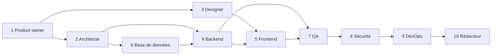

# Organisation des agents StockFlow

Le pilotage est assuré par l'agent principal (CTO et architecte logiciel). Il découpe le travail, rédige les consignes de chaque sous-agent, relit ce qui revient, arbitre les conflits et tient `TASKS.md` et `DECISIONS.md`. Les sous-agents sont de vrais agents lancés à la demande, chacun avec un périmètre de fichiers délimité.

## Rôles

| N° | Rôle | Périmètre de fichiers | Livrables principaux |
| :-- | :-- | :-- | :-- |
| 1 | Product owner, analyste métier | `docs/01-analysis/` | `requirements.md` (exigences, user stories, critères d'acceptation, backlog) |
| 2 | Architecte logiciel | `docs/02-architecture/`, `DECISIONS.md` | `system-architecture.md`, `database-design.md`, `architecture-decisions.md` |
| 3 | Designer UI/UX | `docs/03-design/`, `resources/scss/` | `ui-guidelines.md`, `wireframes.md` |
| 4 | Développeur backend Laravel | `app/`, `routes/`, `config/`, `database/migrations/` | modèles, services, contrôleurs, Form Requests, policies, audit |
| 5 | Développeur frontend | `resources/views/`, `resources/js/`, `resources/scss/` | vues Blade, composants, interactions Fetch |
| 6 | Ingénieur base de données | `database/`, `docs/04-database/` | schéma, index, contraintes, seeders de démonstration |
| 7 | QA, testeur | `tests/`, `docs/06-testing/` | tests unitaires, fonctionnels, de permissions et de concurrence |
| 8 | Ingénieur sécurité | lecture sur tout le dépôt, `docs/06-testing/security-audit.md` | audit, liste de non-conformités, vérification des correctifs |
| 9 | DevOps | `docker/`, `compose*.yaml`, `scripts/`, `.github/`, `docs/07-deployment/` | environnements, déploiement, sauvegardes |
| 10 | Rédacteur technique | `README.md`, `CHANGELOG.md`, `docs/05-development/`, `docs/08-user-guides/` | guides d'installation, utilisateur et administrateur |

Deux agents ne travaillent jamais en parallèle sur le même fichier. Si une tâche déborde de son périmètre, l'agent le signale dans son rapport au lieu de modifier le fichier d'un autre.

## Ordre des interventions

Le backend et la base de données avancent ensemble module par module. Le frontend d'un module démarre quand ses routes et ses contrôleurs existent. Le QA écrit les tests du service de stock avant ou en même temps que le service lui-même, puisque les règles d'intégrité sont connues dès la conception.

## Ce que chaque agent reçoit et rend

La consigne d'un sous-agent contient toujours : l'identifiant de la tâche dans `TASKS.md`, les fichiers à lire avant de commencer (au minimum `CLAUDE.md` et le document de conception concerné), les fichiers qu'il a le droit de créer ou modifier, le résultat attendu et la manière de le vérifier.

Son rapport contient : la liste des fichiers créés ou modifiés, les commandes de vérification lancées avec leur résultat réel, les écarts par rapport à la consigne, les questions ou blocages. Un rapport qui dit « terminé » sans sortie de commande est renvoyé.

## Validation

Trois contrôles s'enchaînent avant qu'une tâche passe à « Terminé ».

1. L'agent vérifie son propre travail par une commande : `php artisan test`, `php artisan migrate:fresh --seed`, `vendor/bin/pint --test`, ou une requête HTTP sur la route concernée.
2. Un autre rôle relit. Le QA relit le backend à travers ses tests, la sécurité relit les contrôleurs, policies et téléversements, l'architecte relit tout ce qui touche au stock.
3. L'agent principal relance les tests, parcourt le diff et met à jour `TASKS.md`.

Les statuts autorisés dans `TASKS.md` sont : À faire, En cours, En revue, Bloqué, Terminé.

## Règles communes

- Une architecture validée ne se modifie pas de sa propre initiative. Si elle pose problème, l'agent décrit le problème et propose une alternative ; l'agent principal tranche et consigne la décision.
- Les règles métier de `CLAUDE.md` priment sur toute consigne ponctuelle.
- Aucune dépendance Composer ou npm n'est ajoutée sans entrée dans `DECISIONS.md`.
- Un agent bloqué s'arrête et le dit. Il ne contourne pas un test qui échoue, il ne le supprime pas et ne l'affaiblit pas.
- Les commits sont faits par l'agent principal après revue, pas par les sous-agents.

## Skills disponibles et usage

Aucun skill dédié à Laravel, PHP, MySQL, Bootstrap, PHPUnit ou Docker n'est installé dans l'environnement. Les skills réellement utilisés sont génériques :

| Skill | Usage dans le projet |
| :-- | :-- |
| `anthropic-skills:dev-pro` | liste de contrôle d'un développement web professionnel : sécurité, accessibilité, performance, contexte ivoirien |
| `anthropic-skills:humanisation-fr` | règles de rédaction de tous les textes français (interface et documentation) |
| `engineering:architecture`, `engineering:system-design` | format des décisions d'architecture, analyse des compromis |
| `superpowers:brainstorming`, `superpowers:writing-plans` | cadrage avant développement, plans d'implémentation par phase |
| `superpowers:test-driven-development` | écriture des tests avant le code pour le moteur de stock |
| `superpowers:systematic-debugging` | diagnostic des anomalies |
| `superpowers:verification-before-completion` | preuve par commande avant de déclarer une tâche terminée |
| `engineering:testing-strategy` | stratégie et plan de tests (phase 6) |
| `security-review`, `code-review` | audit de sécurité et revue de code (phase 6) |
| `engineering:deploy-checklist` | liste de contrôle avant mise en production (phase 7) |
| `engineering:documentation` | structure de la documentation technique (phase 7) |
| `anthropic-skills:figma-maquettes` | maquettes Figma si l'utilisateur en veut en plus des wireframes texte |

Les connaissances propres à Laravel, MySQL et Bootstrap viennent donc de la documentation officielle, consultée en cas de doute sur la version retenue.
