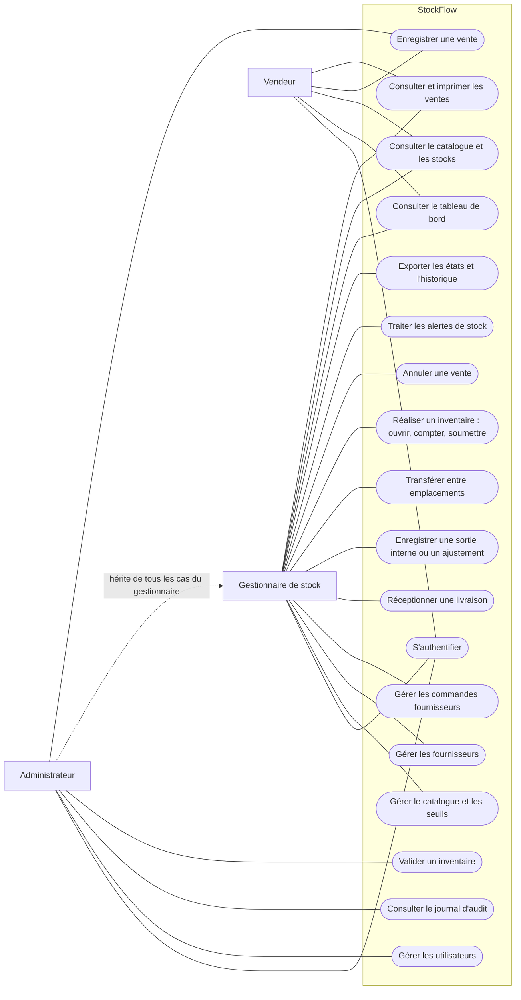
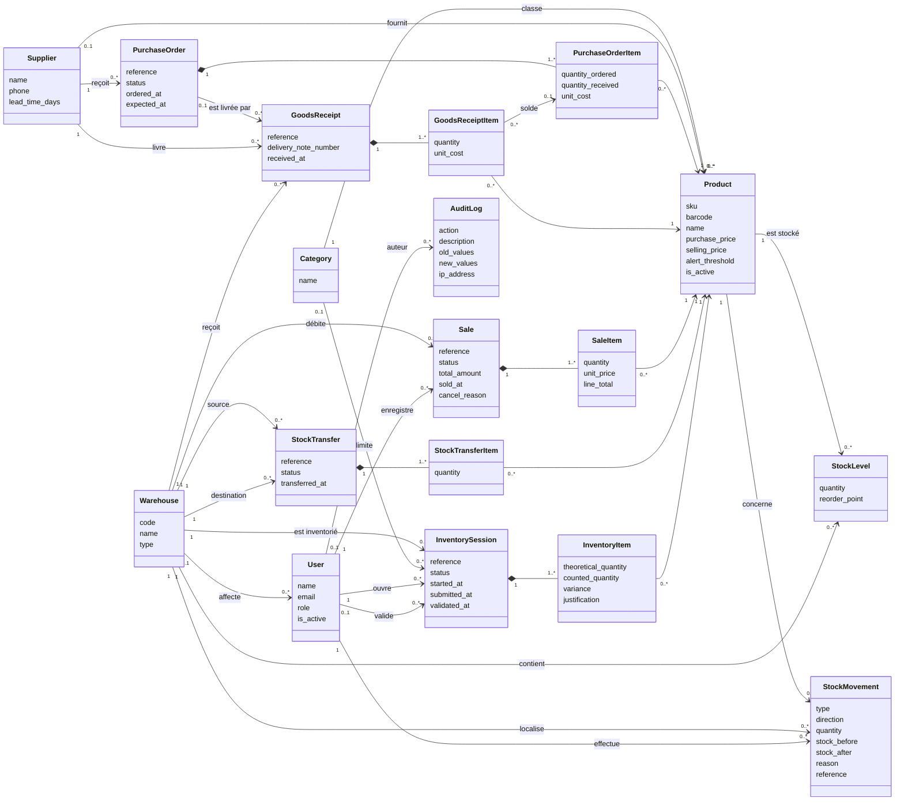

# Exigences StockFlow

Version 1.0 du 13/11/2026. Tâche T-101. Rédacteur : product owner et analyste métier.

Ce document analyse le cahier des charges d'origine (`cahier_des_charges_stockflow.md`), le corrige et le complète. Il s'appuie sur `CLAUDE.md`, sur `DECISIONS.md` (D-001 à D-016) et sur `docs/02-architecture/database-design.md`. Les identifiants de tables, de statuts et de types de mouvements sont ceux du modèle de données.

Plusieurs décisions citées ici ont encore le statut « Proposée » (D-001, D-002, D-003, D-006, D-007, D-008, D-009, D-016). Les exigences qui en dépendent sont rédigées comme si elles étaient acceptées. Un refus de l'une d'elles impose de réviser les exigences qui la citent.

## 1. Présentation du projet

### 1.1 Contexte

Une PME d'Abidjan distribue du matériel informatique et bureautique. Elle gère environ 800 références entre un entrepôt central et un point de vente. Le suivi repose aujourd'hui sur des fichiers Excel partagés et des bons papier.

Le cahier des charges relève quatre problèmes :

- les ventes sont saisies en fin de journée, si bien que la boutique vend des articles déjà en rupture ;
- les erreurs et oublis de saisie créent des écarts d'inventaire, avec une perte estimée à 8 % du chiffre d'affaires annuel ;
- les réapprovisionnements partent trop tard faute d'alerte ;
- personne ne peut dire rapidement qui a sorti ou ajusté une quantité.

### 1.2 Objectifs

| N° | Objectif | Mesure |
| :-- | :-- | :-- |
| O1 | Connaître le stock de chaque emplacement à tout moment | La quantité affichée est celle de `stock_levels` au moment de la requête |
| O2 | Empêcher la vente d'un article indisponible | Aucune quantité négative, y compris sous accès concurrents |
| O3 | Déclencher les réapprovisionnements à temps | Une notification est émise dès qu'un produit franchit son seuil |
| O4 | Savoir qui a fait quoi | Chaque variation de quantité a son mouvement, chaque action sensible sa ligne d'audit |

### 1.3 Périmètre de la version

Application web Laravel, interface en français, utilisée sur le réseau de l'entreprise depuis un ordinateur ou une tablette. Elle couvre le catalogue, les fournisseurs, les commandes fournisseurs et leurs réceptions, les ventes en boutique, les transferts entre emplacements, les inventaires physiques, les alertes, le tableau de bord et les exports. Ce qui est exclu figure en section 10.

## 2. Analyse critique du cahier des charges

### 2.1 Lacunes et incohérences relevées

| N° | Constat dans le cahier des charges | Conséquence | Correction retenue | Décision |
| :-- | :-- | :-- | :-- | :-- |
| L-01 | Le stock est une colonne unique `products.current_stock` alors que la marchandise est répartie sur deux emplacements | Impossible de savoir si un article est en boutique ou à l'entrepôt ; le vendeur peut vendre un article absent de son rayon | Stock tenu dans `stock_levels`, une ligne par produit et par emplacement. La colonne `current_stock` disparaît | D-004 |
| L-02 | Aucun transfert entre l'entrepôt et le point de vente | Le réassort de la boutique ne laisse aucune trace | Document `stock_transfers` exécuté en une étape, avec deux mouvements `transfer` par ligne | D-006 |
| L-03 | F3.1 parle de « réceptions de commandes fournisseurs » mais le modèle ne contient ni commande ni réception | Pas de suivi du commandé, du reçu et du reste à livrer | Tables `purchase_orders` et `goods_receipts` avec leurs lignes ; plusieurs bons de réception par commande | D-016 pour la réception sans commande |
| L-04 | Les réceptions partielles ne sont pas prévues | Une livraison en deux fois ne peut pas être saisie correctement | `quantity_received` cumulée par ligne de commande, statuts `partially_received` et `received` | Modèle de données |
| L-05 | Une vente n'est qu'un mouvement de type OUT | Pas de bon de sortie à plusieurs lignes, pas de prix figé, pas de total, pas de liste des ventes d'un vendeur | Entité `sales` et `sale_items`, référence `BS-AAAA-NNNNNN`, prix unitaire figé à la vente | Modèle de données |
| L-06 | L'annulation d'une vente n'est pas traitée | Une erreur de caisse ne peut se corriger qu'en trafiquant le stock | Annulation justifiée par l'administrateur ou le gestionnaire, mouvements `sale_cancellation`, statut `cancelled` | D-009 |
| L-07 | F3.3 décrit un bon d'inventaire sans étapes ni responsabilités, alors que le tableau des rôles confie la validation des écarts à l'administrateur | Celui qui compte régularise lui-même ses écarts | Session d'inventaire à quatre statuts (`in_progress`, `pending_validation`, `validated`, `cancelled`). Le gestionnaire compte et soumet, l'administrateur valide | D-007, D-009 |
| L-08 | Rien n'est dit sur les ventes pendant un inventaire | Soit la boutique est bloquée, soit le comptage est faussé | Les mouvements restent autorisés. Le théorique est relevé au comptage de chaque ligne, la validation applique l'écart au stock courant | D-007 |
| L-09 | F4.2 compare `quantite_actuelle` au seuil sans dire de quel emplacement il s'agit | L'alerte est ambiguë dès qu'il y a deux stocks | `products.alert_threshold` comparé au stock total ; `stock_levels.reorder_point` facultatif pour le réassort d'un emplacement | D-008 |
| L-10 | F4.2 ne dit pas quand l'alerte est émise ni à qui | Risque d'une alerte répétée à chaque mouvement sous le seuil | Notification par le canal `database`, émise au franchissement du seuil, adressée aux administrateurs et aux gestionnaires | D-013 |
| L-11 | « CRUD complet » sur les produits, catégories et fournisseurs sans règle de suppression | Supprimer un produit ferait perdre ou rendrait orphelin son historique | Suppression logique des produits, fournisseurs et utilisateurs ; clés étrangères en `RESTRICT` ; un document validé s'annule et ne se supprime pas | Règles 5 et 6 de `CLAUDE.md` |
| L-12 | F1.3 limite l'audit aux créations, modifications et suppressions « sur les stocks » | Les connexions, la gestion des comptes, les annulations, les validations et les exports ne sont pas tracés | `stock_movements` trace les quantités ; `audit_logs` trace les actions `created`, `updated`, `deleted`, `restored`, `login`, `logout`, `login_failed`, `validated`, `cancelled`, `exported` | Modèle de données |
| L-13 | L'administrateur a un « CRUD utilisateurs/rôles » alors que les trois profils sont fixes | Un écran de gestion des rôles sans objet | Rôles dans un enum (`admin`, `stock_manager`, `sales_agent`) et une colonne `users.role`. Pas d'écran de gestion des rôles | D-005 |
| L-14 | Le vendeur crée des « bons de sortie » sans limite d'emplacement | Un vendeur pourrait débiter l'entrepôt depuis la boutique | Le vendeur ne vend que depuis son emplacement d'affectation (`users.warehouse_id`) | D-009 |
| L-15 | Laravel 11 et MySQL 8.0 sont imposés | Laravel 11 ne reçoit plus de correctifs de sécurité depuis le 12/03/2026 ; MySQL 8.0 est en fin de vie depuis avril 2026 | Laravel 13 sur PHP 8.4 (repli Laravel 12), MySQL 8.4 LTS | D-001, D-002 |
| L-16 | Le critère de réussite n° 2 porte sur « chaque variation de `current_stock` dans la table `products` » | Le critère vise une colonne qui n'existe plus | Reformulation sur `stock_levels.quantity` (voir 2.2) | D-004 |
| L-17 | Aucune exigence sur les sessions (durée, cookies, régénération) | Session volée ou laissée ouverte sur une tablette d'entrepôt | Exigences ENF-08 et ENF-09 | Aucune, à valider |
| L-18 | Aucune limitation des tentatives de connexion | Attaque par force brute possible | Cinq échecs par minute pour un couple adresse e-mail et adresse IP, puis blocage temporaire (EF-1.3) | Aucune, à valider |
| L-19 | Aucune politique de mot de passe au-delà du hachage | Mots de passe triviaux | Douze caractères au minimum, sans règle de composition (EF-1.6) | D-010 |
| L-20 | Aucune mention des données personnelles | L'application traite des noms, adresses e-mail, téléphones et adresses IP sans cadre | Exigence ENF-15, fondée sur la loi ivoirienne n° 2013-450 du 19 juin 2013 | Aucune, à valider |
| L-21 | Le mot de passe oublié n'est pas traité, et l'envoi d'e-mails n'est pas prévu | Un utilisateur bloqué n'a pas de recours | Réinitialisation par l'administrateur (EF-1.7), cohérente avec D-010 | D-010 |
| L-22 | F3.2 regroupe ventes et sorties internes | Deux opérations aux règles différentes (prix, justification, acteur) sont confondues | Vente dans `sales` ; sortie interne par un mouvement `internal_use` avec motif obligatoire | Modèle de données |
| L-23 | Les types de mouvements se limitent à IN, OUT, ADJ | Impossible de distinguer une vente d'une casse ou un transfert d'un achat | Sept types (`purchase`, `sale`, `sale_cancellation`, `internal_use`, `transfer`, `manual_adjustment`, `inventory_adjustment`) et une colonne `direction` | Modèle de données |
| L-24 | Les prix sont décrits sans devise ni type | Erreurs d'arrondi si des décimaux sont utilisés | Montants en F CFA stockés en entiers | D-012 |
| L-25 | F2.2 demande des « codes-barres ou références internes » sans format | Résultat non vérifiable | SKU généré (préfixe de catégorie et numéro) ; code-barres EAN-13 interne de préfixe 200 ou code du fabricant saisi | D-011 |
| L-26 | La valeur du stock (F4.1) n'a pas de méthode de calcul | KPI non vérifiable | Somme des `quantity × purchase_price` au prix d'achat courant de la fiche | Modèle de données |
| L-27 | L'ergonomie est décrite en une phrase, l'accessibilité est absente | Pas de critère de recette | Exigences ENF-19 à ENF-21 | Aucune, à valider |
| L-28 | Aucune exigence de sauvegarde | Perte de l'historique en cas de panne | Exigence ENF-28 | Aucune, à valider |

### 2.2 Critères de réussite reformulés

| N° | Formulation d'origine | Formulation retenue |
| :-- | :-- | :-- |
| C1 | Zéro stock négatif possible, même lors de soumissions simultanées sur un même produit | Inchangé sur le fond. Vérifié par un test à deux processus réels contre MySQL (D-014) : deux ventes simultanées de 6 unités sur un stock de 10, une seule réussit, le stock final vaut 4 |
| C2 | Chaque variation de `current_stock` dans la table `products` correspond à une ligne dans `stock_movements` | Chaque variation de `stock_levels.quantity` correspond à exactement une ligne de `stock_movements` pour le même produit et le même emplacement. Pour tout couple produit et emplacement, la quantité courante est égale à la somme des mouvements `in` moins la somme des mouvements `out`, et `stock_after` du dernier mouvement est égal à la quantité courante |
| C3 | Base de démonstration : 50 produits, 3 rôles actifs, 100 mouvements | Au moins 60 produits, 6 utilisateurs couvrant les 3 rôles, plus de 150 mouvements créés par les services métier, avec des produits en stock normal, sous seuil et en rupture |

## 3. Acteurs et matrice des permissions

### 3.1 Acteurs

| Acteur | Valeur de `users.role` | Emplacement d'affectation | Mission |
| :-- | :-- | :-- | :-- |
| Administrateur | `admin` | Facultatif | Supervise, gère les comptes, consulte le journal d'audit, valide les inventaires |
| Gestionnaire de stock | `stock_manager` | Facultatif | Tient le catalogue, commande, réceptionne, transfère, inventorie, corrige les ventes erronées |
| Vendeur | `sales_agent` | Obligatoire, de type `store` | Consulte les disponibilités et enregistre les ventes de son emplacement |

### 3.2 Matrice des permissions

Conforme à D-005 et D-009. Chaque case est vérifiée côté serveur par une Gate ou une Policy, y compris pour les routes appelées en Fetch.

| Fonctionnalité | Administrateur | Gestionnaire de stock | Vendeur |
| :-- | :-- | :-- | :-- |
| Se connecter, se déconnecter, changer son mot de passe | Oui | Oui | Oui |
| Gérer les utilisateurs (créer, modifier, désactiver, réinitialiser le mot de passe) | Oui | Non | Non |
| Consulter le journal d'audit | Oui | Non | Non |
| Modifier la fiche d'un emplacement | Oui | Non | Non |
| Consulter le catalogue et les stocks des deux emplacements | Oui | Oui | Oui |
| Voir le prix d'achat et la valeur du stock | Oui | Oui | Non |
| Créer, modifier, désactiver, supprimer une catégorie ou un produit | Oui | Oui | Non |
| Gérer les seuils (`alert_threshold`, `reorder_point`) | Oui | Oui | Non |
| Gérer les fournisseurs | Oui | Oui | Non |
| Créer, modifier, passer, annuler une commande fournisseur | Oui | Oui | Non |
| Enregistrer une réception (sur commande ou directe) | Oui | Oui | Non |
| Enregistrer une sortie interne justifiée | Oui | Oui | Non |
| Enregistrer un ajustement manuel justifié | Oui | Oui | Non |
| Créer un transfert | Oui | Oui | Non |
| Annuler un transfert | Oui | Oui | Non |
| Consulter l'historique des mouvements | Oui | Oui | Non |
| Créer une vente | Oui, depuis un emplacement de type `store` | Non | Oui, depuis son emplacement d'affectation uniquement |
| Consulter et imprimer les ventes | Toutes | Toutes | Les siennes uniquement |
| Annuler une vente | Oui | Oui | Non |
| Ouvrir un inventaire, saisir le comptage, soumettre | Oui | Oui | Non |
| Valider un inventaire ou le renvoyer en comptage | Oui | Non | Non |
| Annuler un inventaire non validé | Oui | Oui | Non |
| Consulter le tableau de bord | Complet | Complet | Réduit (disponibilités, ses ventes du jour) |
| Recevoir et consulter les alertes de stock | Oui | Oui | Non |
| Exporter l'état de stock, les mouvements, les ventes (CSV, PDF) | Oui | Oui | Non |

Deux lignes de cette matrice ne sont couvertes par aucune décision et sont à confirmer : l'annulation d'un transfert par le gestionnaire, et l'absence de création de vente pour le gestionnaire (voir section 10.2).

## 4. Exigences fonctionnelles

La colonne « Origine » renvoie aux fonctions F1.1 à F4.3 du cahier des charges. « Nouveau » désigne une exigence ajoutée par l'analyse.

### 4.1 Module 1 : authentification et accès

| ID | Exigence | Origine |
| :-- | :-- | :-- |
| EF-1.1 | L'utilisateur se connecte avec son adresse e-mail et son mot de passe. Le mot de passe est stocké haché avec Bcrypt. Le message d'échec ne dit pas si c'est l'adresse ou le mot de passe qui est faux | F1.1 |
| EF-1.2 | L'utilisateur se déconnecte par une action explicite. La session est invalidée côté serveur et le jeton CSRF est régénéré | Nouveau |
| EF-1.3 | Après cinq échecs de connexion en une minute pour un même couple adresse e-mail et adresse IP, les tentatives suivantes sont refusées pendant une minute, même avec le bon mot de passe | Nouveau (L-18) |
| EF-1.4 | Un compte désactivé (`is_active` à faux) ou supprimé logiquement ne peut pas se connecter. Une session déjà ouverte par ce compte est fermée à la requête suivante | Nouveau |
| EF-1.5 | L'utilisateur connecté change son mot de passe en fournissant l'ancien | Nouveau (D-010) |
| EF-1.6 | Un mot de passe compte au moins douze caractères, sans obligation de majuscule, de chiffre ou de symbole, et diffère de l'adresse e-mail du compte. Un compte créé ou réinitialisé par l'administrateur doit changer son mot de passe à la connexion suivante | Nouveau (L-19, D-010) |
| EF-1.7 | L'administrateur crée, modifie, désactive, réactive et supprime logiquement les comptes, et réinitialise un mot de passe. Le rôle est choisi parmi `admin`, `stock_manager`, `sales_agent`. L'emplacement d'affectation est obligatoire pour un vendeur et doit être de type `store` | F1.2 |
| EF-1.8 | Un administrateur ne peut ni désactiver ni supprimer son propre compte, ni changer son propre rôle. Le dernier administrateur actif ne peut pas être désactivé | Nouveau |
| EF-1.9 | Toute route vérifie le rôle côté serveur. Une action non autorisée renvoie une réponse 403 et ne modifie rien. Un visiteur non connecté est renvoyé vers la page de connexion | F1.2 |
| EF-1.10 | Le journal d'audit enregistre : connexions réussies et échouées, déconnexions, créations, modifications, suppressions et restaurations sur les utilisateurs, produits, catégories, fournisseurs, emplacements et commandes, validations d'inventaire, annulations de documents, exports. Chaque ligne porte l'auteur, la date et l'heure, l'adresse IP, les anciennes et nouvelles valeurs des champs modifiés. Le mot de passe n'y figure jamais | F1.3 |
| EF-1.11 | L'administrateur consulte le journal d'audit avec des filtres par période, utilisateur, action et objet. Aucune interface ne permet de modifier ou de supprimer une ligne | F1.3 |

### 4.2 Module 2 : catalogue et fournisseurs

| ID | Exigence | Origine |
| :-- | :-- | :-- |
| EF-2.1 | Le gestionnaire crée, modifie et supprime les catégories (nom unique, description). La suppression d'une catégorie qui contient des produits est refusée | F2.1 |
| EF-2.2 | Le gestionnaire crée et modifie un produit : libellé, description, catégorie, fournisseur principal facultatif, prix d'achat, prix de vente, seuil d'alerte, image. Les prix sont des entiers positifs ou nuls en F CFA | F2.1 |
| EF-2.3 | Le SKU est généré à la création à partir du préfixe de la catégorie et d'un numéro (exemple `IMP-000042`). Il est unique et ne se modifie pas | F2.2 |
| EF-2.4 | Le code-barres est soit un EAN-13 interne généré (préfixe 200, clé de contrôle calculée), soit le code du fabricant saisi. Il est unique. La fiche produit l'affiche en SVG et permet d'imprimer une étiquette | F2.2 |
| EF-2.5 | L'image d'un produit est un fichier jpeg, png ou webp de 2 Mo au plus. Tout autre fichier est refusé | F2.1 |
| EF-2.6 | Un produit se désactive et se réactive. Un produit inactif n'est ni vendable ni commandable. La suppression logique est refusée tant que le stock total est supérieur à zéro. L'historique d'un produit supprimé reste consultable | F2.1 (L-11) |
| EF-2.7 | Le catalogue offre une recherche instantanée, sans rechargement de page, par préfixe de SKU, de code-barres ou de libellé, et des filtres par catégorie, fournisseur, état (actif, inactif) et niveau de stock (normal, en alerte, en rupture) | F2.1 |
| EF-2.8 | La fiche produit affiche la quantité par emplacement, le total, le seuil et les derniers mouvements | Nouveau (D-004) |
| EF-2.9 | Le gestionnaire crée, modifie, désactive et supprime logiquement les fournisseurs : raison sociale, interlocuteur, e-mail, téléphone, adresse, délai moyen de livraison en jours | F2.3 |
| EF-2.10 | Chaque produit peut être associé à un fournisseur principal. La fiche fournisseur liste ses produits et ses commandes | F2.3 |
| EF-2.11 | Le prix d'achat et la valeur du stock ne sont ni affichés ni transmis au vendeur, y compris dans les réponses des routes appelées en Fetch | Nouveau |

### 4.3 Module 3 : emplacements et transferts

| ID | Exigence | Origine |
| :-- | :-- | :-- |
| EF-3.1 | L'application gère deux emplacements à la livraison : `ENT` (entrepôt central, type `warehouse`) et `PDV` (point de vente, type `store`). L'administrateur modifie leur nom et leur adresse | Nouveau (D-004) |
| EF-3.2 | À la création d'un produit, une ligne `stock_levels` à zéro est créée pour chaque emplacement actif | Nouveau (D-004) |
| EF-3.3 | Tout utilisateur connecté consulte la quantité de chaque produit dans chaque emplacement ainsi que le total | Nouveau (D-004) |
| EF-3.4 | Le gestionnaire crée un transfert de plusieurs produits d'un emplacement source vers un emplacement de destination différent. Le transfert est exécuté à l'enregistrement, en une transaction : chaque ligne produit un mouvement `transfer` sortant à la source et un mouvement `transfer` entrant à destination, de même référence `TR-AAAA-NNNNNN` | Nouveau (D-006) |
| EF-3.5 | Un transfert dont une ligne dépasse la quantité disponible à la source est refusé en entier. Aucun mouvement n'est créé | Nouveau (règle 2) |
| EF-3.6 | Un transfert `completed` s'annule avec un motif obligatoire. L'annulation crée les mouvements inverses et passe le transfert à `cancelled`. Elle est refusée si la destination ne dispose plus des quantités à restituer | Nouveau (règle 6) |
| EF-3.7 | Le bon de transfert est consultable et imprimable en PDF | Nouveau |
| EF-3.8 | Le gestionnaire peut définir pour un produit un seuil propre à un emplacement (`stock_levels.reorder_point`), utilisé pour le réassort du point de vente | Nouveau (D-008) |

### 4.4 Module 4 : mouvements, commandes fournisseurs et réceptions

| ID | Exigence | Origine |
| :-- | :-- | :-- |
| EF-4.1 | Toute variation de `stock_levels.quantity` produit exactement une ligne de `stock_movements` avec l'auteur, le type, la direction, la quantité, le stock avant, le stock après, la référence et le document source | F1.3, F3.1 à F3.3 |
| EF-4.2 | Aucune opération ne peut rendre une quantité négative. Une sortie supérieure au disponible est refusée avec un message qui indique le produit et la quantité disponible | F3.2 |
| EF-4.3 | Le gestionnaire crée une commande fournisseur à l'état `draft` : fournisseur, emplacement de livraison (l'entrepôt par défaut), lignes avec produit, quantité commandée et coût unitaire. Un produit n'apparaît qu'une fois par commande | F3.1 (L-03) |
| EF-4.4 | Le gestionnaire passe la commande à l'état `ordered`. La date de livraison prévue est calculée à partir du délai du fournisseur et reste modifiable. Une commande n'est modifiable qu'à l'état `draft` | Nouveau |
| EF-4.5 | Une commande s'annule (`cancelled`) tant que rien n'a été reçu. L'annulation est refusée dès qu'une réception existe | Nouveau |
| EF-4.6 | Le gestionnaire enregistre une réception sur une commande `ordered` ou `partially_received`. Il saisit la quantité reçue par ligne, plafonnée au reste à recevoir, et le numéro du bon de livraison. La réception crée un bon `BR-AAAA-NNNNNN`, un mouvement `purchase` par ligne et met à jour `quantity_received`. La commande passe à `partially_received` ou à `received` selon le reste | F3.1 (L-04) |
| EF-4.7 | Le gestionnaire enregistre une réception directe, sans commande : fournisseur, emplacement, lignes avec quantité et coût unitaire. Elle crée un bon de réception et les mouvements `purchase` | F3.1 (D-016) |
| EF-4.8 | Le gestionnaire enregistre une sortie interne (usage propre, casse, don, échantillon) : produit, emplacement, quantité, motif obligatoire. Elle crée un mouvement `internal_use` de référence `BM-AAAA-NNNNNN` | F3.2 |
| EF-4.9 | Le gestionnaire enregistre un ajustement manuel, en plus ou en moins, avec motif obligatoire. Il crée un mouvement `manual_adjustment` | F3.3 |
| EF-4.10 | L'administrateur et le gestionnaire consultent l'historique des mouvements avec des filtres par produit, emplacement, type, période et utilisateur. Chaque ligne renvoie à son document source | F1.3 |
| EF-4.11 | Un mouvement ne se modifie pas et ne se supprime pas. Une erreur se corrige par un nouveau mouvement | Nouveau (règle 5) |
| EF-4.12 | Une commande `partially_received` dont le reliquat ne sera pas livré peut être soldée par le gestionnaire ou l'administrateur, avec un motif obligatoire. Elle passe à `closed` et n'accepte plus de réception | Nouveau (D-018) |

Une réception validée ne s'annule pas (D-018). Une réception erronée se corrige par un ajustement manuel justifié qui cite la référence du bon de réception.

### 4.5 Module 5 : ventes

| ID | Exigence | Origine |
| :-- | :-- | :-- |
| EF-5.1 | Le vendeur compose une vente de plusieurs lignes en recherchant les produits par SKU, code-barres ou libellé. L'emplacement débité est son emplacement d'affectation ; il ne peut pas en choisir un autre, même en modifiant la requête. L'administrateur choisit un emplacement de type `store` | F3.2 (D-009) |
| EF-5.2 | Le prix unitaire d'une ligne est le prix de vente de la fiche au moment de l'enregistrement. Il est fixé par le serveur et conservé dans `sale_items.unit_price`. Le total de la vente est calculé par le serveur | Nouveau (L-05) |
| EF-5.3 | L'enregistrement vérifie la disponibilité de chaque ligne dans l'emplacement débité. Si une ligne dépasse le disponible, la vente entière est refusée : ni vente, ni ligne, ni mouvement | F3.2 |
| EF-5.4 | Une vente enregistrée reçoit une référence `BS-AAAA-NNNNNN`, le statut `completed`, et crée un mouvement `sale` par ligne. Le nom du client est facultatif | F3.2 |
| EF-5.5 | Une ligne porte une quantité entière supérieure à zéro. Un produit n'apparaît qu'une fois par vente. Un produit inactif ou supprimé ne peut pas être vendu | Nouveau |
| EF-5.6 | L'écran de vente affiche la quantité disponible dans l'emplacement du vendeur pour chaque produit ajouté | F3.2 |
| EF-5.7 | Le bon de sortie est consultable et imprimable en PDF : référence, date, vendeur, emplacement, lignes, total en F CFA, mention « Annulée » le cas échéant | Nouveau |
| EF-5.8 | Le vendeur consulte la liste de ses propres ventes. L'administrateur et le gestionnaire consultent toutes les ventes, avec des filtres par période, vendeur, emplacement et statut | Nouveau (D-009) |
| EF-5.9 | L'administrateur ou le gestionnaire annule une vente `completed` avec un motif obligatoire. L'annulation crée un mouvement `sale_cancellation` entrant par ligne dans l'emplacement d'origine, renseigne `cancelled_by`, `cancelled_at` et `cancel_reason`, et passe la vente à `cancelled`. Une vente ne s'annule qu'une fois et ne se supprime pas | Nouveau (D-009) |

### 4.6 Module 6 : inventaires

| ID | Exigence | Origine |
| :-- | :-- | :-- |
| EF-6.1 | Le gestionnaire ouvre une session d'inventaire sur un emplacement, pour tous les produits actifs ou pour une catégorie. L'ouverture crée une ligne à compter par produit. La quantité théorique d'une ligne est relevée au moment où cette ligne est comptée (D-007). La session reçoit une référence `INV-AAAA-NNNNNN` et le statut `in_progress` | F3.3 |
| EF-6.2 | Une seule session `in_progress` ou `pending_validation` peut exister par emplacement | Nouveau |
| EF-6.3 | Le gestionnaire saisit la quantité comptée de chaque ligne, en plusieurs fois si besoin. L'écart (`counted_quantity - theoretical_quantity`) est calculé à la saisie | F3.3 |
| EF-6.4 | Une justification est obligatoire pour toute ligne dont l'écart est différent de zéro | F3.3 |
| EF-6.5 | Le gestionnaire soumet la session quand toutes les lignes sont comptées et que tous les écarts sont justifiés. La session passe à `pending_validation` et le comptage n'est plus modifiable | Nouveau (D-009) |
| EF-6.6 | L'administrateur valide une session `pending_validation`. Pour chaque ligne en écart, un mouvement `inventory_adjustment` applique l'écart au stock courant de l'emplacement, avec la justification comme motif. La session passe à `validated`. Le gestionnaire ne peut pas valider | F3.3 (D-007, D-009) |
| EF-6.7 | Si l'application d'un écart négatif rendait une quantité négative (ventes intervenues depuis le comptage de la ligne), la validation est refusée en entier et les lignes en cause sont listées | Nouveau (règle 2) |
| EF-6.8 | L'administrateur peut renvoyer une session `pending_validation` en comptage (`in_progress`) avec un commentaire, conservé dans `review_comment` | Nouveau (Q-05) |
| EF-6.9 | Une session non validée s'annule (`cancelled`) sans créer de mouvement. Une session `validated` n'est plus modifiable | Nouveau |
| EF-6.10 | Les ventes, réceptions et transferts restent possibles sur un emplacement en cours d'inventaire. La feuille de comptage et l'état des écarts sont imprimables en PDF | Nouveau (D-007) |

### 4.7 Module 7 : tableau de bord

| ID | Exigence | Origine |
| :-- | :-- | :-- |
| EF-7.1 | Le tableau de bord de l'administrateur et du gestionnaire affiche quatre indicateurs : valeur totale du stock (somme des `quantity × purchase_price`), nombre de références actives, nombre de produits en alerte, nombre de mouvements du jour | F4.1 |
| EF-7.2 | La répartition du stock entre les emplacements est affichée en barres HTML et CSS, avec les valeurs en texte | F4.1 (D-015) |
| EF-7.3 | Le tableau de bord liste les produits en alerte, les commandes fournisseurs en attente de livraison et, pour l'administrateur, les sessions d'inventaire à valider | F4.1 |
| EF-7.4 | Le tableau de bord du vendeur affiche ses ventes du jour (nombre et montant) et un accès à la recherche de disponibilité. Il ne contient ni valeur de stock ni prix d'achat | Nouveau |
| EF-7.5 | Les indicateurs se mettent à jour sans rechargement de page, par un appel Fetch périodique ou à la demande | F4.1 |

### 4.8 Module 8 : alertes, rapports et exports

| ID | Exigence | Origine |
| :-- | :-- | :-- |
| EF-8.1 | Un produit actif est en alerte quand son stock total, tous emplacements confondus, est inférieur ou égal à `alert_threshold`. Il est en rupture quand ce total vaut zéro | F4.2 (D-008) |
| EF-8.2 | Un produit est à réassortir dans un emplacement quand `reorder_point` est défini et que la quantité de cet emplacement est inférieure ou égale à ce seuil | Nouveau (D-008) |
| EF-8.3 | Une notification est émise quand une opération fait passer un produit d'un état hors alerte à un état en alerte. Elle est adressée aux administrateurs et aux gestionnaires actifs. Tant que le produit reste sous le seuil, les mouvements suivants n'émettent pas de nouvelle notification | F4.2 (D-013) |
| EF-8.4 | La barre de navigation affiche le nombre de notifications non lues. L'utilisateur consulte la liste, ouvre le produit concerné et marque une notification comme lue | F4.2 |
| EF-8.5 | La liste « À réapprovisionner » présente les produits en alerte avec le stock par emplacement, le seuil, le fournisseur principal, son délai et la quantité déjà en commande. Elle permet de préparer une commande fournisseur ou un transfert pour le produit choisi | Nouveau |
| EF-8.6 | L'administrateur et le gestionnaire exportent l'état de stock (par emplacement et total, valorisé) en CSV et en PDF | F4.3 |
| EF-8.7 | L'administrateur et le gestionnaire exportent l'historique des mouvements en CSV et en PDF, selon les filtres actifs (période, produit, emplacement, type) | F4.3 |
| EF-8.8 | Les fichiers CSV sont encodés en UTF-8 avec BOM, séparés par des points-virgules, et s'ouvrent sans réglage dans Excel en français. Chaque export est tracé dans le journal d'audit (`exported`) | F4.3 |
| EF-8.9 | L'administrateur et le gestionnaire exportent la liste des ventes d'une période en CSV | Nouveau |

## 5. Exigences non fonctionnelles

### 5.1 Intégrité transactionnelle

| ID | Exigence |
| :-- | :-- |
| ENF-01 | Chaque opération de stock s'exécute dans `DB::transaction()` avec `lockForUpdate()` sur les lignes `stock_levels` concernées. `App\Services\StockService` est le seul point d'écriture de `stock_levels.quantity` |
| ENF-02 | Quand plusieurs lignes sont verrouillées, elles le sont dans l'ordre croissant de `(product_id, warehouse_id)`. Une transaction victime d'un interblocage est rejouée jusqu'à trois fois |
| ENF-03 | La base refuse une quantité négative indépendamment du code applicatif (`INT UNSIGNED`, `CHECK (quantity >= 0)`). Les tables qui portent de l'historique sont protégées par des clés étrangères en `RESTRICT` |
| ENF-04 | Un document (vente, réception, transfert, validation d'inventaire, annulation) est écrit en entier ou pas du tout : document, lignes, quantités et mouvements dans la même transaction |

### 5.2 Performance

| ID | Exigence |
| :-- | :-- |
| ENF-05 | La recherche de produits par SKU, code-barres ou libellé répond en moins de 500 ms, mesurés côté serveur, sur un catalogue de 800 produits |
| ENF-06 | Les listes sont paginées côté serveur. Les exports CSV sont produits en flux et ne chargent pas l'ensemble des lignes en mémoire |

### 5.3 Sécurité

| ID | Exigence |
| :-- | :-- |
| ENF-07 | Les mots de passe sont hachés avec Bcrypt (coût 12). Ils n'apparaissent dans aucun journal, export ou message d'erreur |
| ENF-08 | L'identifiant de session est régénéré à la connexion. Le cookie de session est `HttpOnly`, `SameSite=Lax`, et `Secure` en production. Une session inactive expire au bout de 120 minutes |
| ENF-09 | Toute requête qui modifie des données porte un jeton CSRF vérifié, y compris les requêtes Fetch |
| ENF-10 | Les autorisations sont vérifiées côté serveur à chaque requête. Masquer un bouton ne constitue pas un contrôle d'accès |
| ENF-11 | Les requêtes SQL utilisent des paramètres liés. Les vues échappent toutes les données affichées avec `{{ }}` ; `{!! !!}` est réservé au SVG de code-barres généré par le serveur |
| ENF-12 | Les fichiers téléversés sont contrôlés sur leur type réel et leur taille, renommés, et stockés sur le disque `public` |
| ENF-13 | En production, l'application est servie en HTTPS, avec le mode débogage désactivé et des en-têtes de sécurité (`X-Content-Type-Options`, `X-Frame-Options` ou `frame-ancestors`, `Referrer-Policy`) |
| ENF-14 | Aucun secret n'est versionné. `.env.example` documente chaque variable |
| ENF-15 | Le traitement des données personnelles respecte la loi ivoirienne n° 2013-450 du 19 juin 2013. Les données collectées se limitent au nécessaire : nom, adresse e-mail et rôle des utilisateurs, coordonnées des interlocuteurs fournisseurs, nom facultatif du client, adresse IP dans le journal d'audit. Une page d'information décrit les données traitées, leur finalité et la façon d'exercer les droits d'accès et de rectification. Les formalités auprès de l'ARTCI et la durée de conservation relèvent du client (Q-11) |

### 5.4 Traçabilité

| ID | Exigence |
| :-- | :-- |
| ENF-16 | Pour tout couple produit et emplacement, la quantité de `stock_levels` est égale à la somme des mouvements entrants moins la somme des mouvements sortants. Un test automatisé le vérifie sur la base de démonstration |
| ENF-17 | `stock_movements` et `audit_logs` sont en ajout seul. Les modèles lèvent une exception sur toute tentative de modification ou de suppression, et aucune route ne l'expose |
| ENF-18 | Chaque mouvement et chaque ligne d'audit identifie son auteur et sa date. Un utilisateur supprimé logiquement reste l'auteur de son historique |

### 5.5 Ergonomie

| ID | Exigence |
| :-- | :-- |
| ENF-19 | L'interface est utilisable sur ordinateur et sur tablette à partir de 768 px de large, sans défilement horizontal. Les zones cliquables mesurent au moins 44 px de côté sur les écrans de vente, de réception et de comptage |
| ENF-20 | L'interface, les messages de validation et les messages d'erreur sont en français. Une action irréversible (annulation, validation d'inventaire, suppression) demande une confirmation. Un refus métier explique sa cause |

### 5.6 Accessibilité

| ID | Exigence |
| :-- | :-- |
| ENF-21 | L'interface vise le niveau AA des WCAG 2.1 : contraste d'au moins 4,5:1 pour le texte, navigation complète au clavier avec focus visible, champs de formulaire étiquetés, erreurs associées à leur champ, états de stock signalés par un texte ou une icône en plus de la couleur |

### 5.7 Formats locaux

| ID | Exigence |
| :-- | :-- |
| ENF-22 | Les montants sont stockés en entiers et affichés sans décimale, avec une espace comme séparateur de milliers et le suffixe « F CFA » (exemple : `1 200 000 F CFA`) |
| ENF-23 | Les dates sont affichées au format JJ/MM/AAAA, les heures sur 24 heures, dans le fuseau `Africa/Abidjan`. La locale de l'application est `fr` |
| ENF-24 | Les numéros de téléphone sont saisis et affichés au format `+225 XX XX XX XX XX` (dix chiffres après l'indicatif) |

### 5.8 Maintenabilité

| ID | Exigence |
| :-- | :-- |
| ENF-25 | Le code suit les conventions de `CLAUDE.md` : contrôleurs minces, validation en Form Request, autorisation par Policy ou Gate, logique dans des services, style vérifié par Laravel Pint |
| ENF-26 | Les règles de stock, les permissions et les parcours principaux sont couverts par des tests PHPUnit. Les tests de concurrence tournent sur MySQL avec deux processus réels |
| ENF-27 | Le framework, PHP et MySQL sont dans une version qui reçoit des correctifs de sécurité à la date de livraison (D-001, D-002) |

### 5.9 Sauvegarde et démonstration

| ID | Exigence |
| :-- | :-- |
| ENF-28 | La base de données et les images téléversées sont sauvegardées chaque jour, avec une conservation de 30 jours. La procédure de restauration est documentée et testée au moins une fois avant la mise en service |
| ENF-29 | La base de démonstration est créée par les services métier, jamais par insertion directe dans `stock_levels`, et respecte les volumes du critère C3 |

## 6. Parcours utilisateurs principaux

### 6.1 Vente en boutique

Acteur : vendeur affecté au point de vente `PDV`.

1. Le vendeur se connecte et ouvre l'écran « Nouvelle vente ». L'emplacement affiché est `PDV`, non modifiable.
2. Il saisit le début d'un libellé, d'un SKU ou d'un code-barres. La liste des produits correspondants s'affiche avec le prix de vente et la quantité disponible au point de vente.
3. Il ajoute un produit et saisit la quantité. Il répète l'opération pour chaque article.
4. Il saisit, s'il le souhaite, le nom du client, puis enregistre.
5. Le serveur verrouille les lignes de stock, vérifie chaque disponibilité, crée la vente, ses lignes et un mouvement `sale` par ligne.
6. Si une quantité dépasse le disponible, la vente est refusée en entier. L'écran indique le produit en cause et la quantité disponible ; le vendeur corrige et enregistre de nouveau.
7. Le bon de sortie `BS-AAAA-NNNNNN` s'affiche. Le vendeur l'imprime.
8. Si la vente fait passer un produit sous son seuil, les gestionnaires et les administrateurs reçoivent une notification.

### 6.2 Réception d'une commande fournisseur en deux livraisons

Acteur : gestionnaire de stock.

1. Le gestionnaire crée une commande pour un fournisseur : 20 unités du produit A et 10 du produit B, livraison à l'entrepôt. La commande est à l'état `draft`.
2. Il la passe à l'état `ordered`. La date de livraison prévue est calculée avec le délai du fournisseur.
3. À la première livraison, il ouvre la commande, choisit « Réceptionner », saisit 20 pour A et 4 pour B, ainsi que le numéro du bon de livraison.
4. Le serveur crée le bon `BR-AAAA-NNNNNN`, deux mouvements `purchase`, augmente le stock de l'entrepôt et passe la commande à `partially_received`.
5. La commande affiche le reste à recevoir : 0 pour A, 6 pour B.
6. À la seconde livraison, il réceptionne 6 pour B. La saisie de 7 est refusée car elle dépasse le reste.
7. Le serveur crée un second bon de réception et un mouvement `purchase`. La commande passe à `received` et n'accepte plus de réception.

### 6.3 Transfert de l'entrepôt vers le point de vente

Acteur : gestionnaire de stock.

1. Le gestionnaire ouvre « Nouveau transfert », choisit la source `ENT` et la destination `PDV`.
2. Il ajoute les produits et les quantités. L'écran affiche le disponible à la source pour chaque ligne.
3. Il enregistre. Le serveur verrouille les lignes de stock des deux emplacements dans l'ordre prévu et vérifie le disponible à la source.
4. Si une ligne dépasse le disponible, le transfert est refusé en entier.
5. Sinon, le serveur crée le transfert `TR-AAAA-NNNNNN` au statut `completed` et, pour chaque ligne, un mouvement `transfer` sortant à l'entrepôt et un mouvement `transfer` entrant au point de vente.
6. Le gestionnaire imprime le bon de transfert, qui accompagne la marchandise.
7. Le vendeur voit aussitôt les nouvelles quantités au point de vente.

### 6.4 Inventaire physique avec écart, justification et validation

Acteurs : gestionnaire de stock, puis administrateur.

1. Le gestionnaire ouvre une session d'inventaire sur le point de vente pour la catégorie « Imprimantes ». Le serveur crée une ligne à compter par produit ; le théorique de chaque ligne sera relevé à sa saisie. La session est `in_progress`.
2. Il imprime la feuille de comptage ou compte directement sur tablette.
3. Il saisit les quantités comptées. Pour le produit A, le théorique vaut 12 et le compté 10 : l'écart affiché est de -2.
4. Il tente de soumettre. La soumission est refusée tant que l'écart du produit A n'est pas justifié.
5. Il saisit la justification (« deux unités retrouvées endommagées, mises au rebut ») et soumet. La session passe à `pending_validation`.
6. Pendant ce temps, un vendeur a vendu une unité du produit A. Le stock courant vaut 11.
7. L'administrateur ouvre la session, lit les écarts et leurs justifications, puis valide.
8. Le serveur crée un mouvement `inventory_adjustment` sortant de 2 unités pour le produit A. Le stock passe de 11 à 9. La session passe à `validated` et la validation est tracée dans le journal d'audit.
9. Si l'administrateur conteste un comptage, il renvoie la session en comptage avec un commentaire au lieu de valider.

### 6.5 Traitement d'une alerte de réapprovisionnement

Acteur : gestionnaire de stock.

1. Une vente fait passer le stock total d'un produit de 6 à 4 alors que son seuil est de 5. Une notification est émise.
2. Le gestionnaire voit le compteur de notifications dans la barre de navigation et ouvre la liste.
3. Il ouvre la notification. La fiche du produit montre 4 unités à l'entrepôt, 0 au point de vente, aucune commande en cours, un fournisseur principal avec un délai de 7 jours.
4. Il transfère 2 unités de l'entrepôt vers le point de vente pour que la boutique puisse vendre (parcours 6.3).
5. Depuis la liste « À réapprovisionner », il prépare une commande fournisseur pour ce produit, complète la quantité et la passe à `ordered`.
6. La liste indique désormais la quantité en commande pour ce produit.
7. À la réception (parcours 6.2), le stock total repasse au-dessus du seuil et le produit sort de la liste. Un nouveau passage sous le seuil émettra une nouvelle notification.

## 7. Diagrammes

### 7.1 Cas d'utilisation

Le vendeur ne consulte et n'imprime que ses propres ventes, et son tableau de bord est réduit. Il ne vend que depuis son emplacement d'affectation.

### 7.2 Classes métier

Un `StockMovement` renvoie à son document d'origine (`Sale`, `GoodsReceipt`, `StockTransfer`, `InventorySession`) par un lien polymorphe (`source_type`, `source_id`), non représenté pour garder le diagramme lisible.

## 8. User stories

Priorités MoSCoW : M (Must, indispensable à la version), S (Should, attendu mais contournable), C (Could, souhaitable si le temps le permet). Les critères d'acceptation (CA) sont rédigés pour être repris tels quels dans des tests automatisés.

### 8.1 Épopée E1 : authentification et accès

**US-01 : se connecter** (M)
En tant qu'utilisateur, je veux me connecter avec mon adresse e-mail et mon mot de passe, afin d'accéder aux fonctions de mon profil.

- CA1 : Étant donné un compte actif, quand je soumets la bonne adresse et le bon mot de passe, alors je suis redirigé vers le tableau de bord et une ligne `login` est ajoutée à `audit_logs`.
- CA2 : Étant donné un compte actif, quand je soumets un mauvais mot de passe, alors je reste sur la page de connexion avec un message qui ne précise pas le champ en cause, et une ligne `login_failed` est ajoutée.
- CA3 : Étant donné un compte dont `is_active` est faux, quand je soumets les bons identifiants, alors la connexion est refusée.
- CA4 : Étant donné un visiteur non connecté, quand il demande une page de l'application, alors il est redirigé vers la page de connexion.

**US-02 : limiter les tentatives de connexion** (M)
En tant qu'administrateur, je veux que les tentatives de connexion répétées soient bloquées, afin de protéger les comptes contre la force brute.

- CA1 : Étant donné cinq échecs en moins d'une minute pour la même adresse e-mail depuis la même adresse IP, quand une sixième tentative est soumise avec le bon mot de passe, alors elle est refusée avec un message indiquant le délai d'attente.
- CA2 : Étant donné un blocage en cours, quand une minute s'est écoulée, alors une tentative avec les bons identifiants réussit.

**US-03 : se déconnecter et expirer la session** (M)
En tant qu'utilisateur, je veux fermer ma session, afin que personne n'utilise mon compte sur un poste partagé.

- CA1 : Étant donné un utilisateur connecté, quand il se déconnecte, alors une requête rejouée avec l'ancien cookie de session est redirigée vers la page de connexion et une ligne `logout` est ajoutée à `audit_logs`.
- CA2 : Étant donné une session inactive depuis plus de 120 minutes, quand l'utilisateur envoie une requête, alors il est redirigé vers la page de connexion.
- CA3 : Étant donné une connexion réussie, quand on compare l'identifiant de session avant et après, alors il a changé.

**US-04 : changer mon mot de passe** (M)
En tant qu'utilisateur, je veux changer mon mot de passe, afin de garder mon compte sous mon seul contrôle.

- CA1 : Étant donné un utilisateur connecté, quand il fournit son mot de passe actuel et un nouveau mot de passe conforme, alors le nouveau mot de passe permet de se connecter et l'ancien ne le permet plus.
- CA2 : Étant donné un nouveau mot de passe de moins de douze caractères, quand il est soumis, alors il est refusé avec un message qui cite la règle.
- CA3 : Étant donné un mot de passe actuel erroné, quand le formulaire est soumis, alors le mot de passe n'est pas modifié.

**US-05 : gérer les comptes utilisateurs** (M)
En tant qu'administrateur, je veux créer, modifier et désactiver les comptes, afin que chacun n'ait que les droits de son poste.

- CA1 : Étant donné un administrateur, quand il crée un compte avec le rôle `sales_agent` sans emplacement d'affectation, alors la création est refusée.
- CA2 : Étant donné un administrateur, quand il crée un compte valide, alors le compte existe avec le rôle choisi et une ligne `created` est ajoutée à `audit_logs` sans le mot de passe.
- CA3 : Étant donné un compte désactivé par l'administrateur alors que son titulaire est connecté, quand le titulaire envoie une nouvelle requête, alors il est déconnecté.
- CA4 : Étant donné un seul administrateur actif, quand il tente de désactiver son propre compte, alors l'action est refusée.
- CA5 : Étant donné un gestionnaire ou un vendeur, quand il appelle une route de gestion des utilisateurs, alors il reçoit une réponse 403.

**US-06 : cloisonner les accès par rôle** (M)
En tant qu'administrateur, je veux que chaque route vérifie le rôle de l'appelant, afin qu'aucun profil ne dépasse ses droits.

- CA1 : Étant donné un vendeur, quand il envoie directement une requête de création de produit, de réception, de transfert, d'ajustement ou d'export, alors il reçoit une réponse 403 et aucune donnée n'est modifiée.
- CA2 : Étant donné un gestionnaire, quand il envoie une requête de validation d'inventaire, alors il reçoit une réponse 403 et la session reste `pending_validation`.
- CA3 : Étant donné un vendeur, quand il demande une fiche produit par une route Fetch, alors la réponse ne contient pas `purchase_price`.
- CA4 : Étant donné un test paramétré sur la matrice de la section 3.2, quand chaque rôle appelle chaque route, alors le code de réponse correspond à la matrice.

**US-07 : consulter le journal d'audit** (M)
En tant qu'administrateur, je veux consulter le journal des actions sensibles, afin de savoir qui a fait quoi et quand.

- CA1 : Étant donné la modification du prix de vente d'un produit de 15 000 à 17 500, quand l'administrateur ouvre le journal, alors une ligne `updated` montre l'auteur, la date, l'ancienne valeur 15 000 et la nouvelle valeur 17 500.
- CA2 : Étant donné un journal non vide, quand l'administrateur filtre par utilisateur et par période, alors seules les lignes correspondantes sont listées.
- CA3 : Étant donné une ligne d'audit existante, quand le code tente de la modifier ou de la supprimer par le modèle `AuditLog`, alors une exception est levée et la ligne est inchangée.
- CA4 : Étant donné un gestionnaire, quand il demande la page du journal, alors il reçoit une réponse 403.

### 8.2 Épopée E2 : catalogue et fournisseurs

**US-08 : gérer les catégories** (M)
En tant que gestionnaire, je veux créer et organiser des catégories, afin de classer les 800 références.

- CA1 : Étant donné une catégorie « Imprimantes » existante, quand je crée une catégorie du même nom, alors la création est refusée.
- CA2 : Étant donné une catégorie qui contient au moins un produit, quand je la supprime, alors la suppression est refusée et la catégorie existe toujours.
- CA3 : Étant donné une catégorie sans produit, quand je la supprime, alors elle n'apparaît plus dans la liste.

**US-09 : créer un produit** (M)
En tant que gestionnaire, je veux créer une fiche produit avec une référence générée, afin de ne pas gérer les numéros à la main.

- CA1 : Étant donné une catégorie de préfixe `IMP`, quand je crée un produit sans saisir de SKU, alors le produit reçoit un SKU unique de la forme `IMP-NNNNNN`.
- CA2 : Étant donné une création sans code-barres saisi, quand le produit est enregistré, alors son code-barres compte 13 chiffres, commence par 200 et sa clé de contrôle EAN-13 est valide.
- CA3 : Étant donné deux emplacements actifs, quand un produit est créé, alors deux lignes `stock_levels` de quantité 0 existent pour lui et aucun mouvement n'est créé.
- CA4 : Étant donné un prix de vente négatif ou non entier, quand je soumets le formulaire, alors la création est refusée avec un message sur le champ.
- CA5 : Étant donné un code-barres déjà attribué, quand je le saisis pour un autre produit, alors la création est refusée.

**US-10 : modifier, désactiver ou supprimer un produit** (M)
En tant que gestionnaire, je veux retirer un produit du catalogue sans perdre son historique, afin de garder des comptes justes.

- CA1 : Étant donné un produit dont le stock total vaut 3, quand je le supprime, alors la suppression est refusée.
- CA2 : Étant donné un produit dont le stock total vaut 0 et qui a des mouvements, quand je le supprime, alors `deleted_at` est renseigné, ses mouvements existent toujours et il n'apparaît plus dans la recherche de l'écran de vente.
- CA3 : Étant donné un produit désactivé, quand un vendeur tente de l'ajouter à une vente, alors la vente est refusée.
- CA4 : Étant donné un produit existant, quand je tente de modifier son SKU par une requête directe, alors le SKU est inchangé.

**US-11 : rechercher un produit** (M)
En tant qu'utilisateur, je veux trouver un produit en tapant quelques caractères, afin de répondre vite à un client ou à un collègue.

- CA1 : Étant donné un catalogue de 800 produits, quand je recherche un préfixe de SKU, de code-barres ou de libellé, alors la réponse du serveur arrive en moins de 500 ms et ne contient que des produits correspondants.
- CA2 : Étant donné un filtre « en alerte » actif, quand la liste s'affiche, alors tous les produits listés ont un stock total inférieur ou égal à leur seuil.
- CA3 : Étant donné une recherche contenant `%` ou une apostrophe, quand elle est soumise, alors le serveur répond sans erreur et traite ces caractères comme du texte.
- CA4 : Étant donné une recherche sans résultat, quand la liste s'affiche, alors un message indique qu'aucun produit ne correspond.

**US-12 : associer une image à un produit** (S)
En tant que gestionnaire, je veux ajouter une photo à une fiche, afin que le vendeur reconnaisse l'article.

- CA1 : Étant donné un fichier png de 1 Mo, quand je l'envoie, alors il est stocké sous un nom régénéré et `image_path` est renseigné.
- CA2 : Étant donné un fichier de 3 Mo, ou un fichier PDF, ou un fichier PHP renommé en `.jpg`, quand je l'envoie, alors il est refusé et rien n'est stocké.

**US-13 : gérer les fournisseurs** (M)
En tant que gestionnaire, je veux tenir les fiches fournisseurs et les lier aux produits, afin de savoir chez qui commander et sous quel délai.

- CA1 : Étant donné un formulaire fournisseur, quand je saisis un téléphone qui ne respecte pas le format `+225` suivi de dix chiffres, alors l'enregistrement est refusé.
- CA2 : Étant donné un fournisseur lié à des commandes, quand je le supprime, alors `deleted_at` est renseigné et ses commandes restent consultables avec son nom.
- CA3 : Étant donné un fournisseur désactivé, quand je crée une commande, alors il n'est pas proposé.
- CA4 : Étant donné un produit associé à un fournisseur principal, quand j'ouvre la fiche du fournisseur, alors le produit y figure.

**US-14 : imprimer une étiquette de code-barres** (C)
En tant que gestionnaire, je veux imprimer l'étiquette d'un produit, afin d'identifier les articles en rayon.

- CA1 : Étant donné un produit, quand j'ouvre sa fiche, alors la page contient un élément SVG de code-barres et le code en chiffres.
- CA2 : Étant donné un produit, quand je demande l'étiquette, alors un document imprimable contient le libellé, le SKU, le code-barres et le prix de vente au format F CFA.

### 8.3 Épopée E3 : emplacements et transferts

**US-15 : consulter le stock par emplacement** (M)
En tant que vendeur, je veux voir la quantité d'un produit au point de vente et à l'entrepôt, afin de dire au client si l'article est disponible.

- CA1 : Étant donné un produit avec 4 unités à l'entrepôt et 1 au point de vente, quand j'ouvre sa fiche, alors je vois 4, 1 et un total de 5.
- CA2 : Étant donné une vente de 1 unité enregistrée par un autre vendeur, quand je recharge la fiche, alors le point de vente affiche 0.
- CA3 : Étant donné un vendeur, quand il ouvre la fiche, alors ni le prix d'achat ni la valeur du stock ne sont présents dans la page.

**US-16 : transférer du stock entre emplacements** (M)
En tant que gestionnaire, je veux transférer des produits de l'entrepôt vers le point de vente, afin de réassortir la boutique en gardant une trace.

- CA1 : Étant donné 10 unités à l'entrepôt et 2 au point de vente, quand je transfère 4 unités, alors l'entrepôt vaut 6, le point de vente vaut 6 et deux mouvements `transfer` de même référence existent : un `out` (10 vers 6) et un `in` (2 vers 6).
- CA2 : Étant donné un transfert de deux lignes dont la seconde dépasse le disponible, quand je l'enregistre, alors il est refusé, aucune quantité ne change et aucun mouvement n'est créé.
- CA3 : Étant donné une source et une destination identiques, quand je soumets le transfert, alors il est refusé.
- CA4 : Étant donné un transfert réussi, quand je compare la somme des stocks des deux emplacements avant et après, alors elle est identique.

**US-17 : annuler un transfert** (S)
En tant que gestionnaire, je veux annuler un transfert saisi par erreur, afin de rétablir les quantités sans retoucher l'historique.

- CA1 : Étant donné un transfert `completed` de 4 unités, quand je l'annule avec un motif, alors les deux emplacements retrouvent leurs quantités, deux nouveaux mouvements `transfer` inverses portent le motif et le transfert est `cancelled`.
- CA2 : Étant donné une annulation sans motif, quand je la soumets, alors elle est refusée.
- CA3 : Étant donné que la destination ne contient plus que 1 des 4 unités transférées, quand j'annule, alors l'annulation est refusée et rien ne change.
- CA4 : Étant donné un transfert déjà `cancelled`, quand je tente de l'annuler de nouveau, alors l'action est refusée.

### 8.4 Épopée E4 : mouvements, commandes fournisseurs et réceptions

**US-18 : créer et passer une commande fournisseur** (M)
En tant que gestionnaire, je veux enregistrer mes commandes fournisseurs, afin de suivre ce qui est attendu.

- CA1 : Étant donné un fournisseur actif, quand je crée une commande de deux lignes, alors elle existe à l'état `draft` avec une référence `CF-AAAA-NNNNNN` et aucun stock ne change.
- CA2 : Étant donné une commande `draft` pour un fournisseur dont le délai est de 7 jours, quand je la passe à `ordered` le 13/11/2026, alors `expected_at` vaut le 20/11/2026.
- CA3 : Étant donné une commande `ordered`, quand je tente de modifier une ligne, alors la modification est refusée.
- CA4 : Étant donné une commande, quand j'ajoute deux fois le même produit, alors la seconde ligne est refusée.

**US-19 : réceptionner une commande en plusieurs livraisons** (M)
En tant que gestionnaire, je veux saisir chaque livraison d'une commande, afin que le stock et le reste à recevoir soient justes.

- CA1 : Étant donné une commande `ordered` de 10 unités et un stock d'entrepôt de 3, quand je réceptionne 4 unités, alors le stock vaut 7, un mouvement `purchase` `in` (3 vers 7) est créé, `quantity_received` vaut 4 et la commande est `partially_received`.
- CA2 : Étant donné cette même commande, quand je réceptionne les 6 unités restantes, alors la commande est `received` et deux bons de réception lui sont rattachés.
- CA3 : Étant donné un reste à recevoir de 6, quand je saisis 7, alors la réception est refusée et aucun mouvement n'est créé.
- CA4 : Étant donné une commande `received` ou `cancelled`, quand je tente une réception, alors elle est refusée.

**US-20 : enregistrer une réception directe** (S)
En tant que gestionnaire, je veux entrer en stock un achat fait sans commande, afin de couvrir les achats de dépannage.

- CA1 : Étant donné un fournisseur et un produit actifs, quand j'enregistre une réception directe de 5 unités, alors un bon de réception sans `purchase_order_id` existe, le stock augmente de 5 et un mouvement `purchase` est créé.
- CA2 : Étant donné une ligne de quantité 0 ou négative, quand je soumets, alors la réception est refusée.

**US-21 : annuler une commande fournisseur** (S)
En tant que gestionnaire, je veux annuler une commande qui ne sera pas livrée, afin qu'elle ne fausse pas les quantités attendues.

- CA1 : Étant donné une commande `ordered` sans réception, quand je l'annule, alors elle passe à `cancelled` et une ligne `cancelled` est ajoutée à `audit_logs`.
- CA2 : Étant donné une commande `partially_received`, quand je tente de l'annuler, alors l'annulation est refusée.

**US-22 : enregistrer une sortie interne** (M)
En tant que gestionnaire, je veux sortir du stock un article cassé, donné ou utilisé en interne, afin que le stock reflète la réalité.

- CA1 : Étant donné 8 unités à l'entrepôt, quand j'enregistre une sortie interne de 2 unités avec le motif « casse au déchargement », alors le stock vaut 6 et un mouvement `internal_use` `out` (8 vers 6) porte le motif.
- CA2 : Étant donné une sortie interne sans motif, quand je la soumets, alors elle est refusée.
- CA3 : Étant donné 2 unités en stock, quand je saisis une sortie de 3, alors elle est refusée et aucun mouvement n'est créé.

**US-23 : enregistrer un ajustement manuel** (M)
En tant que gestionnaire, je veux corriger ponctuellement une quantité avec un motif, afin de réparer une erreur sans attendre un inventaire.

- CA1 : Étant donné 5 unités en stock, quand j'enregistre un ajustement de +2 avec un motif, alors le stock vaut 7 et un mouvement `manual_adjustment` `in` (5 vers 7) est créé.
- CA2 : Étant donné 5 unités en stock, quand j'enregistre un ajustement de -6, alors il est refusé.
- CA3 : Étant donné un ajustement sans motif, quand je le soumets, alors il est refusé.
- CA4 : Étant donné un vendeur, quand il appelle la route d'ajustement, alors il reçoit une réponse 403.

**US-24 : consulter l'historique des mouvements** (M)
En tant que gestionnaire, je veux consulter et filtrer les mouvements, afin de retracer l'origine d'une quantité.

- CA1 : Étant donné des mouvements de plusieurs types, quand je filtre par produit, emplacement, type et période, alors seules les lignes correspondantes sont listées, de la plus récente à la plus ancienne.
- CA2 : Étant donné un mouvement `sale`, quand je suis son lien, alors j'arrive sur le bon de sortie d'origine.
- CA3 : Étant donné un mouvement existant, quand le code tente de le modifier ou de le supprimer par le modèle `StockMovement`, alors une exception est levée.
- CA4 : Étant donné la base de démonstration, quand un test recalcule pour chaque couple produit et emplacement la somme des `in` moins la somme des `out`, alors le résultat est égal à `stock_levels.quantity`.

### 8.5 Épopée E5 : ventes

**US-25 : enregistrer une vente** (M)
En tant que vendeur, je veux enregistrer une vente au moment où elle a lieu, afin que le stock de la boutique soit à jour.

- CA1 : Étant donné un vendeur affecté à `PDV` et un produit à 9 unités au point de vente, quand il enregistre une vente de 2 unités, alors une vente `completed` de référence `BS-AAAA-NNNNNN` existe, le stock vaut 7 et un mouvement `sale` `out` (9 vers 7) est créé.
- CA2 : Étant donné un produit au prix de vente de 25 000, quand il est vendu en 2 exemplaires, alors `unit_price` vaut 25 000, `line_total` vaut 50 000, et une modification ultérieure du prix de la fiche ne change pas la vente.
- CA3 : Étant donné un vendeur affecté à `PDV`, quand il envoie une requête de vente portant l'identifiant de l'entrepôt, alors la vente est refusée ou débitée sur `PDV`, et le stock de l'entrepôt est inchangé.
- CA4 : Étant donné une requête de vente qui contient un prix unitaire différent de celui de la fiche, quand elle est enregistrée, alors le prix retenu est celui de la fiche.

**US-26 : refuser une vente sans stock suffisant** (M)
En tant que gérant de l'entreprise, je veux qu'aucune vente ne dépasse le stock disponible, afin de ne plus vendre des articles en rupture.

- CA1 : Étant donné 3 unités en stock, quand une vente de 5 unités est soumise, alors elle est refusée, aucune vente et aucun mouvement ne sont créés et le stock vaut toujours 3.
- CA2 : Étant donné une vente de deux lignes dont la seconde dépasse le disponible, quand elle est soumise, alors rien n'est enregistré, y compris pour la première ligne.
- CA3 : Étant donné 10 unités en stock, quand deux processus soumettent en même temps une vente de 6 unités, alors une seule réussit, le stock final vaut 4 et un seul mouvement `sale` existe.
- CA4 : Étant donné un refus pour stock insuffisant, quand la réponse est affichée, alors elle nomme le produit et la quantité disponible.

**US-27 : imprimer le bon de sortie** (M)
En tant que vendeur, je veux imprimer le bon de sortie d'une vente, afin de le remettre au client.

- CA1 : Étant donné une vente enregistrée, quand je demande son bon en PDF, alors la réponse est un PDF qui contient la référence, la date au format JJ/MM/AAAA, les lignes et le total au format `1 200 000 F CFA`.
- CA2 : Étant donné une vente annulée, quand son bon est généré, alors il porte la mention « Annulée ».
- CA3 : Étant donné un vendeur, quand il demande le bon d'une vente enregistrée par un autre vendeur, alors il reçoit une réponse 403.

**US-28 : consulter mes ventes** (M)
En tant que vendeur, je veux retrouver mes ventes, afin de réimprimer un bon ou de vérifier ma journée.

- CA1 : Étant donné deux vendeurs ayant chacun des ventes, quand l'un ouvre la liste des ventes, alors il ne voit que les siennes.
- CA2 : Étant donné un gestionnaire, quand il ouvre la liste, alors il voit les ventes de tous les vendeurs et peut filtrer par vendeur, période et statut.
- CA3 : Étant donné des ventes sur plusieurs jours, quand je filtre sur la date du jour, alors le total affiché est la somme des ventes `completed` du jour.

**US-29 : annuler une vente** (M)
En tant que gestionnaire, je veux annuler une vente erronée, afin de remettre les articles en stock avec une trace.

- CA1 : Étant donné une vente `completed` de 2 unités et un stock de 7, quand je l'annule avec un motif, alors le stock vaut 9, un mouvement `sale_cancellation` `in` (7 vers 9) est créé, la vente est `cancelled` et `cancelled_by`, `cancelled_at`, `cancel_reason` sont renseignés.
- CA2 : Étant donné une annulation sans motif, quand je la soumets, alors elle est refusée.
- CA3 : Étant donné une vente déjà `cancelled`, quand je tente de l'annuler, alors l'action est refusée et aucun mouvement n'est créé.
- CA4 : Étant donné un vendeur, quand il appelle la route d'annulation, y compris pour sa propre vente, alors il reçoit une réponse 403.
- CA5 : Étant donné une vente quelconque, quand une requête de suppression est envoyée, alors aucune route ne l'accepte et la vente existe toujours.

### 8.6 Épopée E6 : inventaires

**US-30 : ouvrir une session d'inventaire** (M)
En tant que gestionnaire, je veux ouvrir un inventaire sur un emplacement ou une catégorie, afin de préparer le comptage.

- CA1 : Étant donné un emplacement contenant 12 produits actifs dont 4 dans la catégorie choisie, quand j'ouvre une session limitée à cette catégorie, alors elle est `in_progress` et compte 4 lignes dont `theoretical_quantity` est égale au stock de l'emplacement à cet instant.
- CA2 : Étant donné une session `in_progress` ou `pending_validation` sur un emplacement, quand j'en ouvre une autre sur le même emplacement, alors l'ouverture est refusée.
- CA3 : Étant donné une session ouverte sur le point de vente, quand un vendeur enregistre une vente au point de vente, alors la vente réussit.

**US-31 : saisir le comptage** (M)
En tant que gestionnaire, je veux saisir les quantités comptées, afin de faire apparaître les écarts.

- CA1 : Étant donné une ligne de quantité théorique 12, quand je saisis 10, alors `variance` vaut -2.
- CA2 : Étant donné une session `in_progress`, quand j'enregistre une partie des lignes puis reviens plus tard, alors les quantités déjà saisies sont conservées.
- CA3 : Étant donné une quantité comptée négative ou non entière, quand je la saisis, alors elle est refusée.
- CA4 : Étant donné une session `pending_validation` ou `validated`, quand je tente de modifier une quantité comptée, alors la modification est refusée.

**US-32 : justifier les écarts et soumettre** (M)
En tant que gestionnaire, je veux justifier chaque écart avant de soumettre l'inventaire, afin que l'administrateur décide en connaissance de cause.

- CA1 : Étant donné une ligne en écart sans justification, quand je soumets, alors la soumission est refusée et la ligne est signalée.
- CA2 : Étant donné une ligne non comptée, quand je soumets, alors la soumission est refusée.
- CA3 : Étant donné toutes les lignes comptées et tous les écarts justifiés, quand je soumets, alors la session passe à `pending_validation`, `submitted_at` est renseigné et aucun stock ne change.

**US-33 : valider un inventaire** (M)
En tant qu'administrateur, je veux valider les écarts d'un inventaire, afin que la régularisation du stock ne dépende pas de celui qui a compté.

- CA1 : Étant donné une ligne de théorique 12, de compté 10 et un stock courant de 11 après une vente, quand je valide, alors un mouvement `inventory_adjustment` `out` de 2 (11 vers 9) est créé avec la justification comme motif, et la session est `validated`.
- CA2 : Étant donné une ligne sans écart, quand je valide, alors aucun mouvement n'est créé pour cette ligne.
- CA3 : Étant donné un gestionnaire, quand il appelle la route de validation, alors il reçoit une réponse 403 et aucun mouvement n'est créé.
- CA4 : Étant donné une ligne d'écart -6 et un stock courant de 3, quand je valide, alors la validation est refusée en entier, aucun mouvement n'est créé et la session reste `pending_validation`.
- CA5 : Étant donné une session `validated`, quand je tente de la valider de nouveau, alors l'action est refusée.

**US-34 : renvoyer en comptage ou annuler un inventaire** (S)
En tant qu'administrateur, je veux renvoyer un inventaire douteux en comptage ou l'annuler, afin de ne pas régulariser sur un comptage faux.

- CA1 : Étant donné une session `pending_validation`, quand l'administrateur la renvoie en comptage avec un commentaire, alors elle repasse à `in_progress` et les quantités comptées redeviennent modifiables.
- CA2 : Étant donné une session `in_progress` ou `pending_validation`, quand elle est annulée, alors elle passe à `cancelled`, aucun mouvement n'est créé et une nouvelle session peut être ouverte sur l'emplacement.
- CA3 : Étant donné une session `validated`, quand une annulation est demandée, alors elle est refusée.

### 8.7 Épopée E7 : tableau de bord

**US-35 : suivre les indicateurs de stock** (M)
En tant que gestionnaire, je veux voir les indicateurs du stock dès la connexion, afin de repérer ce qui demande une action.

- CA1 : Étant donné un jeu de données connu (deux produits, quantités 3 et 5, prix d'achat 10 000 et 20 000), quand j'ouvre le tableau de bord, alors la valeur du stock affichée est `130 000 F CFA`.
- CA2 : Étant donné 4 produits actifs dont 2 en alerte, et 1 produit inactif, quand j'ouvre le tableau de bord, alors il affiche 4 références actives et 2 produits en alerte.
- CA3 : Étant donné 3 mouvements créés aujourd'hui et 5 hier, quand j'ouvre le tableau de bord, alors « mouvements du jour » vaut 3.
- CA4 : Étant donné le tableau de bord ouvert, quand une vente est enregistrée puis que les indicateurs sont rafraîchis par Fetch, alors les valeurs changent sans rechargement de la page.

**US-36 : voir un tableau de bord adapté au vendeur** (S)
En tant que vendeur, je veux un accueil centré sur mes ventes, afin de suivre ma journée sans voir des données qui ne me concernent pas.

- CA1 : Étant donné un vendeur avec 3 ventes `completed` aujourd'hui pour un total de 75 000, quand il ouvre le tableau de bord, alors il voit 3 ventes et `75 000 F CFA`.
- CA2 : Étant donné un vendeur, quand il ouvre le tableau de bord ou appelle la route des indicateurs, alors la réponse ne contient pas la valeur du stock.

### 8.8 Épopée E8 : alertes, rapports et exports

**US-37 : être alerté du passage sous le seuil** (M)
En tant que gestionnaire, je veux être notifié quand un produit passe sous son seuil, afin de lancer le réapprovisionnement à temps.

- CA1 : Étant donné un produit de seuil 5 et de stock total 6, quand une vente de 2 unités est enregistrée, alors chaque gestionnaire et chaque administrateur actif reçoit une notification non lue pour ce produit.
- CA2 : Étant donné ce produit à 4 unités, quand une nouvelle vente de 1 unité est enregistrée, alors aucune nouvelle notification n'est créée.
- CA3 : Étant donné ce produit repassé à 20 unités après une réception, quand son stock retombe à 5, alors une nouvelle notification est créée.
- CA4 : Étant donné un vendeur, quand un produit passe sous le seuil, alors il ne reçoit aucune notification.
- CA5 : Étant donné une notification non lue, quand je la marque comme lue, alors le compteur de la barre de navigation diminue de 1.

**US-38 : traiter la liste des produits à réapprovisionner** (S)
En tant que gestionnaire, je veux une liste des produits en alerte avec leur fournisseur, afin de préparer mes commandes et mes réassorts.

- CA1 : Étant donné des produits au-dessus et au-dessous de leur seuil, quand j'ouvre la liste, alors elle contient exactement les produits actifs dont le stock total est inférieur ou égal à `alert_threshold`.
- CA2 : Étant donné un produit en alerte avec une commande `ordered` de 10 unités non reçues, quand j'ouvre la liste, alors la colonne « en commande » affiche 10.
- CA3 : Étant donné un produit dont le `reorder_point` au point de vente vaut 3 et la quantité au point de vente 2, quand j'ouvre la liste, alors il est signalé « à réassortir au point de vente » même si son stock total dépasse le seuil du produit.

**US-39 : exporter l'état de stock** (M)
En tant que gestionnaire, je veux exporter l'état de stock en CSV et en PDF, afin de le transmettre au comptable.

- CA1 : Étant donné un catalogue de 60 produits actifs, quand j'exporte l'état de stock en CSV, alors le fichier compte une ligne d'en-tête et 60 lignes, séparées par des points-virgules, avec la quantité par emplacement et le total.
- CA2 : Étant donné un libellé contenant des accents, quand j'ouvre le CSV, alors le fichier commence par un BOM UTF-8 et le libellé est intact.
- CA3 : Étant donné une demande d'export PDF, quand elle aboutit, alors la réponse est de type `application/pdf` et une ligne `exported` est ajoutée à `audit_logs`.
- CA4 : Étant donné un vendeur, quand il appelle une route d'export, alors il reçoit une réponse 403.

**US-40 : exporter l'historique des mouvements** (M)
En tant que gestionnaire, je veux exporter les mouvements d'une période, afin de répondre à un contrôle comptable.

- CA1 : Étant donné 150 mouvements dont 40 sur la période choisie, quand j'exporte en CSV avec ce filtre, alors le fichier contient 40 lignes de données.
- CA2 : Étant donné un export CSV, quand je lis une ligne, alors elle contient la date, la référence, le produit, l'emplacement, le type, la direction, la quantité, le stock avant, le stock après, l'auteur et le motif.
- CA3 : Étant donné un filtre dont la date de fin précède la date de début, quand je demande l'export, alors il est refusé avec un message.

## 9. Backlog produit ordonné

Les phases 1 et 2 du projet couvrent l'analyse et la conception. Le découpage des phases de réalisation retenu ici est une hypothèse du product owner, à confirmer par l'agent principal :

| Phase | Contenu |
| :-- | :-- |
| 3 | Socle Laravel, authentification, comptes, contrôle d'accès, journal d'audit |
| 4 | Catalogue, fournisseurs, emplacements, consultation des stocks |
| 5 | Moteur de stock : mouvements, commandes, réceptions, ventes, transferts, inventaires |
| 6 | Tableau de bord, alertes, exports, puis campagne de tests et audit de sécurité |
| 7 | Compléments de confort, déploiement, sauvegarde, documentation |

| Rang | US | Épopée | Priorité | Phase | Dépendances |
| :-- | :-- | :-- | :-- | :-- | :-- |
| 1 | US-01 Se connecter | E1 | M | 3 | Aucune |
| 2 | US-03 Se déconnecter et expirer la session | E1 | M | 3 | US-01 |
| 3 | US-02 Limiter les tentatives de connexion | E1 | M | 3 | US-01 |
| 4 | US-06 Cloisonner les accès par rôle | E1 | M | 3 | US-01 |
| 5 | US-05 Gérer les comptes utilisateurs | E1 | M | 3 | US-06 |
| 6 | US-04 Changer mon mot de passe | E1 | M | 3 | US-01 |
| 7 | US-07 Consulter le journal d'audit | E1 | M | 3 | US-05 |
| 8 | US-08 Gérer les catégories | E2 | M | 4 | US-06 |
| 9 | US-13 Gérer les fournisseurs | E2 | M | 4 | US-06 |
| 10 | US-09 Créer un produit | E2 | M | 4 | US-08, US-13 |
| 11 | US-10 Modifier, désactiver ou supprimer un produit | E2 | M | 4 | US-09 |
| 12 | US-11 Rechercher un produit | E2 | M | 4 | US-09 |
| 13 | US-15 Consulter le stock par emplacement | E3 | M | 4 | US-09 |
| 14 | US-23 Enregistrer un ajustement manuel | E4 | M | 5 | US-15 (première utilisation de `StockService`) |
| 15 | US-22 Enregistrer une sortie interne | E4 | M | 5 | US-23 |
| 16 | US-24 Consulter l'historique des mouvements | E4 | M | 5 | US-23 |
| 17 | US-18 Créer et passer une commande fournisseur | E4 | M | 5 | US-09, US-13 |
| 18 | US-19 Réceptionner une commande en plusieurs livraisons | E4 | M | 5 | US-18, US-23 |
| 19 | US-25 Enregistrer une vente | E5 | M | 5 | US-11, US-23 |
| 20 | US-26 Refuser une vente sans stock suffisant | E5 | M | 5 | US-25 |
| 21 | US-27 Imprimer le bon de sortie | E5 | M | 5 | US-25 |
| 22 | US-28 Consulter mes ventes | E5 | M | 5 | US-25 |
| 23 | US-29 Annuler une vente | E5 | M | 5 | US-25 |
| 24 | US-16 Transférer du stock entre emplacements | E3 | M | 5 | US-23 |
| 25 | US-30 Ouvrir une session d'inventaire | E6 | M | 5 | US-15 |
| 26 | US-31 Saisir le comptage | E6 | M | 5 | US-30 |
| 27 | US-32 Justifier les écarts et soumettre | E6 | M | 5 | US-31 |
| 28 | US-33 Valider un inventaire | E6 | M | 5 | US-32, US-23 |
| 29 | US-35 Suivre les indicateurs de stock | E7 | M | 6 | US-24, US-25 |
| 30 | US-37 Être alerté du passage sous le seuil | E8 | M | 6 | US-25, US-19 |
| 31 | US-39 Exporter l'état de stock | E8 | M | 6 | US-15 |
| 32 | US-40 Exporter l'historique des mouvements | E8 | M | 6 | US-24 |
| 33 | US-20 Enregistrer une réception directe | E4 | S | 5 | US-19 |
| 34 | US-21 Annuler une commande fournisseur | E4 | S | 5 | US-18 |
| 35 | US-17 Annuler un transfert | E3 | S | 5 | US-16 |
| 36 | US-34 Renvoyer en comptage ou annuler un inventaire | E6 | S | 5 | US-32 |
| 37 | US-38 Traiter la liste des produits à réapprovisionner | E8 | S | 6 | US-37, US-18 |
| 38 | US-36 Voir un tableau de bord adapté au vendeur | E7 | S | 6 | US-28, US-35 |
| 39 | US-12 Associer une image à un produit | E2 | S | 7 | US-09 |
| 40 | US-14 Imprimer une étiquette de code-barres | E2 | C | 7 | US-09 |

Répartition : 32 stories M, 7 S, 1 C. Les stories S des rangs 33 à 36 se réalisent pendant la phase 5 si le temps le permet, après les stories M de la même phase.

## 10. Hors périmètre et questions ouvertes

### 10.1 Hors périmètre de cette version

| Sujet | Précision |
| :-- | :-- |
| Facturation et comptabilité | Pas de facture normalisée, pas de TVA, pas d'écritures comptables. Le bon de sortie n'est pas une facture |
| Encaissement | Pas de mode de paiement, pas de caisse, pas de rendu de monnaie |
| Clients et crédit client | Pas de fichier clients, pas de compte client, pas de vente à crédit. Seul un nom libre figure sur la vente |
| Remises et tarifs spéciaux | Le prix de vente est celui de la fiche |
| Retours partiels | Une vente s'annule en entier |
| Multi-devises | F CFA uniquement |
| Coût moyen pondéré | La valorisation utilise le prix d'achat courant de la fiche. Les `unit_cost` des réceptions sont conservés pour une évolution future |
| Stock en transit | Le transfert est immédiat (D-006) |
| Réservation de stock, devis, commandes clients | Non gérés |
| Lots, numéros de série, dates de péremption, garanties | Non gérés |
| Application mobile native, mode hors connexion | L'application est un site web qui demande une connexion au serveur |
| Lecture de code-barres par caméra | Une douchette USB qui émule un clavier fonctionne avec le champ de recherche, sans développement dédié |
| E-mails et SMS | Pas d'envoi de message. Les alertes restent dans l'interface, le mot de passe oublié est traité par l'administrateur |
| Rôles et permissions paramétrables | Trois rôles fixes (D-005) |
| Authentification à deux facteurs, connexion par un fournisseur d'identité | Non prévues |
| Interface en plusieurs langues | Français uniquement |
| Import en masse du catalogue Excel existant | Non prévu dans cette version (voir Q-09) |
| API publique, intégration avec un logiciel tiers | Non prévues |
| Plus de deux emplacements | Le modèle l'accepte, mais aucun écran de création d'emplacement n'est livré |

### 10.2 Questions ouvertes pour le client

| N° | Question | Hypothèse retenue en attendant |
| :-- | :-- | :-- |
| Q-01 | Le gestionnaire de stock doit-il pouvoir enregistrer une vente (remplacement d'un vendeur absent) ? | Non. Seuls le vendeur et l'administrateur vendent |
| Q-02 | Des ventes partent-elles directement de l'entrepôt (ventes en gros, livraisons) ? | Non. Les ventes ne partent que d'un emplacement de type `store` |
| Q-03 | Faut-il pouvoir annuler une réception validée (livraison saisie deux fois, mauvais produit) ? | Non : correction par ajustement manuel justifié (D-018) |
| Q-04 | Qui peut annuler un transfert, et dans quel délai ? | L'administrateur et le gestionnaire, sans limite de délai |
| Q-05 | L'administrateur peut-il renvoyer un inventaire en comptage, ou seulement le valider ou l'annuler ? | Le renvoi est possible (EF-6.8) |
| Q-06 | Le comptage se fait-il à l'aveugle (quantité théorique masquée sur la feuille de comptage) ? | La quantité théorique est masquée sur la feuille imprimée et visible à l'écran après saisie |
| Q-07 | Que faire d'une commande partiellement reçue dont le reste ne sera jamais livré ? | Elle est soldée avec un motif : statut `closed` (D-018) |
| Q-08 | Les vendeurs accordent-ils des remises ? Faut-il noter le mode de paiement (espèces, mobile money, chèque) ? | Non pour les deux, hors périmètre |
| Q-09 | Comment le catalogue et le stock de départ sont-ils chargés à la mise en service : saisie manuelle, import du fichier Excel, inventaire initial ? | Création des fiches à la main puis inventaire initial complet de chaque emplacement |
| Q-10 | Le vendeur peut-il voir le prix d'achat ? | Non (EF-2.11) |
| Q-11 | Quelle durée de conservation pour le journal d'audit, les ventes et le nom des clients ? Qui effectue les formalités auprès de l'ARTCI au titre de la loi n° 2013-450 ? | Conservation sans purge automatique dans cette version ; formalités à la charge du client |
| Q-12 | La durée d'inactivité de 120 minutes avant expiration de la session convient-elle à une tablette partagée en entrepôt ? | 120 minutes |
| Q-13 | Un utilisateur doit-il être forcé de changer le mot de passe fourni par l'administrateur à sa première connexion ? | Non, faute de champ prévu dans le modèle. L'administrateur le demande oralement |
| Q-14 | Les alertes doivent-elles aussi partir par e-mail, SMS ou WhatsApp ? | Non, interface uniquement |
| Q-15 | Où l'application est-elle hébergée (serveur sur site ou hébergeur), et qui administre les sauvegardes ? | Sauvegarde quotidienne conservée 30 jours, hébergement à préciser avec D-003 |
| Q-16 | Le bon de sortie doit-il porter des mentions légales ou fiscales (numéro de compte contribuable, registre du commerce, logo) ? | En-tête simple avec le nom et l'adresse de l'entreprise |
| Q-17 | Un seuil d'alerte à 0 signifie-t-il « alerter à la rupture » ou « ne pas suivre ce produit » ? | Alerte à la rupture, puisque la règle est « inférieur ou égal » |
