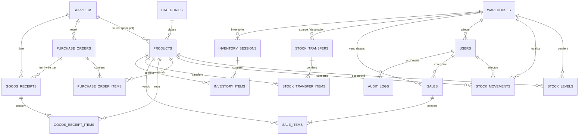

# Modèle de données StockFlow

Ce document est le contrat de référence pour les migrations, les modèles Eloquent et les services. Toute modification passe par une décision consignée dans `DECISIONS.md`.

## Ce qui change par rapport au cahier des charges

Le modèle du cahier des charges tient en cinq tables et porte le stock dans `products.current_stock`. Avec un entrepôt et un point de vente, une seule colonne ne peut pas dire où se trouve la marchandise. Le stock devient donc une table à part, `stock_levels`, avec une ligne par couple produit et emplacement.

Les autres ajouts découlent des besoins exprimés : commandes fournisseurs avec réceptions partielles, ventes avec lignes, transferts, sessions d'inventaire, journal d'audit. Le rôle reste une simple colonne de `users` puisque les trois profils sont fixes.

## Modèle conceptuel



## Modèle logique

Clé primaire soulignée par `PK`, clés étrangères notées `#`. Toutes les tables sont en InnoDB, `utf8mb4_unicode_ci`.

```text
users(PK id, name, email UNIQUE, password, must_change_password, role,
      #warehouse_id NULL, is_active, last_login_at, remember_token, created_at, updated_at, deleted_at)
categories(PK id, code UNIQUE, name UNIQUE, description, created_at, updated_at)
suppliers(PK id, name, contact_name, email, phone, address, lead_time_days,
          is_active, created_at, updated_at, deleted_at)
warehouses(PK id, code UNIQUE, name, type, address, is_active, created_at, updated_at)
products(PK id, sku UNIQUE, barcode UNIQUE, name, description, #category_id,
         #supplier_id NULL, purchase_price, selling_price, alert_threshold,
         image_path, is_active, created_at, updated_at, deleted_at)
stock_levels(PK id, #product_id, #warehouse_id, quantity, reorder_point NULL,
             created_at, updated_at, UNIQUE(product_id, warehouse_id))
stock_movements(PK id, #product_id, #warehouse_id, #user_id, type, direction,
                quantity, stock_before, stock_after, reason, reference,
                source_type, source_id, created_at)
purchase_orders(PK id, reference UNIQUE, #supplier_id, #warehouse_id, #user_id,
                status, ordered_at, expected_at, notes, closure_reason,
                created_at, updated_at)
purchase_order_items(PK id, #purchase_order_id, #product_id, quantity_ordered,
                     quantity_received, unit_cost, UNIQUE(purchase_order_id, product_id))
goods_receipts(PK id, reference UNIQUE, #purchase_order_id NULL, #supplier_id,
               #warehouse_id, #user_id, delivery_note_number, notes, received_at,
               created_at, updated_at)
goods_receipt_items(PK id, #goods_receipt_id, #product_id, #purchase_order_item_id NULL,
                    quantity, unit_cost, UNIQUE(goods_receipt_id, product_id))
sales(PK id, reference UNIQUE, #warehouse_id, #user_id, customer_name, status,
      total_amount, sold_at, #cancelled_by NULL, cancelled_at, cancel_reason,
      created_at, updated_at)
sale_items(PK id, #sale_id, #product_id, quantity, unit_price, line_total,
           UNIQUE(sale_id, product_id))
stock_transfers(PK id, reference UNIQUE, #from_warehouse_id, #to_warehouse_id, #user_id,
                status, notes, transferred_at, #cancelled_by NULL, cancelled_at,
                cancel_reason, created_at, updated_at)
stock_transfer_items(PK id, #stock_transfer_id, #product_id, quantity,
                     UNIQUE(stock_transfer_id, product_id))
inventory_sessions(PK id, reference UNIQUE, #warehouse_id, #category_id NULL, status,
                   #started_by, started_at, submitted_at, #validated_by NULL,
                   validated_at, notes, review_comment, cancel_reason,
                   created_at, updated_at)
inventory_items(PK id, #inventory_session_id, #product_id, theoretical_quantity NULL,
                counted_quantity NULL, variance NULL, counted_at NULL, #counted_by NULL,
                justification,
                UNIQUE(inventory_session_id, product_id))
audit_logs(PK id, #user_id NULL, action, auditable_type, auditable_id, description,
           old_values, new_values, ip_address, user_agent, created_at)
document_sequences(PK id, prefix, year, last_number, UNIQUE(prefix, year))
```

S'y ajoutent les tables d'infrastructure livrées par Laravel : `sessions`, `cache`, `cache_locks`, `jobs`, `failed_jobs` et `notifications` (canal base de données, utilisé pour les alertes de stock dans l'interface). La table `password_reset_tokens` du squelette Laravel est retirée : sans envoi d'e-mail, un mot de passe oublié est réinitialisé par l'administrateur.

Le modèle est en troisième forme normale, avec trois dénormalisations assumées : `stock_before` et `stock_after` sur les mouvements (exigence de traçabilité), `unit_price` et `line_total` sur les lignes de vente (le prix du jour de la vente doit survivre à un changement de tarif), `total_amount` sur la vente (évite de recalculer à chaque liste).

## Dictionnaire de données

Types abrégés : `bigint` = `BIGINT UNSIGNED`, `int` = `INT UNSIGNED`. Sauf mention, les colonnes sont `NOT NULL`.

### users

| Colonne | Type | Contraintes | Description |
| :-- | :-- | :-- | :-- |
| id | bigint | PK | |
| name | varchar(120) | | Nom complet |
| email | varchar(190) | UNIQUE | Identifiant de connexion |
| password | varchar(255) | | Hachage Bcrypt (coût 12). Mot de passe de 12 caractères au moins, sans règle de composition |
| must_change_password | boolean | défaut false | Mis à vrai quand l'administrateur crée le compte ou réinitialise le mot de passe : l'utilisateur en choisit un nouveau à la connexion suivante |
| role | enum | `admin`, `stock_manager`, `sales_agent` | Profil |
| warehouse_id | bigint | NULL, FK warehouses, RESTRICT | Emplacement d'affectation. Obligatoire pour un vendeur et forcément de type `store` : il fixe l'emplacement de ses ventes |
| is_active | boolean | défaut true | Un compte désactivé ne peut plus se connecter |
| last_login_at | timestamp | NULL | |
| deleted_at | timestamp | NULL | Suppression logique : l'historique garde son auteur |

### categories

| Colonne | Type | Contraintes | Description |
| :-- | :-- | :-- | :-- |
| id | bigint | PK | |
| code | varchar(4) | UNIQUE | Trois ou quatre lettres majuscules, préfixe des SKU de la catégorie (`IMP`, `ORD`, `RES`) |
| name | varchar(100) | UNIQUE | |
| description | varchar(500) | NULL | |

Une catégorie qui contient des produits ne peut pas être supprimée (FK en RESTRICT).

### suppliers

| Colonne | Type | Contraintes | Description |
| :-- | :-- | :-- | :-- |
| id | bigint | PK | |
| name | varchar(150) | INDEX | Raison sociale |
| contact_name | varchar(120) | NULL | Interlocuteur |
| email | varchar(190) | NULL | |
| phone | varchar(30) | NULL | Format `+225 XX XX XX XX XX` |
| address | varchar(255) | NULL | Commune, quartier, repère |
| lead_time_days | smallint unsigned | défaut 7 | Délai moyen de livraison en jours |
| is_active | boolean | défaut true | |
| deleted_at | timestamp | NULL | Suppression logique |

### warehouses

| Colonne | Type | Contraintes | Description |
| :-- | :-- | :-- | :-- |
| id | bigint | PK | |
| code | varchar(10) | UNIQUE | `ENT` (entrepôt central), `PDV` (point de vente) |
| name | varchar(100) | | |
| type | enum | `warehouse`, `store` | Les ventes ne partent que d'un emplacement de type `store`, sauf décision contraire |
| address | varchar(255) | NULL | |
| is_active | boolean | défaut true | |

Le modèle accepte un nombre quelconque d'emplacements. La démonstration en crée deux.

### products

| Colonne | Type | Contraintes | Description |
| :-- | :-- | :-- | :-- |
| id | bigint | PK | |
| sku | varchar(30) | UNIQUE | Référence interne générée avant l'insertion : code de la catégorie + numéro tiré de `document_sequences`, par exemple `IMP-000042`. Elle ne change pas si le produit change de catégorie |
| barcode | varchar(13) | UNIQUE | EAN-13 interne (préfixe 200 réservé à l'usage en magasin), clé de contrôle calculée, ou code du fabricant saisi |
| name | varchar(180) | INDEX | Libellé |
| description | text | NULL | |
| category_id | bigint | FK categories, RESTRICT | |
| supplier_id | bigint | NULL, FK suppliers, SET NULL | Fournisseur principal |
| purchase_price | int | CHECK >= 0 | Prix d'achat unitaire en F CFA |
| selling_price | int | CHECK >= 0 | Prix de vente unitaire en F CFA |
| alert_threshold | int | défaut 0 | Seuil d'alerte sur le stock total, tous emplacements confondus |
| image_path | varchar(255) | NULL | Chemin relatif sur le disque `public` |
| is_active | boolean | défaut true | Un produit inactif n'est plus vendable ni commandable |
| deleted_at | timestamp | NULL | Suppression logique, refusée tant que le stock total est supérieur à zéro |

### stock_levels

| Colonne | Type | Contraintes | Description |
| :-- | :-- | :-- | :-- |
| id | bigint | PK | |
| product_id | bigint | FK products, RESTRICT | |
| warehouse_id | bigint | FK warehouses, RESTRICT | |
| quantity | int | défaut 0, CHECK >= 0 | Quantité disponible |
| reorder_point | int | NULL | Seuil propre à l'emplacement (réassort du point de vente depuis l'entrepôt) |

Contrainte `UNIQUE(product_id, warehouse_id)`. La ligne est créée à zéro pour chaque emplacement actif à la création du produit. Le type non signé et la contrainte `CHECK` forment le dernier filet : si un bogue du service tentait de passer sous zéro, MySQL rejetterait l'écriture et la transaction serait annulée.

### stock_movements

| Colonne | Type | Contraintes | Description |
| :-- | :-- | :-- | :-- |
| id | bigint | PK | |
| product_id | bigint | FK products, RESTRICT | |
| warehouse_id | bigint | FK warehouses, RESTRICT | |
| user_id | bigint | FK users, RESTRICT | Auteur de l'opération |
| type | enum | voir ci-dessous | Nature métier |
| direction | enum | `in`, `out` | Sens |
| quantity | int | CHECK > 0 | Toujours positive, le sens est porté par `direction` |
| stock_before | int | | Quantité de l'emplacement avant l'opération |
| stock_after | int | | Quantité après. `stock_after = stock_before + quantity` si `in`, `- quantity` si `out` |
| reason | varchar(500) | NULL | Motif. Obligatoire pour `internal_use`, `manual_adjustment`, `inventory_adjustment` et les annulations |
| reference | varchar(30) | INDEX | Numéro du bon : celui du document source, ou `BM-AAAA-NNNNNN` pour un mouvement manuel |
| source_type, source_id | varchar(60), bigint | NULL, INDEX composé | Lien polymorphe vers le document d'origine (`sale`, `goods_receipt`, `stock_transfer`, `inventory_session`) |
| created_at | timestamp | INDEX | Date et heure de l'opération. Pas de `updated_at` : la ligne ne change jamais |

Valeurs de `type` et correspondance avec le cahier des charges (IN, OUT, ADJ) :

| type | direction possible | Cahier | Origine |
| :-- | :-- | :-- | :-- |
| `purchase` | in | IN | Réception fournisseur |
| `sale` | out | OUT | Vente |
| `sale_cancellation` | in | IN | Annulation d'une vente |
| `internal_use` | out | OUT | Sortie interne (usage propre, casse, don, échantillon) |
| `transfer` | out puis in | OUT + IN | Transfert entre emplacements, deux lignes de même référence. L'annulation écrit deux lignes `transfer` en sens inverse, motif obligatoire |
| `manual_adjustment` | in ou out | ADJ | Correction ponctuelle justifiée, y compris celle d'une réception erronée |
| `inventory_adjustment` | in ou out | ADJ | Régularisation d'un écart d'inventaire validé |

### purchase_orders et purchase_order_items

| Colonne | Type | Contraintes | Description |
| :-- | :-- | :-- | :-- |
| reference | varchar(30) | UNIQUE | `CF-AAAA-NNNNNN` |
| supplier_id | bigint | FK suppliers, RESTRICT | |
| warehouse_id | bigint | FK warehouses, RESTRICT | Emplacement de livraison, l'entrepôt par défaut |
| user_id | bigint | FK users | Créateur |
| status | enum | `draft`, `ordered`, `partially_received`, `received`, `closed`, `cancelled` | `closed` : commande soldée alors qu'un reliquat ne sera jamais livré |
| ordered_at | date | NULL | |
| expected_at | date | NULL | Calculée à partir du délai fournisseur, modifiable |
| notes | text | NULL | |
| closure_reason | varchar(500) | NULL | Motif obligatoire au passage à `closed` ou `cancelled` |

| Colonne (ligne) | Type | Contraintes | Description |
| :-- | :-- | :-- | :-- |
| purchase_order_id | bigint | FK, CASCADE | |
| product_id | bigint | FK products, RESTRICT | |
| quantity_ordered | int | CHECK > 0 | |
| quantity_received | int | défaut 0, CHECK <= quantity_ordered | Cumul des réceptions |
| unit_cost | int | | Prix d'achat négocié en F CFA |

Une commande n'est modifiable qu'à l'état `draft`. Elle ne peut être annulée que si rien n'a été reçu ; une commande partiellement reçue se solde (`closed`).

### goods_receipts et goods_receipt_items

Un bon de réception par livraison. Plusieurs bons peuvent se rattacher à une même commande, ce qui couvre les réceptions partielles. `purchase_order_id` est nul pour une entrée directe sans commande préalable.

Un bon de réception enregistré ne s'annule pas (décision D-018). Une erreur de saisie se corrige par un ajustement manuel justifié qui cite la référence du bon.

| Colonne | Type | Contraintes | Description |
| :-- | :-- | :-- | :-- |
| reference | varchar(30) | UNIQUE | `BR-AAAA-NNNNNN` |
| purchase_order_id | bigint | NULL, FK, RESTRICT | |
| supplier_id | bigint | FK suppliers, RESTRICT | |
| warehouse_id | bigint | FK warehouses, RESTRICT | |
| user_id | bigint | FK users | Réceptionnaire |
| delivery_note_number | varchar(60) | NULL | Numéro du bon de livraison du fournisseur |
| received_at | datetime | | |

Lignes : `product_id`, `purchase_order_item_id` (nul hors commande), `quantity` (> 0), `unit_cost`.

### sales et sale_items

| Colonne | Type | Contraintes | Description |
| :-- | :-- | :-- | :-- |
| reference | varchar(30) | UNIQUE | `BS-AAAA-NNNNNN`, numéro du bon de sortie |
| warehouse_id | bigint | FK warehouses, RESTRICT | Emplacement débité |
| user_id | bigint | FK users, INDEX | Vendeur |
| customer_name | varchar(150) | NULL | Nom du client, facultatif |
| status | enum | `completed`, `cancelled` | |
| total_amount | bigint | | Somme des lignes en F CFA |
| sold_at | datetime | INDEX | |
| cancelled_by, cancelled_at, cancel_reason | bigint, datetime, varchar(500) | NULL | Renseignés ensemble à l'annulation |

Lignes : `product_id`, `quantity` (> 0), `unit_price` (prix de vente au moment de la vente), `line_total`.

Une vente n'existe pas à l'état de brouillon côté serveur : le panier vit dans le navigateur, et l'enregistrement crée la vente, ses lignes et ses mouvements dans une seule transaction, ou rien.

### stock_transfers et stock_transfer_items

| Colonne | Type | Contraintes | Description |
| :-- | :-- | :-- | :-- |
| reference | varchar(30) | UNIQUE | `TR-AAAA-NNNNNN` |
| from_warehouse_id | bigint | FK warehouses | |
| to_warehouse_id | bigint | FK warehouses, CHECK différent de la source | |
| user_id | bigint | FK users | |
| status | enum | `completed`, `cancelled` | |
| notes | varchar(500) | NULL | |
| transferred_at | datetime | | |
| cancelled_by, cancelled_at, cancel_reason | | NULL | |

Lignes : `product_id`, `quantity` (> 0).

Le transfert est exécuté en une fois : la sortie de la source et l'entrée à destination sont écrites dans la même transaction (décision D-006). Il n'y a pas de stock « en transit ».

### inventory_sessions et inventory_items

| Colonne | Type | Contraintes | Description |
| :-- | :-- | :-- | :-- |
| reference | varchar(30) | UNIQUE | `INV-AAAA-NNNNNN` |
| warehouse_id | bigint | FK warehouses | Emplacement inventorié |
| category_id | bigint | NULL, FK categories | Inventaire tournant limité à une catégorie, sinon inventaire complet |
| status | enum | `in_progress`, `pending_validation`, `validated`, `cancelled` | |
| started_by, started_at | bigint, datetime | | |
| submitted_at | datetime | NULL | Fin du comptage |
| validated_by, validated_at | bigint, datetime | NULL | Validation par un administrateur |
| notes | text | NULL | |
| review_comment | varchar(500) | NULL | Commentaire de l'administrateur quand il renvoie la session en comptage (`pending_validation` vers `in_progress`) |
| cancel_reason | varchar(500) | NULL | Motif obligatoire à l'annulation. Seule une session non validée peut être annulée |

| Colonne (ligne) | Type | Contraintes | Description |
| :-- | :-- | :-- | :-- |
| inventory_session_id | bigint | FK, CASCADE | |
| product_id | bigint | FK products, RESTRICT | |
| theoretical_quantity | int | NULL | Stock de l'emplacement lu au moment où la ligne est comptée, et non à l'ouverture de la session |
| counted_quantity | int | NULL | Quantité comptée, nulle tant que la ligne n'est pas saisie |
| variance | int signé | NULL | `counted_quantity - theoretical_quantity`, calculé à la saisie |
| counted_at | datetime | NULL | Instant du comptage de la ligne |
| counted_by | bigint | NULL, FK users | Auteur du comptage |
| justification | varchar(500) | NULL | Obligatoire si l'écart est différent de zéro |

Une seule session ouverte (`in_progress` ou `pending_validation`) par emplacement à la fois. La règle est vérifiée dans le service sous verrou de la ligne `warehouses`.

Le théorique est relevé ligne par ligne, à la saisie du comptage (décision D-007 révisée). Avec un relevé à l'ouverture, une vente faite entre l'ouverture et le comptage serait retranchée deux fois : théorique 10, 3 vendus, 7 comptés donnerait un écart de -3 appliqué à un stock de 7. À la validation, chaque écart est appliqué au stock courant, ce qui laisse intactes les ventes faites après le comptage. Si un écart négatif dépasse le stock courant, la validation entière est refusée et la ligne doit être recomptée. Une session validée ne s'annule plus : une erreur se corrige par un nouvel inventaire ou un ajustement manuel.

### audit_logs

| Colonne | Type | Contraintes | Description |
| :-- | :-- | :-- | :-- |
| id | bigint | PK | |
| user_id | bigint | NULL, FK users | Nul pour une tentative de connexion échouée |
| action | varchar(40) | INDEX | `created`, `updated`, `deleted`, `restored`, `login`, `logout`, `login_failed`, `validated`, `cancelled`, `exported` |
| auditable_type, auditable_id | varchar(60), bigint | NULL, INDEX composé | Objet concerné |
| description | varchar(255) | NULL | Phrase lisible, par exemple « Annulation de la vente BS-2026-000128 » |
| old_values, new_values | json | NULL | Valeurs avant et après, limitées aux champs modifiés. Le mot de passe et le jeton de session en sont exclus |
| ip_address | varchar(45) | NULL | |
| user_agent | varchar(255) | NULL | |
| created_at | timestamp | INDEX | |

### document_sequences

| Colonne | Type | Contraintes | Description |
| :-- | :-- | :-- | :-- |
| prefix | varchar(10) | | `BS`, `BR`, `CF`, `TR`, `INV`, `BM`, ou le code d'une catégorie pour les SKU |
| year | smallint unsigned | | Année du compteur, 0 pour les compteurs sans remise à zéro annuelle (SKU, codes-barres) |
| last_number | int | | Dernier numéro attribué |

Contrainte `UNIQUE(prefix, year)`.

## Index

| Table | Index | Sert à |
| :-- | :-- | :-- |
| products | UNIQUE `sku`, UNIQUE `barcode`, INDEX `name`, INDEX `(category_id, is_active)`, INDEX `supplier_id` | Recherche instantanée par préfixe de SKU, de code-barres ou de nom, filtres du catalogue |
| stock_levels | UNIQUE `(product_id, warehouse_id)`, INDEX `(warehouse_id, quantity)` | Verrouillage ciblé d'une ligne, état de stock par emplacement |
| stock_movements | INDEX `(product_id, warehouse_id, created_at)`, INDEX `(type, created_at)`, INDEX `created_at`, INDEX `(source_type, source_id)`, INDEX `reference`, INDEX `user_id` | Fiche de stock d'un produit, historique filtré, mouvements du jour, retour au document source |
| sales | INDEX `sold_at`, INDEX `(user_id, sold_at)`, INDEX `(warehouse_id, sold_at)` | Ventes du jour, ventes d'un vendeur |
| purchase_orders | INDEX `(status, expected_at)`, INDEX `supplier_id` | Commandes en attente |
| inventory_sessions | INDEX `(warehouse_id, status)` | Contrôle de la session ouverte |
| audit_logs | INDEX `created_at`, INDEX `(auditable_type, auditable_id)`, INDEX `(user_id, created_at)`, INDEX `action` | Consultation et filtres du journal |

La recherche produit utilise un préfixe (`LIKE 'terme%'`) sur `sku`, `barcode` et `name`, ce qui exploite les index. Une recherche « contient » sur le libellé reste possible : sur 800 références, un balayage complet de la table prend quelques millisecondes, très loin du plafond de 500 ms. Un index `FULLTEXT` sur `name` pourra être ajouté si le catalogue dépasse quelques dizaines de milliers de lignes.

## Intégrité et accès concurrents

Le schéma et le service se répartissent le travail ainsi.

| Règle | Garantie par le schéma | Garantie par le service |
| :-- | :-- | :-- |
| Pas de stock négatif | `INT UNSIGNED` et `CHECK (quantity >= 0)` | Lecture de la ligne sous `lockForUpdate()`, comparaison, refus avec `InsufficientStockException` |
| Un mouvement par variation | | `StockService` est le seul point d'écriture de `stock_levels.quantity` |
| Historique intact | Aucune route ni méthode de mise à jour ; les modèles `StockMovement` et `AuditLog` lèvent une exception sur `update` et `delete` | |
| Pas de doublon de SKU, de code-barres, de référence de document | Index `UNIQUE` | Validation `unique` dans les Form Requests pour un message propre |
| Pas d'orphelin | Clés étrangères en `RESTRICT` sur tout ce qui porte de l'historique | Suppression logique des produits, fournisseurs et utilisateurs |
| Réception plafonnée à la commande | `CHECK (quantity_received <= quantity_ordered)` | Verrou sur les lignes de commande pendant la réception |

Séquence type d'une opération à plusieurs lignes (vente de trois produits, par exemple) :

1. Ouvrir la transaction.
2. Trier les lignes par `(product_id, warehouse_id)`, puis charger les `stock_levels` correspondants avec `lockForUpdate()` en une requête ordonnée.
3. Vérifier toutes les disponibilités. S'il en manque, lever une `InsufficientStockException` qui liste chaque ligne en défaut avec sa quantité disponible : la transaction est annulée et rien n'est écrit.
4. Écrire le document et ses lignes, mettre à jour les quantités, insérer les mouvements et la ligne d'audit de l'opération.
5. Valider la transaction, puis émettre les notifications d'alerte de seuil après le commit.

L'audit des opérations de stock est écrit dans la transaction (décision D-019) : une opération validée ne peut pas exister sans sa trace. Seules les notifications partent après le commit, car une alerte perdue se recalcule alors qu'une trace perdue ne se retrouve pas.

Deux ventes simultanées sur le même produit se retrouvent en file sur le verrou de la ligne `stock_levels` : la seconde lit la quantité déjà diminuée par la première. L'ordre de verrouillage constant évite les interblocages entre deux paniers qui partagent des produits ; par précaution, `DB::transaction($callback, 3)` rejoue la transaction si MySQL en signale un.

Les références de documents (`BS-2026-000128`) sont attribuées avant l'insertion par `ReferenceGenerator`, qui incrémente sous `lockForUpdate()` la ligne `(prefix, year)` de `document_sequences` dans la transaction de l'opération (décision D-017). La référence est donc connue au moment d'écrire le document et ses mouvements, ce qui évite toute mise à jour après coup d'une table en ajout seul. Les numéros se suivent sans doublon et une transaction annulée ne consomme pas de numéro.

## Valorisation

La valeur du stock affichée au tableau de bord est la somme des `quantity × purchase_price` de chaque produit, au prix d'achat courant de la fiche. Le calcul d'un coût moyen pondéré à chaque réception est hors périmètre de cette version ; les `unit_cost` conservés sur les réceptions permettront de l'ajouter sans migration destructive.

## Jeu de démonstration

Les seeders de démonstration créent les données en appelant les services métier, pas en insérant directement dans `stock_levels`. La règle « un mouvement par variation » reste ainsi vraie sur la base de démonstration, et un test peut le prouver en rejouant l'historique. Volumes visés : 6 catégories, 6 fournisseurs, 2 emplacements, 60 produits, 6 utilisateurs, plus de 150 mouvements étalés sur trois mois, avec des produits en stock normal, sous seuil et en rupture.
