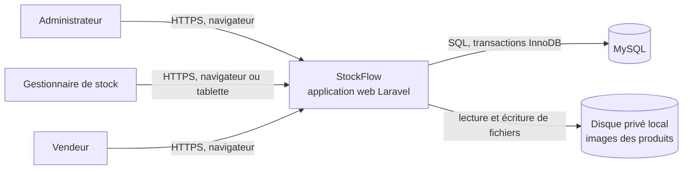
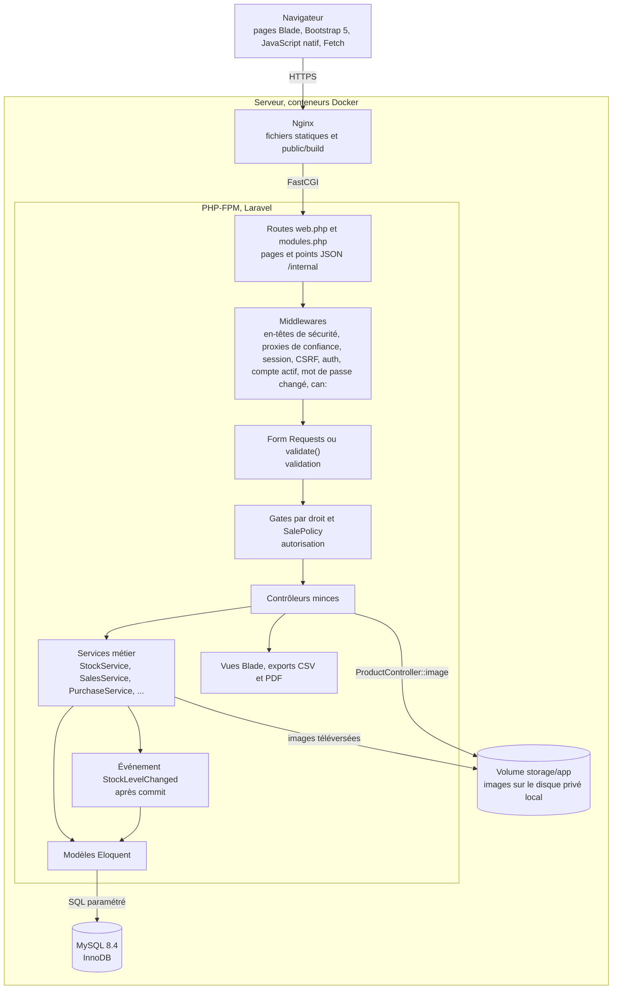
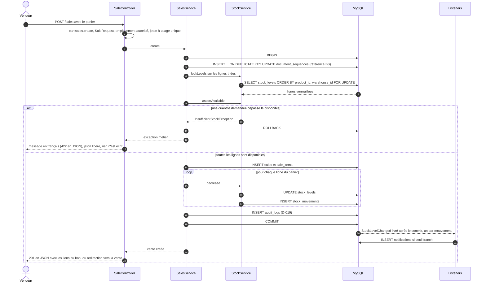
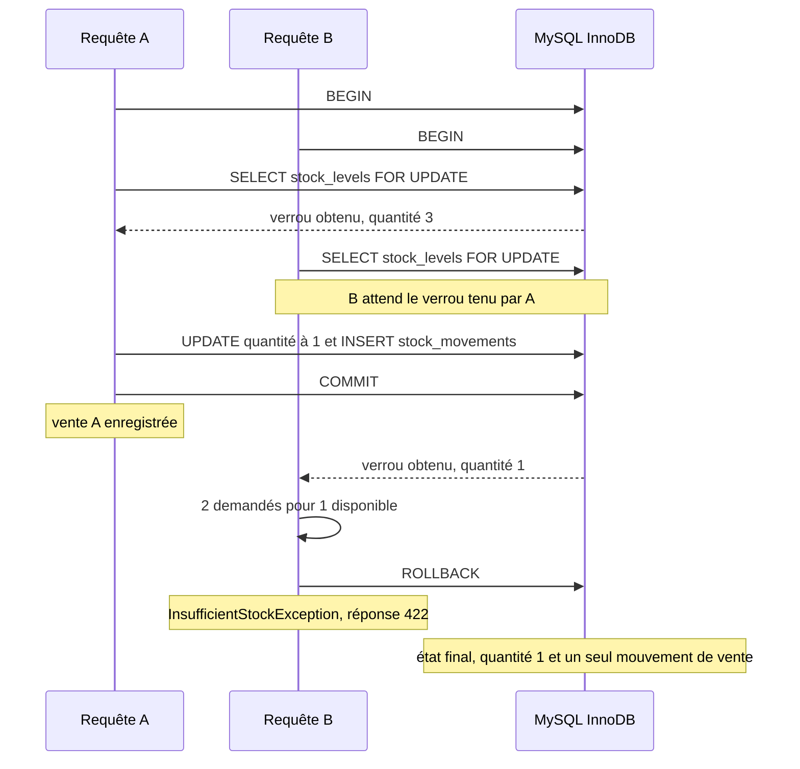
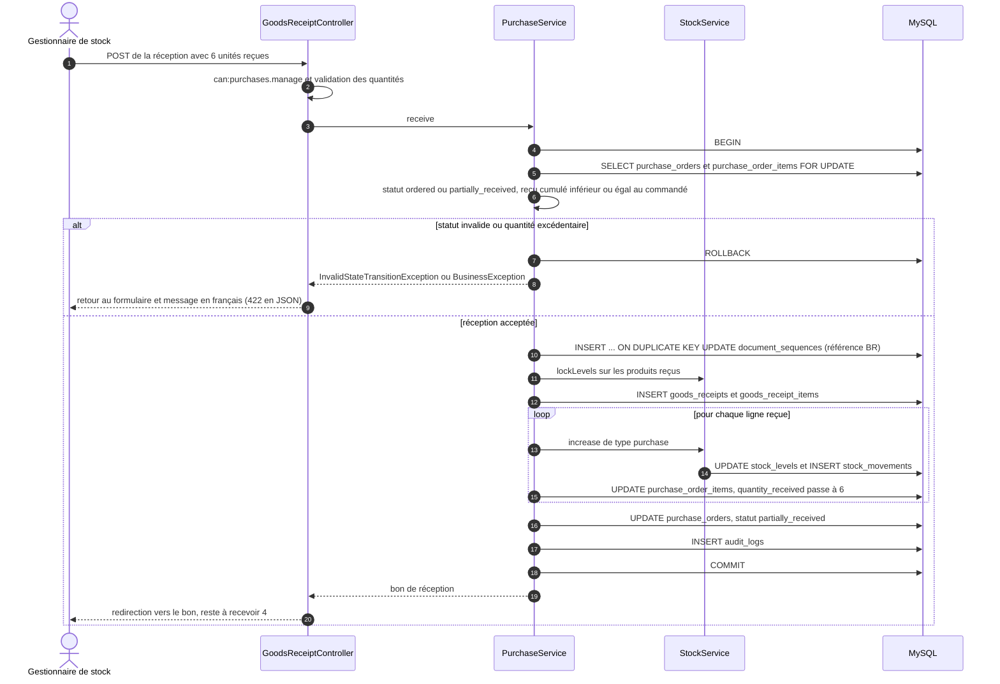
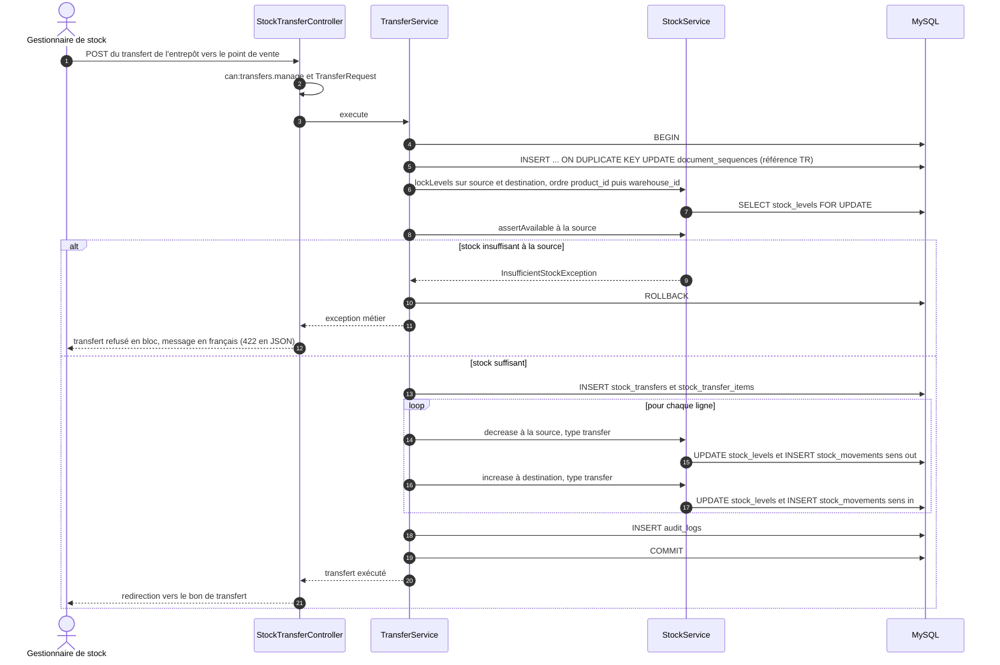
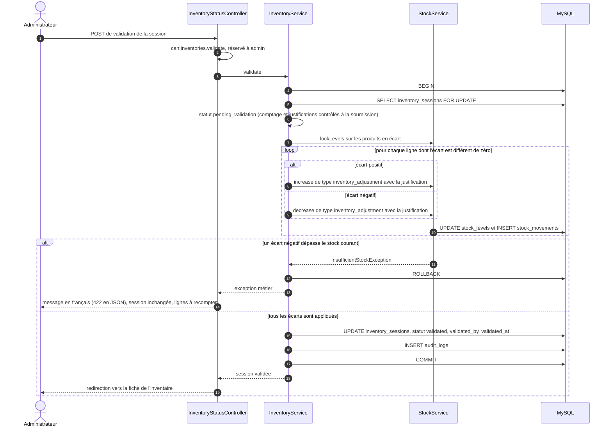

# Architecture du système StockFlow

Mis à jour le 19/11/2026 : alignement sur le code (T-908c).

Ce document décrit l'organisation technique de l'application : couches, services métier, modules, flux critiques, sécurité, arborescence et environnements. Le modèle de données n'est pas repris ici, il est défini dans `database-design.md`. Les choix structurants sont argumentés dans `architecture-decisions.md` (ADR-001 à ADR-020).

Le document a d'abord été écrit avant le code, comme un contrat. Il décrit désormais l'application telle qu'elle est construite : quand l'implémentation s'est écartée du contrat de départ, c'est le code qui fait foi et le texte a été corrigé. Les décisions D-001 à D-021 sont acceptées (Laravel 13 sur PHP 8.4, MySQL 8.4, Docker Compose) ; D-022 et D-023 sont encore au statut « Proposée ».

## 1. Vue d'ensemble

StockFlow est un monolithe Laravel. Les pages sont rendues côté serveur par Blade et mises en forme avec Bootstrap 5. Le JavaScript est natif, sans framework : il sert à la recherche instantanée, aux filtres de liste, au panier de vente, à la saisie d'inventaire et au tableau de bord (changement de période, graphiques Chart.js, rafraîchissement), par des appels Fetch. Les données sont dans MySQL (InnoDB). Les images des produits sont sur le disque privé `local` de Laravel (`storage/app/private`) et servies par une route réservée aux utilisateurs connectés.

Le découpage est MVC avec une couche de services. Les contrôleurs ne contiennent pas de règle métier : ils valident, autorisent, délèguent à un service et répondent. Toute écriture de stock passe par `App\Services\StockService`.

Il n'y a ni file d'attente à surveiller, ni WebSocket, ni API publique. Le seul listener s'exécute de façon synchrone après le commit, et le « temps réel » du cahier des charges est obtenu par deux moyens : chaque écran lit le stock courant en base au moment de l'affichage, et le tableau de bord interroge un point JSON à intervalle régulier (30 secondes).

### Schéma de contexte



L'application n'appelle aucun service externe. Bootstrap, Bootstrap Icons et Chart.js (D-021) sont installés par npm et compilés par Vite : aucune ressource n'est chargée depuis un CDN, ce qui simplifie la politique CSP et supprime une dépendance à la connexion internationale. Chart.js est chargé par un `import()` dynamique dans `resources/js/modules/dashboard.js` : Vite en fait un fichier séparé, téléchargé seulement sur le tableau de bord.

### Schéma des couches



En production, le TLS est terminé par un proxy inverse placé devant le service `web`, qui n'écoute que sur `127.0.0.1` (section 11).

## 2. Couches et responsabilités

### Routes

Toutes les routes sont dans `routes/web.php`, qui inclut `routes/modules.php` pour les modules métier. Elles sont donc toutes dans le groupe de middlewares `web` (session, cookies chiffrés, CSRF). Elles sont organisées en groupes :

| Groupe | Middlewares | Contenu |
| :-- | :-- | :-- |
| Invité | `guest`, `throttle:20,1` sur l'envoi du formulaire | formulaire de connexion |
| Public | aucun | page `/legal` (mentions légales et données personnelles), route `/up` de contrôle de santé |
| Session ouverte | `auth`, `active`, `password.changed` | déconnexion, changement de mot de passe (`throttle:10,1`), page d'accueil, tableau de bord |
| Modules | les mêmes, plus `can:<droit>` par groupe | catalogue, stock, mouvements, transferts, inventaires, achats, ventes, alertes, rapports (`throttle:20,1`), utilisateurs, emplacements, journal d'audit |
| JSON interne | les mêmes, plus `throttle:120,1` et `can:<droit>`, préfixe `/internal`, nom `internal.` | recherche produit (`internal.products.search`), données du tableau de bord (`internal.dashboard`) |

La page d'accueil `/` redirige le vendeur vers le point de vente (`sales.create`) et les autres profils vers le tableau de bord. D'autres routes répondent en JSON quand la requête l'attend, sans être sous `/internal` : l'enregistrement d'une vente (`POST /sales`) et la saisie des comptages d'inventaire (`PUT /inventories/{inventory}/counts`), ainsi que les listes filtrées en direct, qui renvoient un fragment HTML sur l'en-tête `X-Partial`.

Les points JSON appelés par Fetch restent dans `web.php` et ne vont pas dans `routes/api.php`. Les raisons :

- `routes/api.php` est prévu pour des clients sans état, authentifiés par jeton. Il n'est d'ailleurs plus créé par défaut depuis la structure allégée de Laravel : il faut l'installer avec Sanctum. Ici, le seul client est le navigateur de l'utilisateur déjà connecté.
- En restant dans le groupe `web`, ces points réutilisent le cookie de session et la protection CSRF. Il n'y a aucun jeton à émettre, à stocker dans le navigateur ou à révoquer.
- Les mêmes middlewares, Policies et Gates s'appliquent aux pages et aux réponses JSON. Une règle d'accès n'est écrite qu'une fois.
- Aucune API n'est exposée à des tiers, donc pas de CORS à configurer ni de versionnement à maintenir.

Le préfixe retenu est `/internal` plutôt que `/api/internal`, pour qu'on ne prenne pas ces routes pour une API publique sans état. Si une application tierce devait un jour consommer les données, une vraie API avec jetons serait ajoutée dans `routes/api.php`, par une nouvelle décision.

Les requêtes Fetch envoient l'en-tête `X-CSRF-TOKEN` (lu dans une balise `meta`), `X-Requested-With: XMLHttpRequest` et `Accept: application/json`. Le module `resources/js/lib/http.js` centralise ces appels : sur un code 401 ou 419 (session expirée), il recharge la page, ce qui ramène à la connexion ; les autres erreurs remontent avec le message JSON du serveur, affiché par l'écran appelant.

### Middlewares

Déclarés dans `bootstrap/app.php` (méthode `withMiddleware`).

| Middleware | Alias ou place | Rôle |
| :-- | :-- | :-- |
| `App\Http\Middleware\SecurityHeaders` | en tête de la pile globale (`prepend`) | pose les en-têtes de sécurité sur toutes les réponses, y compris les pages d'erreur rendues hors du groupe `web`, `/up` et le JSON (section 6) |
| `App\Http\Middleware\TrustProxies` | remplace celui de Laravel dans la pile globale | proxies de confiance lus dans `config('stockflow.trusted_proxies')` à chaque requête (section 6) |
| `Authenticate` (Laravel) | `auth` | redirige vers la connexion, ou répond 401 en JSON |
| `App\Http\Middleware\EnsureUserIsActive` | `active` | déconnecte et refuse un compte dont `is_active` est faux, même si sa session est encore valide (401 en JSON) |
| `App\Http\Middleware\EnsurePasswordIsChanged` | `password.changed` | tant que `must_change_password` est vrai, n'ouvre que le changement de mot de passe et la déconnexion (403 en JSON) |
| `Authorize` (Laravel) | `can` | vérifie un droit de la matrice des rôles sur un groupe de routes, par exemple `can:purchases.manage` |
| `ThrottleRequests` (Laravel) | `throttle` | limite le débit de la connexion, du changement de mot de passe, des rapports et des points JSON |

Il n'y a pas de middleware `role` : le filtre par groupe de routes est le middleware `can:` sur les Gates de la matrice. Il ne remplace pas la Policy, qui décide au niveau de l'objet (un vendeur ne voit que ses ventes), ni les contrôles faits dans le contrôleur (un vendeur ne vend que depuis son emplacement, `SaleController::resolveStore`).

### Validation

Les écritures qui portent des lignes ou des champs nombreux ont une Form Request dans `app/Http/Requests` (sans sous-dossier par module) : `ProductRequest`, `CategoryRequest`, `SupplierRequest`, `PurchaseOrderRequest`, `DirectReceiptRequest`, `SaleRequest`, `TransferRequest`, `MovementRequest`, `ReasonRequest` (motif obligatoire), `DashboardPeriodRequest`, `Auth\LoginRequest`, et la classe commune `LinesRequest`. Elles portent les règles, les messages en français et la normalisation des lignes. Les formulaires courts (réception sur commande, ouverture et comptage d'inventaire, filtres de liste, utilisateurs, emplacements) sont validés par `$request->validate()` dans le contrôleur. Les services refont les contrôles métier (lignes en double fusionnées, produit actif, motif de 5 caractères au moins) par le trait `App\Services\Concerns\NormalizesLines`.

### Gates et Policy

Les droits sont définis une fois, dans `App\Enums\Role::permissions()` (D-005). `AppServiceProvider` crée une Gate par droit (`catalog.view`, `catalog.manage`, `sales.create`, `prices.view-purchase`, `dashboard.full`, `audit.view`, etc.), qui répond selon le rôle de l'utilisateur. Une seule Policy existe, `SalePolicy`, pour la décision au niveau de l'objet : `view` (le vendeur ne voit que ses ventes) et `cancel` (droit `sales.cancel` et vente non annulée). Les contrôleurs l'appellent par `Gate::authorize()`.

Matrice appliquée par `Role::permissions()`, conforme à D-009 :

| Action | Droit | admin | stock_manager | sales_agent |
| :-- | :-- | :-- | :-- | :-- |
| Gérer les utilisateurs et les emplacements, consulter le journal d'audit | `users.manage`, `warehouses.manage`, `audit.view` | oui | non | non |
| Créer et modifier catégories, produits, fournisseurs | `catalog.manage`, `suppliers.manage` | oui | oui | non |
| Consulter le catalogue et le stock | `catalog.view`, `stock.view` | oui | oui | oui |
| Commandes fournisseurs, réceptions, transferts | `purchases.manage`, `transfers.manage` | oui | oui | non |
| Sorties internes, ajustements manuels, historique des mouvements | `movements.manage`, `movements.view` | oui | oui | non |
| Enregistrer une vente | `sales.create` | oui | non (D-009) | oui, depuis son emplacement d'affectation |
| Consulter les ventes | `sales.view`, `sales.view-all` | toutes | toutes | les siennes |
| Annuler une vente | `sales.cancel` | oui | oui | non |
| Ouvrir, saisir, soumettre et annuler un inventaire | `inventories.manage` | oui | oui | non |
| Valider un inventaire ou le renvoyer en comptage | `inventories.validate` | oui | non | non |
| Voir les prix d'achat | `prices.view-purchase` | oui | oui | non |
| Alertes, rapports et exports CSV et PDF | `alerts.view`, `reports.view` | oui | oui | non |
| Tableau de bord complet (valeur du stock, mouvements, emplacements) | `dashboard.full` | oui | oui | non, ses ventes seulement |

Chaque route, y compris JSON, vérifie l'autorisation côté serveur. Les directives `@can` des vues ne servent qu'à masquer ce qui serait refusé de toute façon. Le test `tests/Feature/Security/PermissionMatrixTest.php` parcourt la matrice.

### Contrôleurs

Un contrôleur par module, avec des actions nommées pour les transitions d'état (`SaleController::cancel`, `InventoryController::validateSession`, `PurchaseOrderController::confirm`). Un contrôleur n'écrit pas dans `stock_levels` et ne contient pas de condition métier. Il traduit une requête HTTP en appel de service, puis le résultat en redirection, en vue ou en JSON. Une exception : `MovementController::store` ouvre lui-même la transaction qui regroupe l'appel à `StockService` et la ligne d'audit du mouvement manuel ; la quantité reste écrite par le service.

### Services

Classes sans état de `app/Services`, injectées par le conteneur. Elles portent les règles métier, ouvrent les transactions et lèvent des exceptions métier. Elles ne connaissent ni la requête HTTP ni la session : l'utilisateur agissant leur est passé en argument, ce qui les rend appelables depuis un test, un seeder ou une commande. Détail en section 3.

### Modèles Eloquent

Un modèle par table de `database-design.md`. Ils portent les relations, les `casts` (enums, dates, entiers), les portées de requête (`active()`, `stores()`, `withTotalStock()`) et les accesseurs de présentation simples. Ils ne portent pas de règle de stock.

Protections placées dans les modèles et le fournisseur de services :

- `StockMovement` et `AuditLog` utilisent le trait `App\Models\Concerns\AppendOnly`, qui lève `ImmutableRecordException` sur `updating` et `deleting` (règle 5 de `CLAUDE.md`). La protection est applicative ; il n'y a ni déclencheur MySQL ni droits restreints sur ces tables (D-023, proposée).
- `StockLevel` n'a pas `quantity` dans `$fillable`. Il n'y a pas de garde sur l'événement `updating` : la règle « seul `StockService` écrit la quantité » repose sur la revue de code et sur la commande `stock:verify`, qui rejoue l'historique.
- `Model::preventSilentlyDiscardingAttributes()` est activé hors production : une affectation de masse sur un champ non autorisé lève une erreur.
- `Relation::enforceMorphMap()` fixe des noms courts et stables (`sale`, `goods_receipt`, `stock_transfer`, ...) dans les colonnes polymorphes `source_type`, `auditable_type` et `notifiable_type`.
- `DB::prohibitDestructiveCommands()` interdit en production `migrate:fresh`, `migrate:refresh`, `migrate:reset`, `migrate:rollback` et `db:wipe`, même avec `--force`.

### Événement et listener

Un seul événement applicatif, `App\Events\StockLevelChanged`, marqué `ShouldDispatchAfterCommit` : il ne part qu'une fois la transaction validée, et il est abandonné si elle est annulée.

| Événement | Émis par | Listener | Effet |
| :-- | :-- | :-- | :-- |
| `StockLevelChanged` | `StockService`, un par mouvement | `CheckStockThresholds` (découvert automatiquement) | appelle `AlertService::evaluate()` pour détecter un franchissement de seuil |

Le listener est synchrone (`QUEUE_CONNECTION=sync`). S'il échoue, l'opération déjà validée n'est pas remise en cause : l'erreur est journalisée au niveau `critical`. L'audit ne passe pas par un événement : il est écrit dans la transaction (voir `AuditService` en section 3), y compris pour les connexions et les exports.

### Notifications

`App\Notifications\LowStockNotification`, canal `database` (D-013). Le nombre d'alertes non lues de la barre supérieure et les compteurs de la barre latérale sont calculés au rendu de la page par `App\View\Composers\NavigationComposer` ; le point JSON du tableau de bord renvoie aussi ce nombre (`alerts`) à chaque rafraîchissement. La liste des produits à réapprovisionner ne dépend pas des notifications : elle est calculée par requête sur l'état courant du stock (`AlertService::productsBelowThreshold()`).

### Exports

`App\Exports\CsvWriter` écrit le CSV en flux avec `fputcsv` dans une réponse `streamDownload` (BOM UTF-8, séparateur point-virgule), à partir de requêtes lues par `lazy()` pour ne pas charger l'historique en mémoire. Les PDF sont rendus par dompdf à partir des vues `resources/views/reports/pdf` (D-011), dans `ReportController`, et refusés au-delà de `config('stockflow.pdf_max_rows')` lignes (2 000) : l'écran propose alors le CSV. Chaque export écrit une ligne d'audit `exported` par `AuditService::record()`.

## 3. Services métier

Les signatures ci-dessous sont celles du code (`app/Services`). Les lignes de document sont des tableaux validés par une Form Request, de forme `array<int, array{product_id: int, quantity: int}>`, avec `unit_cost` en plus pour les achats.

Règles communes à tous les services qui touchent au stock :

- la méthode publique qui déplace du stock (vente, annulation de vente, réception, transfert, annulation de transfert, validation d'inventaire) ouvre `DB::transaction($callback, 3)`. Les appels imbriqués à `StockService` et à `ReferenceGenerator` s'inscrivent dans cette transaction par point de sauvegarde, et seul le niveau extérieur rejoue l'opération si MySQL signale un interblocage. Les transitions qui ne touchent pas au stock (confirmer ou solder une commande, soumettre ou annuler un inventaire) ouvrent une transaction simple ;
- ordre de verrouillage constant : d'abord la ligne du document existant (commande, vente, transfert, session) et ses lignes filles par `id` croissant, puis le compteur de `document_sequences`, enfin les lignes `stock_levels` par `(product_id, warehouse_id)` croissant ;
- toutes les lignes de stock d'une opération sont verrouillées en une fois avant la première écriture ;
- les quantités sont des entiers strictement positifs, les prix sont lus en base et jamais repris du formulaire.

### StockService

Seul point d'écriture de `stock_levels.quantity`.

```php
final class StockService
{
    /** Entrée de stock. Écrit le niveau et un mouvement de sens "in". */
    public function increase(
        int $productId, int $warehouseId, int $quantity,
        MovementType $type, User $user,
        ?string $reason = null, ?Model $source = null, ?string $reference = null,
    ): StockMovement;

    /**
     * Sortie de stock. Écrit le niveau et un mouvement de sens "out".
     * @throws InsufficientStockException si $quantity dépasse le disponible
     */
    public function decrease(
        int $productId, int $warehouseId, int $quantity,
        MovementType $type, User $user,
        ?string $reason = null, ?Model $source = null, ?string $reference = null,
    ): StockMovement;

    /**
     * Verrouillage ordonné. Réservé aux autres services, jamais appelé par un contrôleur.
     * @param  array<int, array{0: int, 1: int}>  $pairs  couples [product_id, warehouse_id]
     * @return Collection<string, StockLevel>  indexée par "product_id:warehouse_id"
     */
    public function lockLevels(array $pairs): Collection;

    /**
     * Contrôle groupé des disponibilités sur des lignes déjà verrouillées.
     * @throws InsufficientStockException  avec la liste complète des manques
     */
    public function assertAvailable(Collection $lockedLevels, array $lines, int $warehouseId): void;

    /** Crée à zéro les lignes stock_levels d'un nouveau produit ou d'un nouvel emplacement. */
    public function initializeLevels(Product|Warehouse $subject): void;

    /** Lecture sans verrou, pour l'affichage. */
    public function available(int $productId, int $warehouseId): int;
    public function totalFor(int $productId): int;
}
```

Règles :

- `increase` et `decrease` refusent une quantité nulle ou négative et un type de mouvement employé dans un sens qu'il n'autorise pas (`InvalidArgumentException`), puis s'exécutent dans une transaction : ils lisent la ligne `stock_levels` avec `lockForUpdate()` (par `lockLevels`), calculent `stock_before` et `stock_after`, mettent à jour la quantité et insèrent exactement une ligne `stock_movements`. Reprendre un verrou déjà posé par `lockLevels` dans la même transaction est sans effet, donc un appel isolé (sortie interne, ajustement) est sûr sans préparation.
- `lockLevels` exige une transaction ouverte (sinon `LogicException`), dédoublonne et trie les couples, puis les charge avec `lockForUpdate()` par une requête ordonnée sur `product_id, warehouse_id`. Si une ligne manque, il la crée à zéro par `insertOrIgnore` et reprend les verrous.
- `decrease` refuse toute sortie supérieure au disponible avec `InsufficientStockException`. La colonne non signée et la contrainte `CHECK (quantity >= 0)` du schéma restent le dernier filet.
- le motif est exigé quand `MovementType::requiresReason()` est vrai (`internal_use`, `manual_adjustment`, `inventory_adjustment`, annulations), sinon `MissingReasonException`.
- la référence du mouvement est celle du document source. Pour un mouvement manuel sans référence, `StockService` en demande une à `ReferenceGenerator` (`BM-AAAA-NNNNNN`), avant de verrouiller la ligne de stock.
- après chaque mouvement, le service émet `StockLevelChanged`, livré après le commit, qui ne sert qu'aux alertes de seuil.
- l'audit d'une opération de stock n'est pas confié à un listener : le service métier (ou `MovementController` pour un mouvement manuel) appelle `AuditService::record()` dans la transaction (D-019).
- `initializeLevels` crée les lignes à zéro pour tous les emplacements d'un nouveau produit, ou pour tous les produits (retirés compris) d'un nouvel emplacement. Il est appelé par l'événement `created` des modèles `Product` et `Warehouse`.

`InsufficientStockException` porte, pour chaque ligne en défaut, le produit (identifiant, nom, SKU), l'emplacement, la quantité demandée et la quantité disponible (méthode `shortages()`, reprise dans la réponse JSON sous la clé `shortages`). Son message utilisateur est en français, par exemple « Stock insuffisant pour Cartouche HP 305 noire : 2 disponibles, 5 demandés. »

Les motifs des annulations sont typés `?string` dans les signatures : le service les contrôle lui-même (`NormalizesLines::requireReason`, 5 caractères au moins) et lève `MissingReasonException` s'ils manquent.

### PurchaseService

```php
final class PurchaseService
{
    public function createDraft(array $data, User $user): PurchaseOrder;
    public function updateDraft(PurchaseOrder $order, array $data, User $user): PurchaseOrder;
    public function confirm(PurchaseOrder $order, User $user): PurchaseOrder;
    public function cancel(PurchaseOrder $order, User $user, ?string $reason): PurchaseOrder;
    public function close(PurchaseOrder $order, User $user, ?string $reason): PurchaseOrder;

    /** Réception totale ou partielle d'une commande. */
    public function receive(PurchaseOrder $order, array $lines, array $receiptData, User $user): GoodsReceipt;

    /** Entrée directe sans commande préalable (D-016). */
    public function receiveDirect(Supplier $supplier, Warehouse $warehouse, array $lines, array $receiptData, User $user): GoodsReceipt;
}
```

Règles : une commande partiellement reçue dont le reliquat ne viendra pas se solde par `close` (statut `closed`, motif dans `closure_reason`). Un bon de réception enregistré ne s'annule pas : l'erreur se corrige par un ajustement manuel justifié (D-018).

- transitions : `draft` vers `ordered` (`confirm`, qui renseigne `ordered_at` et, s'il est vide, calcule `expected_at` avec `lead_time_days`), `ordered` vers `partially_received` puis `received`, et `draft` ou `ordered` vers `cancelled` tant que rien n'a été reçu. Toute autre transition lève `InvalidStateTransitionException`.
- une commande n'est modifiable qu'à l'état `draft`.
- `receive` verrouille la commande et ses lignes, refuse une quantité qui ferait dépasser le reste à recevoir (`BusinessException`), crée le bon de réception, appelle `StockService::increase` (type `purchase`) pour chaque ligne, cumule `quantity_received` et recalcule le statut de la commande. Un excédent livré passe par une réception directe.
- la réception ne modifie pas `products.purchase_price` : la valorisation reste au prix de la fiche, comme le prévoit `database-design.md`.

### SalesService

```php
final class SalesService
{
    /** @throws InsufficientStockException */
    public function create(Warehouse $warehouse, array $lines, ?string $customerName, User $user): Sale;

    /** @throws InvalidStateTransitionException si la vente est déjà annulée */
    public function cancel(Sale $sale, User $user, ?string $reason): Sale;
}
```

Règles :

- l'emplacement doit être de type `store` et actif. Pour un vendeur, c'est son emplacement d'affectation : `SaleController` ne lui propose que celui-là et refuse en 403 un autre emplacement forcé dans la requête (D-009).
- chaque produit doit être actif. Le prix unitaire est `products.selling_price` lu dans la transaction, `line_total` et `total_amount` sont calculés par le service.
- la vente, ses lignes et ses mouvements (type `sale`) sont écrits ensemble ou pas du tout. Il n'y a pas de vente partielle : un seul manque refuse tout le panier.
- `cancel` verrouille la vente, vérifie le statut `completed`, renseigne `cancelled_by`, `cancelled_at` et `cancel_reason`, puis réintègre chaque ligne par `StockService::increase` (type `sale_cancellation`).
- le formulaire de vente porte un jeton à usage unique, consommé par `SaleController::store` avec `Cache::add()` (clé `sale-form:<jeton>`, 12 heures) : une double soumission du même panier ne crée pas deux ventes et reçoit un 409 en JSON, ou une redirection avec avertissement. Si la vente est refusée par une règle métier, le jeton est libéré pour que le vendeur corrige son panier.

### TransferService

```php
final class TransferService
{
    /** @throws InsufficientStockException */
    public function execute(Warehouse $from, Warehouse $to, array $lines, ?string $notes, User $user): StockTransfer;

    /** @throws InsufficientStockException si la destination n'a plus les quantités à rendre */
    public function cancel(StockTransfer $transfer, User $user, ?string $reason): StockTransfer;
}
```

Règles : source et destination différentes et actives ; les lignes de stock des deux emplacements sont verrouillées ensemble dans l'ordre commun ; chaque ligne produit deux mouvements de type `transfer` et de même référence, une sortie à la source puis une entrée à destination (D-006). L'annulation écrit les deux mouvements inverses et échoue si la marchandise a déjà quitté la destination.

### InventoryService

```php
final class InventoryService
{
    /** Ouvre la session et crée une ligne à compter par produit du périmètre. */
    public function open(Warehouse $warehouse, ?Category $category, User $user, ?string $notes = null): InventorySession;

    /** Enregistre les quantités comptées, en une ou plusieurs fois. */
    public function recordCounts(InventorySession $session, array $counts, User $user): InventorySession;

    /** Clôt le comptage : in_progress vers pending_validation. */
    public function submit(InventorySession $session, User $user): InventorySession;

    /** Renvoie la session en comptage : pending_validation vers in_progress. */
    public function sendBack(InventorySession $session, User $admin, ?string $comment): InventorySession;

    /** Applique les écarts au stock : pending_validation vers validated. */
    public function validate(InventorySession $session, User $admin): InventorySession;

    public function cancel(InventorySession $session, User $user, ?string $reason): InventorySession;
}
```

Règles :

- `open` verrouille la ligne `warehouses`, vérifie qu'aucune session n'est ouverte sur l'emplacement, puis crée une ligne `inventory_items` par produit du périmètre, sans quantité théorique ni quantité comptée.
- `recordCounts` n'est possible qu'à l'état `in_progress`. Pour chaque ligne saisie, il lit le stock courant de l'emplacement sous verrou, l'enregistre dans `theoretical_quantity` avec `counted_at` et `counted_by`, puis calcule `variance = counted_quantity - theoretical_quantity`. Il n'écrit rien dans le stock. Recompter une ligne relève à nouveau le théorique.
- `submit` exige que toutes les lignes soient comptées et que chaque écart non nul ait une justification.
- `validate` est réservé à l'administrateur (D-009). Il verrouille la session, verrouille les lignes de stock des produits en écart, puis applique chaque écart au stock courant : `increase` si l'écart est positif, `decrease` s'il est négatif, avec le type `inventory_adjustment` et la justification comme motif. Les mouvements restent autorisés pendant le comptage (D-007).
- si un écart négatif dépasse le stock courant, `decrease` lève `InsufficientStockException`, toute la validation est annulée et la session reste en attente. L'administrateur utilise alors `sendBack` pour faire recompter les lignes concernées.
- `cancel` n'est possible qu'avant la validation.

Le théorique est relevé à la saisie de chaque ligne et non à l'ouverture (D-007 révisée, option C de l'ADR-007). Une vente faite avant le comptage d'un produit est déjà dans le théorique, une vente faite après est préservée parce que l'écart s'applique au stock courant. La seule fenêtre d'erreur restante est le délai entre le comptage physique et sa saisie, d'où la saisie sur tablette au fil du comptage. La transition `sendBack` enregistre son motif dans `inventory_sessions.review_comment`.

### AuditService

```php
final class AuditService
{
    public function record(
        AuditAction $action, ?Model $subject = null, ?string $description = null,
        array $oldValues = [], array $newValues = [], ?int $userId = null,
    ): AuditLog;
}
```

Règles : `AuditService` est le seul point d'écriture de `audit_logs`, et il écrit au moment de l'appel, sans événement intermédiaire. `old_values` et `new_values` ne contiennent que les champs modifiés ; `password`, `remember_token`, `current_password` et `password_confirmation` sont toujours retirés. L'utilisateur est celui passé en argument, sinon l'utilisateur connecté ; l'adresse IP et l'agent utilisateur sont lus dans la requête HTTP en cours (vides pour une commande ou un seeder) ; la description est tronquée à 250 caractères.

Trois sources d'appel :

- les opérations de stock (vente, réception, transfert, mouvement manuel, ouverture, soumission et validation d'inventaire, annulations, transitions de commande) : le service appelle `record()` dans sa transaction, l'opération et sa trace sont validées ensemble ou pas du tout (D-019) ;
- les modèles `Product`, `Category`, `Supplier`, `Warehouse` et `User` utilisent le trait `App\Models\Concerns\Auditable`, qui appelle `record()` dans les événements Eloquent `created`, `updated`, `deleted` et `restored`, donc dans la transaction de l'écriture quand il y en a une ;
- `LoginController` trace la connexion, la déconnexion, l'échec de connexion et le blocage après trop d'échecs (action `login_failed`), et `ReportController` chaque export (`exported`).

### AlertService

```php
final class AlertService
{
    /** Appelé par le listener CheckStockThresholds après chaque mouvement. */
    public function evaluate(StockMovement $movement): void;

    /** Produits actifs dont le stock total est au plus leur seuil, ruptures en tête. 0 : sans limite. */
    public function productsBelowThreshold(int $limit = 0): Collection;
    public function belowThresholdQuery(): Builder;

    /** Administrateurs et gestionnaires actifs. */
    public function recipients(): Collection;
}
```

Règles (D-008, D-013) : le seuil du produit (`alert_threshold`) se compare au stock total, le seuil d'emplacement (`reorder_point`), quand il est renseigné, au stock de cet emplacement. Seuls les mouvements sortants d'un produit actif sont évalués. Une notification n'est créée qu'au franchissement, c'est-à-dire quand la quantité passe d'une valeur supérieure au seuil à une valeur inférieure ou égale. Le service ne crée pas de nouvelle notification tant qu'une notification non lue existe pour le même produit et la même portée. Destinataires : les administrateurs et les gestionnaires de stock actifs.

### ReferenceGenerator

```php
final class ReferenceGenerator
{
    /** Exemple : next(DocumentType::Sale) rend "BS-2026-000128". Date par défaut : maintenant. */
    public function next(DocumentType $type, ?CarbonInterface $date = null): string;

    /** Numéro suivant d'une série. L'année 0 désigne une série sans remise à zéro. */
    public function nextNumber(string $prefix, int $year = 0): int;
}
```

Préfixes : `CF` commande fournisseur, `BR` bon de réception, `BS` bon de sortie, `TR` transfert, `INV` inventaire, `BM` mouvement manuel. Le numéro vient de la table `document_sequences` (D-017). Le générateur incrémente le compteur en une seule instruction atomique, `INSERT INTO document_sequences (prefix, year, last_number) VALUES (?, ?, 1) ON DUPLICATE KEY UPDATE last_number = last_number + 1`, puis relit `last_number` ; la ligne reste verrouillée par la transaction de l'opération jusqu'à sa fin. Une lecture `SELECT ... FOR UPDATE` suivie d'un `INSERT` avait été écartée : quand la série n'existe pas encore (première vente de l'année), elle posait des verrous d'intervalle partagés et deux transactions s'interbloquaient, cas reproduit par les tests de concurrence. La référence est connue avant l'insertion du document et de ses mouvements, aucune ligne de `stock_movements` n'est retouchée, et une transaction annulée ne consomme pas de numéro. Le compteur est pris avant les lignes de stock, toujours dans cet ordre.

### SKU et BarcodeGenerator

Il n'y a pas de classe `SkuGenerator` : le SKU est attribué par `ProductService::create`, avec le code de la catégorie (`categories.code`) comme préfixe et un numéro tiré de `ReferenceGenerator::nextNumber($category->code)`, série sans année. Exemple : `IMP-000042`, 42e produit créé dans la catégorie Imprimantes. Le SKU ne change pas si le produit change de catégorie.

```php
final class BarcodeGenerator
{
    /** EAN-13 interne : "200" + numéro de la série "EAN" sur 9 chiffres + clé de contrôle. */
    public function next(): string;
    public static function checkDigit(string $twelveDigits): int;
    public static function isValidEan13(string $code): bool;
    /** Rendu SVG par picqer/php-barcode-generator : EAN-13 si le code en est un, Code 128 sinon. */
    public function svg(string $code, int $height = 56): string;
}
```

Règles : le code-barres interne commence par 200, plage réservée à l'usage en magasin, suivi d'un numéro d'ordre tiré de la série `EAN` de `document_sequences`. Clé de contrôle EAN-13 : somme des chiffres de rang impair, plus trois fois la somme des chiffres de rang pair, sur les douze premiers chiffres comptés depuis la gauche ; la clé est `(10 - somme mod 10) mod 10`. Un code du fabricant saisi à la main est accepté s'il compte de 8 à 13 chiffres et n'est pas déjà attribué (`ProductRequest`) ; le dessin utilise alors le Code 128 s'il n'est pas un EAN-13 valide. Le SVG produit est le seul contenu affiché avec `{!! !!}`.

### ProductService

`ProductService` coordonne le catalogue : `create` (SKU, code-barres, image, seuils par emplacement), `update` et `delete` (suppression logique refusée tant que le stock total, lu sous verrou, est supérieur à zéro). Les lignes de stock à zéro sont créées par l'événement `created` du modèle `Product`. L'image est enregistrée avant la transaction sous un nom régénéré (`UploadedFile::store`) dans `products/` sur le disque privé `local` (`ProductService::IMAGE_DISK`) ; si la transaction échoue, le fichier est supprimé.

### DashboardService

Refait le 19/11/2026 avec le tableau de bord (D-021, qui remplace D-015). Règles détaillées dans `docs/10-ui-ux-dashboard/dashboard-indicators.md`.

```php
final class DashboardService
{
    /** Tout ce que l'écran affiche pour une période, prêt à être envoyé en JSON. */
    public function forPeriod(Period $period, User $user, bool $compare = true): array;

    public function snapshot(User $user): array;                 // état du stock à l'instant
    public function flows(Period $period, User $user): array;    // flux de la période
    public function compare(string $key, int $value, ?int $previous): array;
    public function salesSeries(Period $period, User $user): array;
    public function movementSeries(Period $period): array;
    public function byWarehouse(): array;
    public function stockStatusDistribution(): array;
    public function topProducts(Period $period, User $user, int $limit = 5): array;
    public function latestMovements(int $limit = 6): Collection;
    public function latestSales(User $user, int $limit = 6): Collection;
    public function toReorder(int $limit = 6): Collection;
}
```

Règles :

- la période est un objet `App\Support\Period`, construit côté serveur à partir d'un préréglage (aujourd'hui, hier, 7 ou 30 derniers jours, semaine, mois ou année en cours ou précédente ; 30 derniers jours par défaut) ou de deux dates (période personnalisée de deux ans au plus), validé par `DashboardPeriodRequest`. Les bornes sont des journées entières dans le fuseau `Africa/Abidjan`.
- deux familles d'indicateurs : l'état du stock, mesuré à l'instant (références actives, unités, valeur au prix d'achat, produits sous le seuil et en rupture, commandes en attente), sans comparaison possible faute d'historique de l'état ; les flux de la période (ventes, chiffre d'affaires, panier moyen, unités entrées et sorties, transferts, ajustements), comparés à la période précédente donnée par `Period::previous()` (même tranche du mois ou de l'année précédente, sinon période de même durée qui se termine la veille). La comparaison se désactive par le paramètre `compare`.
- graphiques Chart.js : ventes de la période, mouvements entrées et sorties, répartition du stock par emplacement, répartition des produits par état. Le pas est le jour jusqu'à 62 jours, la semaine jusqu'à 183 jours, le mois au-delà (`Period::granularity()`, regroupement SQL par `DATE_FORMAT` et `WEEKDAY`, propres à MySQL).
- périmètre selon le profil : sans le droit `dashboard.full`, le vendeur ne voit que ses propres ventes, ni la valeur du stock, ni les commandes, ni les graphiques de mouvements et d'emplacements.
- la page est rendue complète par le serveur (`DashboardController`, lisible sans JavaScript), puis `GET /internal/dashboard` renvoie le même tableau en JSON à chaque changement de période et toutes les `config('stockflow.dashboard_refresh_seconds')` secondes (30). Une période invalide renvoie 422 en JSON ; sur la page, elle ramène à la période par défaut avec un avertissement.

## 4. Modules et correspondances

Les vues sont dans `resources/views/<dossier>`. « Interne » désigne un contrôleur JSON de `App\Http\Controllers\Internal`. Les droits sont ceux de `Role::permissions()`, vérifiés par le middleware `can:` de `routes/modules.php`.

| Module | Contrôleurs | Services | Modèles | Droits ou Policy | Vues |
| :-- | :-- | :-- | :-- | :-- | :-- |
| Auth | `Auth\LoginController`, `Auth\PasswordController` | `AuditService` (appel direct) | `User` | middlewares `guest`, `auth`, `active`, `password.changed` | `auth/` |
| Dashboard | `DashboardController`, interne `DashboardDataController` | `DashboardService`, `AlertService` | `Product`, `StockLevel`, `StockMovement`, `Sale`, `PurchaseOrder` | `stock.view`, périmètre par `dashboard.full`, `movements.view`, `alerts.view` | `dashboard/` |
| Category | `CategoryController` | aucun (CRUD simple) | `Category` | `catalog.manage` | `categories/` |
| Product | `ProductController` (dont `image`), interne `ProductSearchController` | `ProductService`, `ReferenceGenerator`, `BarcodeGenerator` | `Product` | `catalog.view`, `catalog.manage` | `products/` |
| Supplier | `SupplierController` | aucun (CRUD simple) | `Supplier` | `suppliers.manage` | `suppliers/` |
| Warehouse et Stock | `WarehouseController` (liste et modification, pas de création, D-020), `StockController` (état du stock) | `StockService` (`initializeLevels` par le modèle) | `Warehouse`, `StockLevel` | `warehouses.manage`, `stock.view` | `warehouses/`, `stock/` |
| Movement | `MovementController` (historique, sortie interne, ajustement manuel) | `StockService`, `AuditService` | `StockMovement` | `movements.view`, `movements.manage` | `movements/` |
| PurchaseOrder | `PurchaseOrderController` (dont `confirm`, `cancel`, `close`) | `PurchaseService` | `PurchaseOrder`, `PurchaseOrderItem` | `purchases.manage` | `purchase-orders/` |
| GoodsReceipt | `GoodsReceiptController` (réception sur commande et réception directe) | `PurchaseService`, `StockService` | `GoodsReceipt`, `GoodsReceiptItem` | `purchases.manage` | `goods-receipts/` |
| Transfer | `TransferController` (dont `cancel` et `print`) | `TransferService`, `StockService` | `StockTransfer`, `StockTransferItem` | `transfers.manage` | `transfers/` |
| Sale | `SaleController` (dont `cancel` et `print`) | `SalesService`, `StockService` | `Sale`, `SaleItem` | `sales.create`, `sales.view`, `sales.cancel`, `SalePolicy` | `sales/` |
| Inventory | `InventoryController` (dont `counts`, `submit`, `validateSession`, `sendBack`, `cancel`, `print`) | `InventoryService`, `StockService` | `InventorySession`, `InventoryItem` | `inventories.manage`, `inventories.validate` | `inventories/` |
| Alert et Notification | `AlertController` (liste, tout marquer comme lu) | `AlertService` | notifications Laravel (`DatabaseNotification`) | `alerts.view`, notifications de l'utilisateur connecté seulement | `alerts/` |
| Report et Export | `ReportController` (état du stock et mouvements en CSV ou PDF, ventes en CSV) | `CsvWriter`, dompdf, `AuditService` | `Product`, `StockLevel`, `StockMovement`, `Sale` | `reports.view` | `reports/`, `reports/pdf/` |
| User | `UserController` (création, modification, réinitialisation du mot de passe ; pas de suppression) | `AuditService` | `User` | `users.manage` | `users/` |
| AuditLog | `AuditLogController` (lecture seule) | aucun | `AuditLog` | `audit.view` | `audit-logs/` |

La page `/legal` (mentions légales et données personnelles) est servie par `Route::view` depuis `resources/views/legal.blade.php`, sans contrôleur. Les bons imprimables (vente, réception, transfert, inventaire) utilisent le gabarit `layouts/print.blade.php`.

`UserController::update` interdit à un administrateur de retirer son propre rôle d'administrateur ou de désactiver son propre compte. Comme seul un administrateur peut modifier les comptes, il en reste toujours au moins un actif. Il n'y a pas de `UserPolicy`.

## 5. Diagrammes de séquence des opérations critiques

### a. Vente avec vérification de disponibilité et verrouillage



### b. Deux ventes concurrentes sur le même produit

Situation de départ : 3 unités en stock au point de vente. Les requêtes A et B demandent chacune 2 unités au même instant.



La seconde requête lit la quantité après le commit de la première parce que `FOR UPDATE` fait une lecture courante et non une lecture de l'instantané de la transaction. C'est ce comportement que prouve le test de `tests/Concurrency` avec deux processus réels (D-014).

### c. Réception partielle d'une commande fournisseur

Exemple : commande de 10 unités, première livraison de 6.



La livraison du solde passe par la même séquence : un second bon de réception est créé et la commande passe à `received` quand toutes les lignes sont soldées.

### d. Transfert entre emplacements



### e. Validation d'un inventaire avec régularisation des écarts



## 6. Sécurité

### Authentification et sessions

- Authentification par session avec le garde `web` de Laravel, écrite à la main (D-010) : connexion, déconnexion, changement de mot de passe. Pas d'inscription libre, les comptes sont créés par l'administrateur, qui réinitialise aussi un mot de passe oublié ; `must_change_password` impose alors un nouveau mot de passe à la connexion suivante (middleware `password.changed`).
- L'identifiant de session est régénéré à la connexion (`$request->session()->regenerate()`). À la déconnexion, la session est invalidée et le jeton CSRF régénéré.
- Les tentatives de connexion sont limitées par `RateLimiter` dans `LoginController`, sur la clé adresse électronique et adresse IP : cinq échecs par minute, puis blocage temporaire. La route ajoute `throttle:20,1` par adresse IP. Chaque échec et chaque blocage sont tracés dans `audit_logs` (action `login_failed`), sans le mot de passe.
- Le message d'échec est le même que l'adresse existe ou non. Un compte désactivé est refusé à la connexion, puis à chaque requête par le middleware `active`.
- Mots de passe hachés en Bcrypt (coût 12, valeur de `BCRYPT_ROUNDS`). Règle unique (`Password::defaults()`) : 12 caractères au minimum, sans obligation de majuscule, de chiffre ou de symbole. La longueur est plafonnée à 72 caractères, limite au-delà de laquelle Bcrypt ignore la saisie.
- L'option « se souvenir de moi » n'est pas proposée : les postes de la boutique sont partagés.
- Sessions stockées en base (`SESSION_DRIVER=database`), réglées dans `config/session.php` :
  - durée de 120 minutes d'inactivité (`SESSION_LIFETIME`, D-010) ;
  - expiration à la fermeture du navigateur : `SESSION_EXPIRE_ON_CLOSE`, vrai par défaut et dans `.env.example`, pour les postes partagés. Le cookie de session n'a alors pas de date d'expiration ;
  - contenu chiffré en base : `SESSION_ENCRYPT`, vrai par défaut et dans `.env.example` ;
  - cookie `stockflow-session`, `HttpOnly`, `SameSite=Lax` ;
  - attribut `Secure` : `SESSION_SECURE_COOKIE`, qui vaut vrai par défaut quand `APP_ENV=production`. `.env.example` le pose à `false` pour le développement en HTTP : il ne faut pas reprendre cette valeur en production.

### Proxies de confiance

En production, le TLS est terminé par un proxy inverse devant le service `web`. Pour que Laravel reconnaisse le schéma HTTPS et l'adresse réelle du client, les en-têtes `X-Forwarded-For`, `X-Forwarded-Host`, `X-Forwarded-Port` et `X-Forwarded-Proto` ne sont acceptés que des proxies déclarés dans `TRUSTED_PROXIES` : `*` derrière le proxy de production (le service `web` n'écoute que sur `127.0.0.1`), une liste d'adresses séparées par des virgules, ou vide en développement.

La valeur est lue par `config('stockflow.trusted_proxies')` dans `App\Http\Middleware\TrustProxies`, qui remplace le middleware de Laravel dans `bootstrap/app.php`. Elle est lue au moment de la requête, et non par un `env()` dans `bootstrap/app.php` : ce fichier s'exécute avant le chargement de `.env`, et la variable y était ignorée hors Docker (constat M-1 de `docs/05-development/backend-config-audit.md`). Le réglage fonctionne donc avec un fichier `.env` comme avec la configuration en cache. Sans lui, HSTS ne serait jamais envoyé, le cookie ne serait pas `Secure` par détection automatique et la limitation des connexions compterait toute l'entreprise comme une seule adresse. Test : `tests/Feature/Security/TrustedProxiesTest.php`.

### Protection des requêtes

- CSRF : jeton vérifié sur toute requête qui modifie un état, formulaires (`@csrf`) comme appels Fetch (`X-CSRF-TOKEN`). Aucune route n'est exclue de la vérification.
- Autorisation côté serveur sur chaque route, pages et JSON, par le middleware `can:` puis, pour les ventes, par `SalePolicy`. Les identifiants reçus dans l'URL sont résolus par liaison de modèle ; une vente d'un autre vendeur est refusée par la Policy, et les listes du vendeur sont filtrées sur son identifiant quel que soit le filtre demandé.
- Validation de toute entrée, par Form Request ou `$request->validate()`. Seules les valeurs validées sont transmises aux services. Les modèles déclarent `$fillable`.
- Requêtes SQL paramétrées par Eloquent et le Query Builder. Les colonnes de tri et de filtre venant de l'URL sont comparées à une liste blanche avant d'entrer dans une requête. Les seules expressions SQL brutes (`selectRaw`, `whereRaw`, `DATE_FORMAT` des graphiques) sont écrites dans le code, sans valeur venant de la requête.
- Échappement Blade `{{ }}` partout. `{!! !!}` est limité au SVG de code-barres produit par le serveur. Le JavaScript qui construit du HTML passe par `escapeHtml()` de `resources/js/lib/http.js`.
- Les cellules des exports CSV qui commencent par `=`, `+`, `-` ou `@` sont neutralisées (`CsvWriter::cell`), pour qu'un tableur ne les interprète pas comme des formules.

### En-têtes de sécurité

Posés par `App\Http\Middleware\SecurityHeaders`, placé en tête de la pile globale : ils couvrent aussi les pages d'erreur, la page de maintenance, `/up` et les réponses JSON.

| En-tête | Valeur | Remarque |
| :-- | :-- | :-- |
| `Content-Security-Policy` | `default-src 'self'; script-src 'self' 'nonce-...'; style-src 'self' 'nonce-...'; img-src 'self' data: blob:; font-src 'self'; connect-src 'self'; object-src 'none'; base-uri 'self'; form-action 'self'; frame-ancestors 'none'` | nonce fourni par `Vite::useCspNonce()` |
| `X-Content-Type-Options` | `nosniff` | aussi posé sur la réponse qui sert une image de produit |
| `X-Frame-Options` | `DENY` | doublon de `frame-ancestors` pour les anciens navigateurs |
| `Referrer-Policy` | `strict-origin-when-cross-origin` | |
| `Permissions-Policy` | `camera=(), microphone=(), geolocation=(), payment=()` | |
| `Strict-Transport-Security` | `max-age=31536000; includeSubDomains` | seulement quand la requête est reconnue comme HTTPS (`$request->isSecure()`), ce qui suppose les proxies de confiance en production |

Conséquence de la politique de styles : pas d'attribut `style` dans les vues servies au navigateur (seul le gabarit PDF de `reports/pdf`, rendu par dompdf côté serveur, en contient). Les barres d'avancement utilisent l'élément `<progress>` ou des classes CSS. Les graphiques du tableau de bord sont dessinés par Chart.js dans des éléments `<canvas>` (D-021, qui remplace D-015). Les scripts sont des fichiers compilés par Vite ; aucun script en ligne dans les vues. En environnement `local`, quand le serveur de développement de Vite tourne, la politique ajoute `http://localhost:<VITE_PORT>`, sa connexion WebSocket et `'unsafe-inline'` pour les styles.

### Téléversement d'images

- Types acceptés : jpeg, png, webp, contrôlés par les règles `image` et `mimes`, qui lisent le contenu du fichier et pas seulement son extension, puis par `getimagesize` : un fichier qui ne se décode pas comme une image est refusé. Taille maximale 2 Mo (`config('stockflow.product_image')`). Le SVG est refusé.
- Le nom d'origine est abandonné, le fichier est enregistré sous un nom aléatoire (`UploadedFile::store`) dans `products/` sur le disque privé `local` (`storage/app/private`). Seul le chemin relatif est stocké dans `products.image_path`.
- L'image n'est pas réencodée : contrôle du contenu, nom régénéré, disque privé et en-tête `nosniff` sont jugés suffisants (D-022, proposée, écart SEC-07 accepté).
- Les images ne sont pas publiques : elles sont servies par `GET /products/{product}/image` (`ProductController::image`, droit `catalog.view`), avec `X-Content-Type-Options: nosniff` et `Cache-Control: private`. Le disque `public` et `storage:link` ne sont pas utilisés, et `serve` est désactivé sur le disque `local` (`config/filesystems.php`). Nginx garde un bloc `/storage/` qui sert des fichiers statiques sans les interpréter ; il ne sert à rien tant qu'aucun lien `public/storage` n'existe. Seul `public/index.php` est transmis à PHP-FPM.

### Secrets et configuration

- Aucun secret dans Git. `.env` et `.env.production` sont ignorés, `.env.example` documente chaque variable sans valeur sensible.
- `APP_KEY` et les mots de passe de base sont propres à chaque environnement. En production, `APP_DEBUG=false` ; `scripts/deploy.sh` refuse de déployer si `APP_DEBUG`, `APP_ENV` ou `APP_KEY` sont mal réglés.
- Le compte MySQL de l'application n'a de droits que sur sa base. Le compte `root` de MySQL ne sert pas à l'application.
- Les journaux ne doivent contenir ni mot de passe ni jeton de session. Écart connu au 19/11/2026 : `zend.exception_ignore_args` n'est pas activé dans `docker/php/php.ini`, et une trace d'exception peut contenir des arguments de fonction (constat M-4 de `backend-config-audit.md`, correction du ressort du DevOps).

### Données personnelles et pages légales

L'application traite des données personnelles au sens de la loi ivoirienne n° 2013-450 relative à la protection des données à caractère personnel : nom et adresse électronique des utilisateurs, traces de leur activité (journal d'audit, adresse IP, agent utilisateur), noms de clients saisis sur les ventes, interlocuteurs des fournisseurs.

Une page publique, `/legal` (« Mentions légales et données personnelles »), liée depuis les gabarits `layouts/guest` (page de connexion) et `layouts/app`, réunit :

- les mentions légales : éditeur, contact, hébergeur, tirés de `config('stockflow.company')` (variables `COMPANY_*`) ;
- les données personnelles : données traitées, finalités, droits et moyen de les exercer, cookies.

Principes appliqués dans la conception : `customer_name` est facultatif et aucune autre donnée de client n'est collectée ; les comptes sont désactivés ou supprimés logiquement pour que l'historique garde son auteur ; le journal d'audit n'est lisible que par l'administrateur. Les formalités préalables auprès de l'autorité de protection (ARTCI), les durées de conservation et les valeurs `COMPANY_*` réelles sont à valider par l'entreprise, responsable du traitement, avant la mise en production.

## 7. Gestion des erreurs

### Exceptions métier

Elles héritent toutes de `App\Exceptions\BusinessException`, classe concrète, levée aussi directement pour les refus sans classe dédiée (ligne de réception invalide, emplacement ou produit inactif, inventaire sans produit à compter). Elle porte un message utilisateur en français et une méthode `details()` qui ajoute des données structurées à la réponse JSON. Il n'y a ni code court ni statut propre à chaque classe : toutes sont rendues en 422.

| Exception | Cas | Statut HTTP |
| :-- | :-- | :-- |
| `BusinessException` | refus métier générique | 422 |
| `InsufficientStockException` | quantité demandée supérieure au disponible ; `details()` renvoie `shortages` | 422 |
| `InvalidStateTransitionException` | transition interdite : vente ou transfert déjà annulé, commande déjà reçue, session déjà validée | 422 |
| `MissingReasonException` | motif absent ou trop court sur une opération qui l'exige | 422 |
| `InventoryAlreadyOpenException` | une session est déjà ouverte sur l'emplacement | 422 |
| `ImmutableRecordException` | tentative de modifier ou supprimer un mouvement ou une ligne d'audit ; hérite de `LogicException`, pas de `BusinessException` | 500, anomalie de programmation, journalisée |

Le seul 409 de l'application ne vient pas d'une exception : c'est la réponse JSON de `SaleController::store` à la double soumission d'une vente (jeton à usage unique déjà consommé, section 3).

Les erreurs de saisie ne sont pas des exceptions métier : elles sont traitées par la validation de Laravel. Une période de tableau de bord invalide (`App\Support\Period`) est transformée en erreur de validation par `DashboardPeriodRequest`.

### Rendu

Le rendu est configuré une seule fois dans `bootstrap/app.php` (méthode `withExceptions`). Une réponse JSON est rendue pour toute route `internal/*` et toute requête qui attend du JSON (`shouldRenderJsonWhen`).

| Situation | Réponse HTML | Réponse JSON |
| :-- | :-- | :-- |
| Validation | retour au formulaire, saisie conservée, erreurs sous les champs | 422, `{"message": "...", "errors": {"champ": ["..."]}}` |
| Exception métier | retour à la page précédente, saisie conservée (sauf les mots de passe), message flash `error` | 422, `{"message": "..."}` plus les clés de `details()`, par exemple `"shortages": [...]` |
| Double soumission d'une vente | redirection vers la liste des ventes avec un avertissement | 409, `{"message": "..."}` |
| Non authentifié | redirection vers la connexion | 401 |
| Compte désactivé | déconnexion, retour à la connexion avec un message | 401 |
| Mot de passe à changer | redirection vers le changement de mot de passe | 403 |
| Non autorisé | page 403 en français | 403 |
| Introuvable | page 404 en français | 404 |
| Session expirée (CSRF) | page 419 qui invite à recharger | 419, le module Fetch recharge la page |
| Trop de requêtes | page 429 | 429 |
| Erreur inattendue | page 500 sans détail technique | 500, message générique |
| Maintenance (`php artisan down`) | page 503 | 503 |

Les pages d'erreur sont dans `resources/views/errors` (403, 404, 419, 429, 500, 503, gabarit `layout.blade.php`) ; aucune n'affiche le message de l'exception.

### Messages et journalisation

- Tous les messages vus par l'utilisateur sont en français : messages de validation dans `lang/fr/validation.php` et dans les Form Requests, messages métier écrits en français dans les exceptions et les contrôleurs. Aucun message technique, aucun nom de table, aucune trace d'exécution n'atteint l'interface en production.
- Les exceptions métier sont des refus prévus : `bootstrap/app.php` les exclut du journal (`dontReport(BusinessException::class)`). Elles ne sont pas journalisées ; un refus n'est visible que par l'utilisateur qui l'a reçu. Les opérations acceptées, elles, sont dans `audit_logs`.
- Les erreurs inattendues sont journalisées au niveau `error` avec leur trace, y compris un interblocage qui épuise les trois tentatives de `DB::transaction`. L'échec du listener d'alerte après commit est journalisé au niveau `critical`.
- Journaux : canal `stack` vers `daily` (`LOG_CHANNEL=stack`, `LOG_STACK=daily`), un fichier par jour dans `storage/logs`, conservé `LOG_DAILY_DAYS` jours, en développement comme en production. En production, `storage/logs` est le volume Docker `logs` et `LOG_LEVEL` vaut `warning`.
- Le journal technique et le journal d'audit sont deux choses distinctes : le premier sert au diagnostic, le second (`audit_logs`) est une donnée métier consultable dans l'application.

## 8. Arborescence du projet

Structure allégée de Laravel : les middlewares, le routage et le rendu des exceptions se configurent dans `bootstrap/app.php`. Il n'y a ni `app/Http/Kernel.php` ni `app/Console/Kernel.php`. Les commandes Artisan de `app/Console/Commands` sont découvertes automatiquement, comme le listener et la Policy.

Arborescence relevée le 19/11/2026.

```text
stackflow/
├── .github/workflows/ci.yml               # intégration continue
├── app/
│   ├── Console/Commands/
│   │   └── VerifyStockIntegrity.php       # stock:verify, rapproche niveaux et mouvements (lecture seule)
│   ├── Enums/
│   │   ├── Role.php                       # admin, stock_manager, sales_agent, et matrice permissions()
│   │   ├── WarehouseType.php
│   │   ├── MovementType.php               # porte requiresReason() et allowedDirections()
│   │   ├── MovementDirection.php
│   │   ├── PurchaseOrderStatus.php
│   │   ├── SaleStatus.php
│   │   ├── TransferStatus.php
│   │   ├── InventoryStatus.php
│   │   ├── AuditAction.php
│   │   └── DocumentType.php               # préfixes CF, BR, BS, TR, INV, BM
│   ├── Events/
│   │   └── StockLevelChanged.php
│   ├── Exceptions/
│   │   ├── BusinessException.php
│   │   ├── InsufficientStockException.php
│   │   ├── InvalidStateTransitionException.php
│   │   ├── MissingReasonException.php
│   │   ├── InventoryAlreadyOpenException.php
│   │   └── ImmutableRecordException.php
│   ├── Exports/
│   │   └── CsvWriter.php                  # fputcsv en flux, BOM UTF-8, séparateur point-virgule
│   ├── Http/
│   │   ├── Controllers/
│   │   │   ├── Auth/                      # LoginController, PasswordController
│   │   │   ├── Internal/                  # DashboardDataController, ProductSearchController (JSON)
│   │   │   └── ...                        # un contrôleur par ligne du tableau de la section 4
│   │   ├── Middleware/
│   │   │   ├── EnsureUserIsActive.php
│   │   │   ├── EnsurePasswordIsChanged.php
│   │   │   ├── SecurityHeaders.php
│   │   │   └── TrustProxies.php
│   │   └── Requests/                      # Form Requests, dossier Auth/ pour LoginRequest
│   ├── Listeners/
│   │   └── CheckStockThresholds.php
│   ├── Models/
│   │   ├── Concerns/                      # AppendOnly.php, Auditable.php
│   │   └── ...                            # un modèle par table de database-design.md, plus DocumentSequence
│   ├── Notifications/
│   │   └── LowStockNotification.php
│   ├── Policies/
│   │   └── SalePolicy.php
│   ├── Providers/
│   │   └── AppServiceProvider.php         # Gates, carte polymorphe, règle de mot de passe, commandes destructives, nonce CSP
│   ├── Services/
│   │   ├── Concerns/NormalizesLines.php   # fusion des lignes, produits actifs, motif obligatoire
│   │   ├── StockService.php
│   │   ├── PurchaseService.php
│   │   ├── SalesService.php
│   │   ├── TransferService.php
│   │   ├── InventoryService.php
│   │   ├── AuditService.php
│   │   ├── AlertService.php
│   │   ├── ProductService.php
│   │   ├── DashboardService.php
│   │   ├── ReferenceGenerator.php
│   │   └── BarcodeGenerator.php
│   ├── Support/
│   │   ├── Format.php                     # montants "1 200 000 F CFA", dates JJ/MM/AAAA
│   │   └── Period.php                     # période d'analyse du tableau de bord
│   └── View/Composers/
│       └── NavigationComposer.php         # compteurs de la barre latérale et de la cloche
├── bootstrap/
│   ├── app.php                            # routage, middlewares, rendu des exceptions
│   └── providers.php
├── config/                                # fichiers Laravel, plus stockflow.php (entreprise, pagination, plafond PDF, rafraîchissement, images, proxies, port Vite)
├── database/
│   ├── factories/
│   ├── migrations/                        # 11 migrations
│   └── seeders/
│       ├── DatabaseSeeder.php
│       ├── ReferenceDataSeeder.php        # emplacements ENT et PDV, premier administrateur
│       └── DemoSeeder.php                 # jeu de démonstration, passe par les services, refusé en production
├── docker/
│   ├── php/                               # Dockerfile (étapes dev, prod, web), php.ini, opcache-prod.ini, fpm-dev.conf
│   └── nginx/                             # default.conf
├── docs/
│   ├── 01-analysis/
│   ├── 02-architecture/                   # ce document, database-design.md, architecture-decisions.md
│   ├── 03-design/
│   ├── 04-database/                       # schema.sql, initialisation.md
│   ├── 05-development/
│   ├── 06-testing/
│   ├── 07-deployment/
│   ├── 08-user-guides/
│   └── 10-ui-ux-dashboard/                # tableau de bord, design system
├── lang/
│   └── fr/                                # auth.php, validation.php, pagination.php
├── public/
│   └── index.php                          # pas de lien public/storage
├── resources/
│   ├── scss/                              # app.scss, print.scss, _variables, _design-system, _dashboard, _motion
│   ├── js/
│   │   ├── app.js
│   │   ├── print.js
│   │   ├── lib/http.js                    # Fetch, jeton CSRF, traitement des erreurs, échappement
│   │   └── modules/                       # product-search, live-list, line-items, sale-cart, inventory-count, dashboard
│   └── views/
│       ├── layouts/                       # app, guest, print, partials/ (sidebar, topbar)
│       ├── components/                    # alertes, KPI, cartes de graphique, badges, formulaires, confirmation
│       ├── errors/                        # 403, 404, 419, 429, 500, 503
│       ├── auth/  dashboard/  categories/  products/  suppliers/
│       ├── warehouses/  stock/  movements/
│       ├── purchase-orders/  goods-receipts/  transfers/  sales/  inventories/
│       ├── alerts/  reports/ (dont pdf/)  users/  audit-logs/
│       └── legal.blade.php                # mentions légales et données personnelles
├── routes/
│   ├── web.php                            # connexion, session, tableau de bord
│   ├── modules.php                        # modules métier et groupe /internal
│   └── console.php
├── scripts/                               # install, start, deploy, backup, restore (.sh, et .ps1 pour install et start)
├── storage/
│   └── app/private/products/              # images téléversées, volume persistant en production
├── tests/
│   ├── Unit/                              # sans base (Period)
│   ├── Feature/                           # Auth, Catalog, Dashboard, Modules, Security, Stock
│   ├── Concurrency/                       # processus réels contre MySQL
│   │   └── workers/                       # scripts lancés en parallèle par les tests
│   └── TestCase.php
├── .env.example
├── compose.yaml                           # développement
├── compose.prod.yaml                      # production
├── composer.json
├── package.json
├── phpunit.xml                            # suites Unit, Feature, Concurrency
└── vite.config.js
```

Il n'y a pas de `routes/api.php`, pas de dossier `app/Repositories` (Eloquent suffit à cette échelle), pas de dossier `app/Jobs` (aucun traitement différé), pas de `pint.json` (Pint tourne avec son préréglage par défaut, `laravel`).

## 9. Conventions de développement

### Nommage

| Élément | Convention | Exemple |
| :-- | :-- | :-- |
| Table | anglais, pluriel, `snake_case` | `stock_movements` |
| Modèle | anglais, singulier, `PascalCase` | `StockMovement` |
| Contrôleur | nom de la ressource au singulier + `Controller`, transitions en méthodes | `SaleController::cancel`, `InventoryController::validateSession` |
| Form Request | ressource + `Request`, partagée entre création et modification | `SaleRequest`, `ProductRequest`, `ReasonRequest` |
| Service | domaine + `Service` | `SalesService` |
| Policy | modèle + `Policy`, méthodes Laravel plus actions métier | `SalePolicy::cancel` |
| Droit (Gate) | `module.action` en minuscules | `sales.create`, `inventories.validate` |
| Enum | singulier, cas en `PascalCase`, valeur en `snake_case` | `Role::StockManager = 'stock_manager'` |
| Événement | fait accompli, au passé | `StockLevelChanged` |
| Listener | action à l'infinitif | `CheckStockThresholds` |
| Route | URL en `kebab-case` au pluriel, nom en `ressource.action` | `/purchase-orders`, `purchase-orders.show` |
| Vue | dossier du module, fichier de l'action ; fragment préfixé par `_` | `sales/create.blade.php`, `sales/_table.blade.php` |
| Test | phrase en français, en `snake_case`, qui énonce la règle | `test_une_sortie_superieure_au_stock_est_refusee_sans_rien_ecrire` |
| Module JavaScript | `kebab-case`, un fichier par écran interactif | `sale-cart.js` |

Les noms de méthodes de test sont en français, par exception à la règle « code en anglais » de `CLAUDE.md` : ils servent de liste lisible des règles vérifiées.

### Structure d'un contrôleur type

Extrait simplifié de `SaleController::store` :

```php
class SaleController extends Controller
{
    public function __construct(private readonly SalesService $sales) {}

    public function store(SaleRequest $request): RedirectResponse|JsonResponse
    {
        // Autorisation : middleware can:sales.create sur la route.
        // Validation : SaleRequest::rules(). Emplacement : resolveStore() refuse en 403
        // un point de vente qui n'est pas celui du vendeur.
        $store = $this->resolveStore($request->user(), $request->integer('warehouse_id'));

        // Jeton à usage unique (double soumission : 409 en JSON).
        // ...

        $sale = $this->sales->create($store, $request->lines(), $request->validated('customer_name'), $request->user());

        return redirect()->route('sales.show', $sale)->with('success', "Vente {$sale->reference} enregistrée.");
    }
}
```

Pas de `try/catch` pour rendre les exceptions métier : elles sont rendues par la configuration de `bootstrap/app.php`. Le seul `try/catch` de `SaleController::store` libère le jeton avant de relancer l'exception. Pas de requête Eloquent d'écriture de stock dans le contrôleur.

### Structure d'un service type

```php
final class SalesService
{
    use NormalizesLines;

    public function __construct(
        private readonly StockService $stock,
        private readonly ReferenceGenerator $references,
        private readonly AuditService $audit,
    ) {}

    public function create(Warehouse $warehouse, array $lines, ?string $customerName, User $user): Sale
    {
        // 0. Contrôles sans verrou : point de vente actif, lignes normalisées.
        return DB::transaction(function () use ($warehouse, $lines, $customerName, $user): Sale {
            // 1. Attribuer la référence (compteur, avant les lignes de stock).
            // 2. Verrouiller toutes les lignes de stock, dans l'ordre.
            // 3. Vérifier les disponibilités et lire les prix en base.
            // 4. Écrire le document et ses lignes.
            // 5. Appeler StockService pour chaque ligne (événements d'alerte livrés après le commit).
            // 6. Écrire la ligne d'audit de l'opération.
        }, 3);
    }
}
```

Un service ne lit pas `request()` ni `session()`. Il reçoit des modèles et des valeurs validées, rend un modèle, et signale un refus par une exception métier. Seul `AuditService` lit la requête en cours (adresse IP, agent utilisateur) et, à défaut d'utilisateur passé en argument, l'utilisateur connecté.

### Traduction

`APP_LOCALE=fr`. Les textes d'interface et les messages produits par le code (exceptions, messages flash, notifications) sont écrits directement en français dans les vues, les contrôleurs et les services ; le code n'utilise pas `__()`. Seuls les fichiers `lang/fr/validation.php`, `auth.php` et `pagination.php` existent, rédigés à la main, sans paquet de traduction ; les Form Requests précisent leurs propres messages. Les libellés des enums viennent d'une méthode `label()` écrite en français dans l'enum. Montants et dates sont formatés par `App\Support\Format` (`money`, `number`, `date`, `dateTime`, `percent`, `signed`), alias `Format` dans les vues, et côté JavaScript par `formatMoney` et `formatNumber` de `resources/js/lib/http.js`.

### Tests

- Un test par règle métier, nommé d'après la règle.
- `tests/Unit` : fonctions pures, sans base. Au 19/11/2026, seule la période du tableau de bord (`PeriodTest`) y est testée ; la clé EAN-13 et les formats sont couverts par les tests Feature.
- `tests/Feature` : requêtes HTTP et appels de service sur la base MySQL de test `db-test`, avec `RefreshDatabase`. Dossiers `Auth`, `Catalog`, `Dashboard`, `Modules`, `Security` (matrice des droits, en-têtes, cookie de session, proxies de confiance, commandes destructives) et `Stock`.
- `tests/Concurrency` : plusieurs processus PHP réels (`workers/sell.php`) lancés en parallèle contre MySQL, avec `DatabaseTruncation` et non `RefreshDatabase`, puisqu'une transaction de test cacherait les données aux autres processus (D-014). Les assertions portent sur l'état final : stock jamais négatif, stock final égal au stock initial moins les ventes acceptées, un mouvement par vente acceptée.
- L'intégrité est vérifiée par la commande `stock:verify` (`StockIntegrityCommandTest`) et par un test de `StockServiceTest` : pour chaque ligne `stock_levels`, la quantité est égale aux entrées moins les sorties de `stock_movements`. La commande tourne aussi à la fin du déploiement et après le chargement de la démonstration.
- Il n'y a pas de test d'architecture qui interdirait d'écrire `quantity` hors de `StockService` : la règle repose sur la revue de code et sur `stock:verify`.
- Jamais de SQLite, y compris pour les tests rapides : les verrous, les contraintes `CHECK` et les fonctions de date du tableau de bord n'y ont pas le même comportement.
- Une seule suite à la fois : les suites partagent `db-test`.
- L'intégration continue (`.github/workflows/ci.yml`) lance `composer validate`, `pint --test`, les migrations, les suites `Unit,Feature` puis `Concurrency`, `composer audit` et `npm audit`.

### Style

Laravel Pint avec son préréglage par défaut (`laravel`), sans fichier `pint.json`. `vendor/bin/pint --test` doit passer avant toute revue. Types déclarés sur les paramètres et les retours, classes `final` pour les services, pas de logique dans les vues au-delà des conditions d'affichage et des boucles.

### Messages de commit

En français, courts, un sujet par commit. Forme : le module, deux-points, puis ce que fait le commit, à l'infinitif. Exemples : `Stock : verrouiller les niveaux dans un ordre constant`, `Ventes : refuser un panier dont une ligne dépasse le disponible`. Pas de commit qui mêle une correction et une fonctionnalité. Une branche par phase, fusionnée dans `main` après validation. Les commits sont faits par l'agent principal après revue.

## 10. Risques techniques

| Risque | Probabilité | Impact | Parade |
| :-- | :-- | :-- | :-- |
| Interblocage entre deux opérations qui partagent des produits | faible | moyen : une requête échoue | ordre de verrouillage constant (document, compteur, puis `stock_levels` par `(product_id, warehouse_id)`), verrouillage groupé avant toute écriture, compteur incrémenté par `INSERT ... ON DUPLICATE KEY UPDATE`, trois tentatives par `DB::transaction`, test de concurrence |
| Contournement de `StockService` : un contrôleur, un seeder ou une commande écrit `quantity` directement | moyenne | fort : traçabilité rompue | `quantity` hors de `$fillable`, seeders passant par les services, commande `stock:verify` après le déploiement et la démonstration, revue de l'architecte sur tout ce qui touche au stock |
| Dérive entre `stock_movements` et `stock_levels` | faible | fort : critère de réussite n° 2 du cahier | niveau et mouvement écrits dans la même transaction, commande `stock:verify` et test de rejeu de l'historique, tables d'historique en ajout seul (protection applicative, D-023) |
| MariaDB locale (XAMPP) utilisée à la place du MySQL de production | moyenne tant que Docker n'est pas démarré | moyen : différences sur le type JSON, les verrous et l'optimiseur, tests non représentatifs | même image MySQL partout (D-002, D-003), port distinct pour ne pas confondre avec XAMPP, les tests de concurrence ne sont valables que sur MySQL |
| Fin de support de Laravel, de PHP ou de MySQL | certaine à terme | fort : plus de correctifs de sécurité | D-001 et D-002, versions fixées dans `composer.json` (`php: ^8.4`, plateforme 8.4.1) et dans les images Docker, revue des dates de support à chaque phase, `composer audit` dans l'intégration continue |
| Volumétrie de `stock_movements` et de `audit_logs` | faible à l'échelle de la PME | moyen : listes et exports lents | index de `database-design.md`, pagination systématique, exports CSV par `lazy()` |
| PDF lourds avec dompdf (mémoire, durée) | moyenne | moyen : erreur 500 ou délai dépassé sur un gros export | plafond de 2 000 lignes (`config('stockflow.pdf_max_rows')`, valeur écrite dans le fichier, à ajuster après mesure), au-delà l'écran propose le CSV, gabarits simples sans image répétée |
| Perte des images téléversées lors d'un déploiement | moyenne sans précaution | moyen : fiches sans photo | volume Docker persistant `storage` monté sur `storage/app`, jamais dans l'image, sauvegardé par `scripts/backup.sh` avec la base |
| Ventes pendant une session de comptage d'inventaire | forte | moyen : écart faux si la saisie est différée | théorique relevé à la saisie de chaque ligne (D-007 révisée) ; saisie sur tablette au fil du comptage ; la validation refuse un écart qui rendrait le stock négatif et la ligne est recomptée |
| Échec d'un listener après commit (alerte non créée) | faible | faible : la liste des produits sous seuil est recalculée sur l'état courant | l'audit des opérations de stock est écrit dans la transaction (D-019) ; échec du listener journalisé au niveau `critical` |
| Lenteur des fichiers montés depuis Windows dans Docker | moyenne | faible : confort de développement | volumes nommés pour `vendor` et `node_modules` (`compose.yaml`) |
| Double soumission d'un formulaire (double clic, rechargement) | moyenne | moyen : vente ou réception en double | jeton à usage unique côté serveur pour la vente (409), bouton désactivé à l'envoi (`form[data-once]`), redirection après chaque écriture |
| Session expirée pendant une longue saisie d'inventaire | moyenne | faible : saisie à refaire | enregistrement des comptages par Fetch, rechargement de la page sur le code 419 |
| Commande destructive lancée sur la base de production | faible | fort : perte de données | `DB::prohibitDestructiveCommands()` en production, `DemoSeeder` refusé en production, restauration par `scripts/restore.sh` |

## 11. Environnements

### Développement

Docker Compose (`compose.yaml`, D-003). Les scripts `scripts/install.sh` et `scripts/start.sh` (et leurs équivalents `.ps1`) préparent et démarrent l'environnement.

| Service | Image | Rôle |
| :-- | :-- | :-- |
| `app` | PHP-FPM 8.4, étape `dev` de `docker/php/Dockerfile`, avec les extensions `pdo_mysql`, `gd`, `intl`, `zip`, `bcmath`, `opcache`, `pcntl` (plus celles de l'image de base), Composer et Node 22 | exécute Laravel, Composer, Artisan, npm et le serveur Vite (port `VITE_PORT`, 5173) |
| `web` | Nginx 1.28 | sert `public/` et transmet les requêtes PHP à `app`, sur `127.0.0.1:8080` |
| `db` | MySQL 8.4 | base `stockflow`, publiée sur `127.0.0.1:3307` |
| `db-test` | MySQL 8.4, profil `test`, données en mémoire vive (`tmpfs`) | base `stockflow_test` des tests automatisés, démarrée à la demande |

Le code est monté dans le conteneur ; `vendor` et `node_modules` vivent dans des volumes Docker. MySQL est publié sur un port différent de 3306, déjà occupé par la MariaDB de XAMPP. Le XAMPP du poste (PHP 8.2.12 sans `gd`, `intl` ni `sodium`, MariaDB 10.4.32) n'est pas utilisé par le projet.

### Test

Base MySQL dédiée `stockflow_test` sur le service `db-test` (profil `test` de `compose.yaml`), distinct du serveur de développement. Il n'y a pas de fichier `.env.testing` : la configuration de test est dans `phpunit.xml` (`APP_ENV=testing`, `DB_HOST=db-test`, `DB_DATABASE=stockflow_test`, cache et session `array`, `BCRYPT_ROUNDS=4`). Les suites `Unit` et `Feature` remettent la base à zéro par `RefreshDatabase`. La suite `Concurrency` utilise `DatabaseTruncation`, sans transaction englobante. Les tests ne tournent jamais sur la base de développement ni sur SQLite.

### Production

Un serveur avec Docker Compose (`compose.prod.yaml`), mêmes trois services de base (`app`, `web`, `db`), sans `db-test`.

- L'image `app` (étape `prod`) est construite en plusieurs étapes : dépendances Composer sans les paquets de développement, ressources compilées par Vite, réglages OPcache de production. Le code n'est pas monté, il est dans l'image, sans `.env` ni `tests`. L'image `web` (étape `web`) embarque Nginx, `public/` et les ressources compilées de la même version.
- La configuration est fournie au démarrage par `env_file: .env.production`. `config:cache`, `route:cache` et `view:cache` sont lancés par `scripts/deploy.sh` après les migrations, pas à la construction de l'image.
- Volumes persistants : `dbdata` (données MySQL), `storage` monté sur `storage/app` (images du disque privé `local`, dans `storage/app/private`) et `logs` monté sur `storage/logs`. `scripts/backup.sh` sauvegarde la base et `storage/app`.
- HTTPS obligatoire, terminé par un proxy inverse placé devant le service `web`, qui n'écoute que sur `127.0.0.1`. Les proxies de confiance sont déclarés par `TRUSTED_PROXIES=*` dans `.env.production` et lus par `config('stockflow.trusted_proxies')` (section 6).
- Les migrations sont lancées par le script de déploiement (`migrate --force`), après une sauvegarde, suivies de `ReferenceDataSeeder` et, en fin de déploiement, de `stock:verify`.
- `APP_ENV=production`, `APP_DEBUG=false`, cookies `Secure` (par défaut en production), HSTS actif derrière le proxy, MySQL non publié hors du réseau Docker.

Le choix de l'hébergeur, le certificat et la planification des sauvegardes relèvent du DevOps et sont décrits dans `docs/07-deployment/`.

### Variables d'environnement principales

| Variable | Développement | Production | Rôle |
| :-- | :-- | :-- | :-- |
| `APP_NAME` | `StockFlow` | `StockFlow` | nom affiché, nom du cookie de session |
| `APP_ENV` | `local` | `production` | |
| `APP_KEY` | générée | générée, propre au serveur | chiffrement des cookies et des sessions |
| `APP_PREVIOUS_KEYS` | vide | vide, sauf pendant une rotation de clé | anciennes clés encore acceptées |
| `APP_DEBUG` | `true` | `false` | détail des erreurs |
| `APP_URL` | `http://localhost:8080` | URL HTTPS du site | |
| `APP_LOCALE`, `APP_FALLBACK_LOCALE` | `fr` | `fr` | langue |
| `APP_FAKER_LOCALE` | `fr_FR` | sans objet | données de démonstration |
| `BCRYPT_ROUNDS` | `12` | `12` | coût du hachage |
| `LOG_CHANNEL`, `LOG_STACK` | `stack`, `daily` | `stack`, `daily` | un fichier de journal par jour dans `storage/logs` |
| `LOG_LEVEL` | `debug` | `warning` | niveau minimal journalisé |
| `LOG_DAILY_DAYS` | `30` | à fixer, `30` par défaut | nombre de fichiers journaliers conservés |
| `DB_CONNECTION` | `mysql` | `mysql` | |
| `DB_HOST`, `DB_PORT` | `db`, `3306` (réseau Docker) | `db`, `3306` | |
| `DB_DATABASE`, `DB_USERNAME`, `DB_PASSWORD` | `stockflow`, compte dédié | compte dédié, mot de passe fort | |
| `DB_ROOT_PASSWORD` | lu par Compose | lu par Compose | compte `root` du conteneur MySQL, pas utilisé par l'application |
| `APP_PORT`, `FORWARD_DB_PORT`, `VITE_PORT` | `8080`, `3307`, `5173` | `APP_PORT` seulement | ports publiés sur le poste |
| `SESSION_DRIVER` | `database` | `database` | |
| `SESSION_LIFETIME` | `120` | `120` | durée d'inactivité en minutes |
| `SESSION_EXPIRE_ON_CLOSE` | `true` | `true` | session terminée à la fermeture du navigateur |
| `SESSION_ENCRYPT` | `true` | `true` | contenu de session chiffré en base |
| `SESSION_SECURE_COOKIE` | `false` | `true`, ou absente (vrai par défaut en production) | cookie envoyé en HTTPS seulement |
| `SESSION_SAME_SITE` | `lax` | `lax` | |
| `CACHE_STORE` | `database` | `database` | jetons à usage unique, limiteurs de débit |
| `QUEUE_CONNECTION` | `sync` | `sync` | pas de traitement différé |
| `FILESYSTEM_DISK` | `local` | `local` | disque par défaut ; les images utilisent aussi explicitement le disque privé `local` (`ProductService::IMAGE_DISK`) |
| `TRUSTED_PROXIES` | vide | `*` | proxies de confiance, lus par `config('stockflow.trusted_proxies')` |
| `ADMIN_NAME`, `ADMIN_EMAIL`, `ADMIN_PASSWORD` | facultatives | à fournir au premier déploiement, puis à retirer | premier administrateur créé par `ReferenceDataSeeder` |
| `COMPANY_NAME`, `COMPANY_ADDRESS`, `COMPANY_PHONE`, `COMPANY_EMAIL`, `COMPANY_RCCM`, `COMPANY_PUBLISHER`, `COMPANY_HOST` | valeurs d'exemple | valeurs réelles de l'entreprise | identité affichée sur la connexion, les bons et la page `/legal` |

Le fuseau `Africa/Abidjan` est fixé par `APP_TIMEZONE` (défaut de `config/app.php`). Il n'y a pas de variable `STOCKFLOW_*` : les réglages propres à l'application sont écrits dans `config/stockflow.php` (`per_page` 20, `pdf_max_rows` 2 000, `dashboard_refresh_seconds` 30, `product_image` 2 Mo et jpeg, png, webp) ; seuls l'identité de l'entreprise (`COMPANY_*`), les proxies de confiance (`TRUSTED_PROXIES`) et le port de Vite (`VITE_PORT`) y sont lus depuis l'environnement. Changer le plafond PDF ou l'intervalle de rafraîchissement demande donc une modification du fichier. Toute variable ajoutée est documentée dans `.env.example`.
