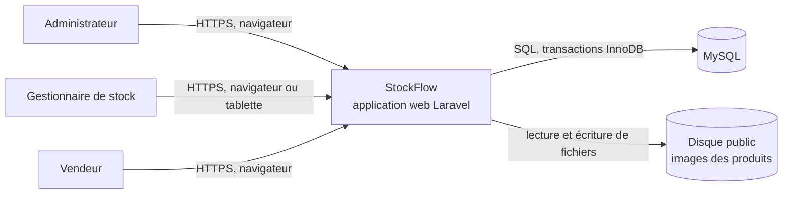
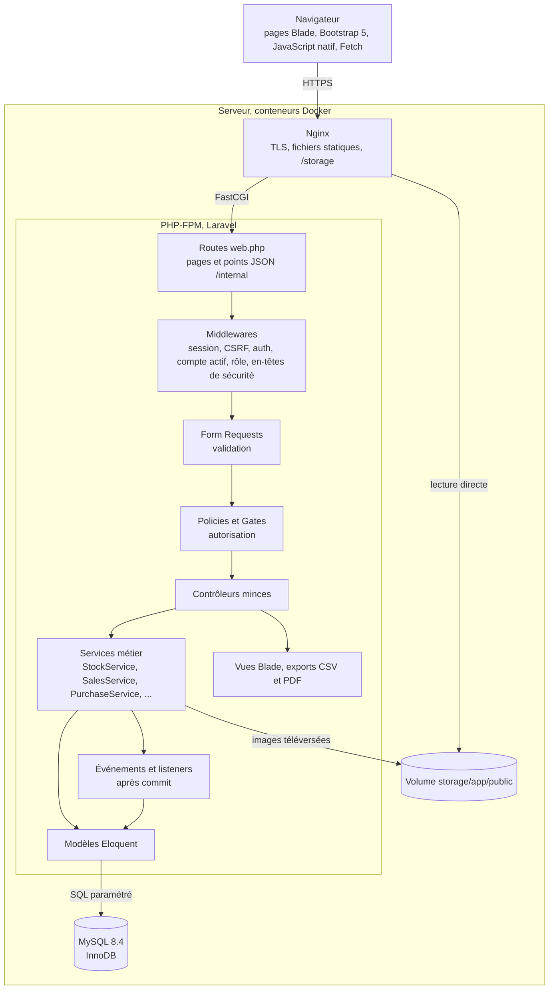
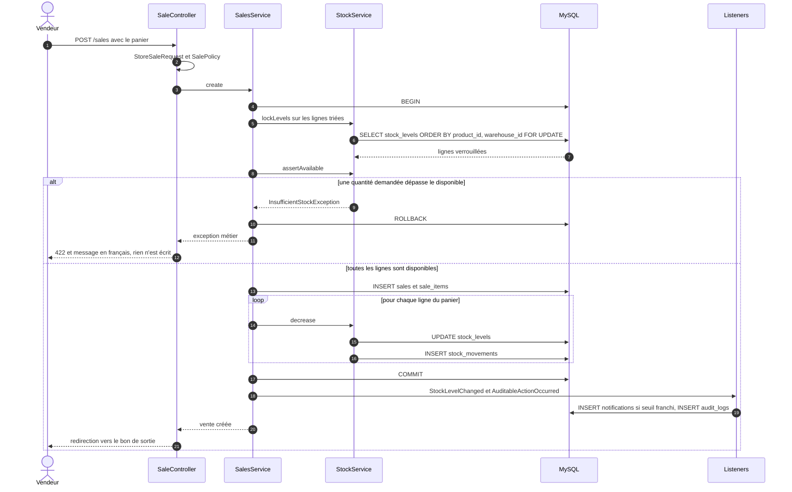
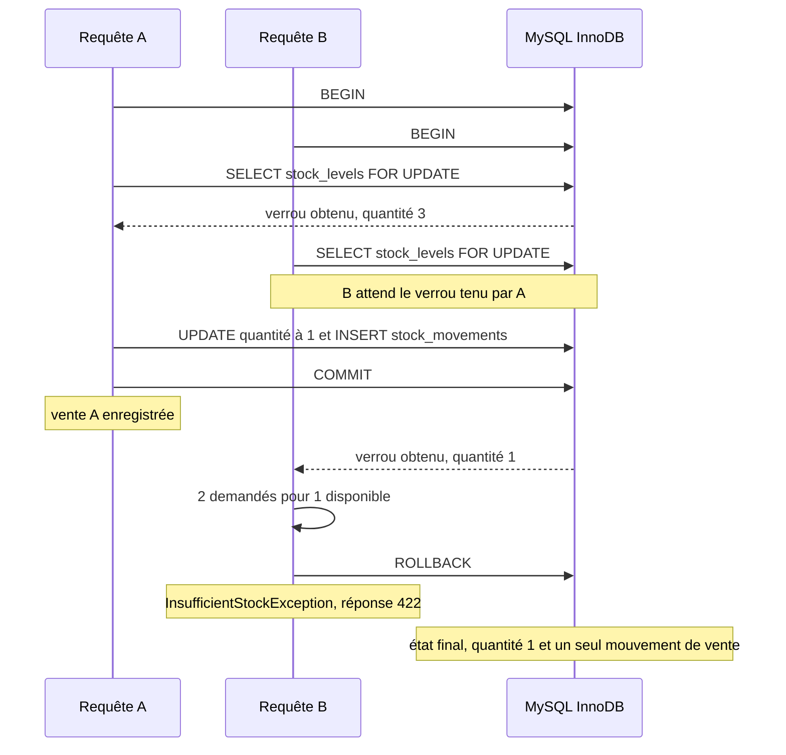
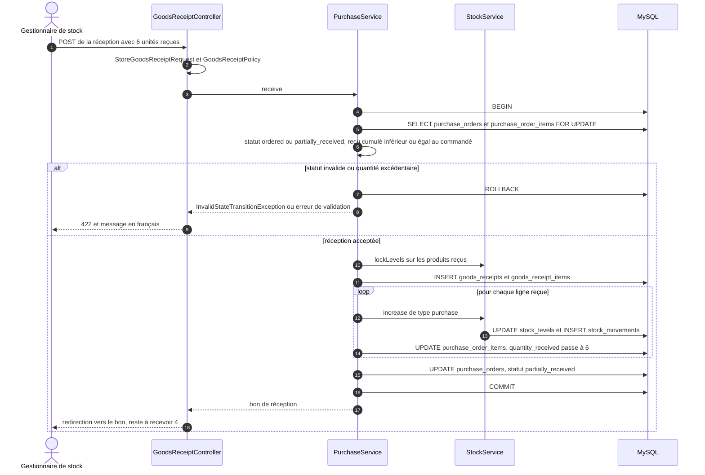
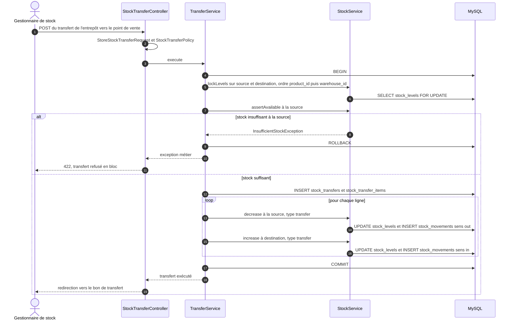
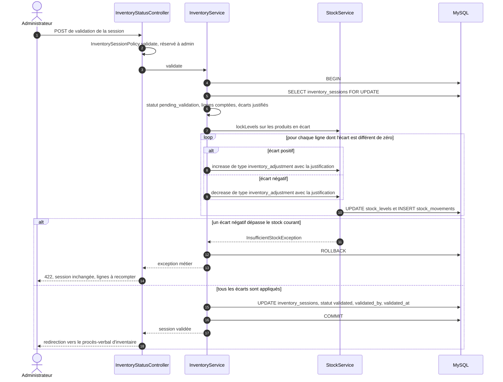

# Architecture du système StockFlow

Ce document décrit l'organisation technique de l'application : couches, services métier, modules, flux critiques, sécurité, arborescence et environnements. Le modèle de données n'est pas repris ici, il est défini dans `database-design.md`. Les choix structurants sont argumentés dans `architecture-decisions.md` (ADR-001 à ADR-016).

Trois décisions dont dépend ce document sont encore au statut « Proposée » : la version de Laravel (D-001), la base de données (D-002) et Docker (D-003). Le texte est écrit pour la proposition du registre : Laravel 13 sur PHP 8.4, MySQL 8.4 et Docker Compose. Si l'utilisateur retient le repli Laravel 12 sur PHP 8.2, l'architecture ne change pas : la structure allégée du projet (un seul fichier `bootstrap/app.php`, pas de `Kernel`) est la même dans les deux versions.

## 1. Vue d'ensemble

StockFlow est un monolithe Laravel. Les pages sont rendues côté serveur par Blade et mises en forme avec Bootstrap 5. Le JavaScript est natif, sans framework : il sert à la recherche instantanée, au panier de vente, à la saisie d'inventaire et au rafraîchissement des indicateurs, par des appels Fetch vers des points JSON internes. Les données sont dans MySQL (InnoDB). Les images des produits sont sur le disque `public` de Laravel.

Le découpage est MVC avec une couche de services. Les contrôleurs ne contiennent pas de règle métier : ils valident, autorisent, délèguent à un service et répondent. Toute écriture de stock passe par `App\Services\StockService`.

Il n'y a ni file d'attente à surveiller, ni WebSocket, ni API publique. Les listeners s'exécutent de façon synchrone après le commit, et le « temps réel » du cahier des charges est obtenu par deux moyens : chaque écran lit le stock courant en base au moment de l'affichage, et le tableau de bord interroge un point JSON à intervalle régulier.

### Schéma de contexte



L'application n'appelle aucun service externe. Bootstrap est installé par npm et compilé par Vite : aucune ressource n'est chargée depuis un CDN, ce qui simplifie la politique CSP et supprime une dépendance à la connexion internationale.

### Schéma des couches



## 2. Couches et responsabilités

### Routes

Toutes les routes sont dans `routes/web.php`, donc dans le groupe de middlewares `web` (session, cookies chiffrés, CSRF). Elles sont organisées en groupes :

| Groupe | Middlewares | Contenu |
| :-- | :-- | :-- |
| Invité | `guest`, `throttle` sur la connexion | formulaire de connexion |
| Public | aucun | mentions légales, politique de confidentialité |
| Authentifié | `auth`, `active` | tableau de bord, catalogue, ventes, changement de mot de passe |
| Par rôle | `auth`, `active`, `role:...` | modules réservés (achats, inventaires, utilisateurs, audit) |
| JSON interne | `auth`, `active`, `throttle`, préfixe `/internal`, nom `internal.` | recherche produit, disponibilité, indicateurs, compteur de notifications, saisie d'inventaire |

Les points JSON appelés par Fetch restent dans `web.php` et ne vont pas dans `routes/api.php`. Les raisons :

- `routes/api.php` est prévu pour des clients sans état, authentifiés par jeton. Il n'est d'ailleurs plus créé par défaut depuis la structure allégée de Laravel : il faut l'installer avec Sanctum. Ici, le seul client est le navigateur de l'utilisateur déjà connecté.
- En restant dans le groupe `web`, ces points réutilisent le cookie de session et la protection CSRF. Il n'y a aucun jeton à émettre, à stocker dans le navigateur ou à révoquer.
- Les mêmes middlewares, Policies et Gates s'appliquent aux pages et aux réponses JSON. Une règle d'accès n'est écrite qu'une fois.
- Aucune API n'est exposée à des tiers, donc pas de CORS à configurer ni de versionnement à maintenir.

Le préfixe retenu est `/internal` plutôt que `/api/internal`, pour qu'on ne prenne pas ces routes pour une API publique sans état. Si une application tierce devait un jour consommer les données, une vraie API avec jetons serait ajoutée dans `routes/api.php`, par une nouvelle décision.

Les requêtes Fetch envoient l'en-tête `X-CSRF-TOKEN` (lu dans une balise `meta`) et `Accept: application/json`. Un petit module `resources/js/lib/http.js` centralise ces appels et le traitement des codes 401, 403, 419 et 422.

### Middlewares

Déclarés dans `bootstrap/app.php` (méthode `withMiddleware`).

| Middleware | Alias | Rôle |
| :-- | :-- | :-- |
| `Authenticate` (Laravel) | `auth` | redirige vers la connexion, ou répond 401 en JSON |
| `App\Http\Middleware\EnsureUserIsActive` | `active` | déconnecte et refuse un compte dont `is_active` est faux, même si sa session est encore valide |
| `App\Http\Middleware\EnsureUserHasRole` | `role` | premier filtre par rôle sur un groupe de routes, par exemple `role:admin,stock_manager` |
| `App\Http\Middleware\SecurityHeaders` | ajouté au groupe `web` | pose les en-têtes de sécurité sur chaque réponse (section 6) |
| `ThrottleRequests` (Laravel) | `throttle` | limite les tentatives de connexion et le débit des points JSON |

Le middleware `role` est un filtre grossier par groupe. Il ne remplace pas la Policy, qui décide au niveau de l'objet (un vendeur ne voit que ses ventes, ne vend que depuis son emplacement).

### Form Requests

Une classe par action d'écriture, dans `app/Http/Requests/<Module>/`. Elle porte les règles de validation, les messages en français et la normalisation des entrées (suppression des espaces, fusion des lignes en double sur un même produit). Sa méthode `authorize()` appelle la Policy correspondante, pour que l'autorisation soit vérifiée avant la validation. Le contrôleur ne lit que `$request->validated()`.

### Policies et Gates

Une Policy par modèle exposé (`ProductPolicy`, `SalePolicy`, `InventorySessionPolicy`, ...), découverte automatiquement par Laravel. Les actions sans modèle passent par des Gates définis dans `AppServiceProvider` : `export-reports`, `view-audit-log`, `record-internal-use`, `adjust-stock`, `view-purchase-prices`. Les rôles viennent de l'enum `App\Enums\Role` (D-005).

Matrice de départ, tirée du cahier des charges et de D-009. Elle sera alignée sur `docs/01-analysis/requirements.md` quand ce document existera.

| Action | admin | stock_manager | sales_agent |
| :-- | :-- | :-- | :-- |
| Gérer les utilisateurs et les emplacements, consulter le journal d'audit | oui | non | non |
| Créer et modifier catégories, produits, fournisseurs | oui | oui | non |
| Consulter le catalogue et les disponibilités | oui | oui | oui |
| Commandes fournisseurs, réceptions, transferts | oui | oui | non |
| Sorties internes, ajustements manuels, historique des mouvements | oui | oui | non |
| Enregistrer une vente | oui | oui | oui, depuis son emplacement d'affectation |
| Consulter les ventes | toutes | toutes | les siennes |
| Annuler une vente | oui | oui | non |
| Ouvrir, saisir et soumettre un inventaire | oui | oui | non |
| Valider un inventaire | oui | non | non |
| Exporter en CSV et PDF | oui | oui | non |

Chaque route, y compris JSON, vérifie l'autorisation côté serveur. Les directives `@can` des vues ne servent qu'à masquer ce qui serait refusé de toute façon.

### Contrôleurs

Contrôleurs de ressources quand le module s'y prête, contrôleurs à action unique pour les transitions d'état (annuler une vente, valider un inventaire). Un contrôleur n'ouvre pas de transaction, n'écrit pas dans `stock_levels` et ne contient pas de condition métier. Il traduit une requête HTTP en appel de service, puis le résultat en redirection, en vue ou en JSON.

### Services

Classes sans état de `app/Services`, injectées par le conteneur. Elles portent les règles métier, ouvrent les transactions et lèvent des exceptions métier. Elles ne connaissent ni la requête HTTP ni la session : l'utilisateur agissant leur est passé en argument, ce qui les rend appelables depuis un test, un seeder ou une commande. Détail en section 3.

### Modèles Eloquent

Un modèle par table de `database-design.md`. Ils portent les relations, les `casts` (enums, dates, entiers), les portées de requête (`active()`, `belowThreshold()`) et les accesseurs de présentation simples. Ils ne portent pas de règle de stock.

Protections placées dans les modèles :

- `StockMovement` et `AuditLog` lèvent une exception sur `update` et `delete` (règle 5 de `CLAUDE.md`).
- `StockLevel` n'expose pas `quantity` à l'affectation de masse et refuse, par un contrôle à l'événement `updating`, toute modification de `quantity` qui ne vient pas de `StockService`.
- `Model::shouldBeStrict()` est activé hors production : chargement paresseux interdit, attribut inconnu refusé.

### Événements et listeners

Deux événements applicatifs, tous deux marqués `ShouldDispatchAfterCommit` : ils ne partent qu'une fois la transaction validée, et sont abandonnés si elle est annulée.

| Événement | Émis par | Listener | Effet |
| :-- | :-- | :-- | :-- |
| `StockLevelChanged` | `StockService`, un par mouvement | `CheckStockThresholds` | appelle `AlertService` pour détecter un franchissement de seuil |
| `AuditableActionOccurred` | les services métier et le trait `Auditable` des modèles du catalogue | `WriteAuditLog` | appelle `AuditService::record()` |
| `Login`, `Logout`, `Failed`, `Lockout` (Laravel) | le système d'authentification | `LogAuthenticationActivity` | journalise connexions, déconnexions et échecs |

Les listeners sont synchrones (`QUEUE_CONNECTION=sync`). Un listener qui échoue ne remet pas en cause l'opération déjà validée : l'erreur est journalisée au niveau `critical`. La trace du stock, elle, est écrite dans la transaction (`stock_movements`), donc jamais perdue.

### Notifications

`App\Notifications\LowStockNotification`, canal `database` (D-013). L'icône de notification de la barre de navigation lit le nombre de notifications non lues par un point JSON interne. La liste des produits en alerte du tableau de bord ne dépend pas des notifications : elle est calculée par requête sur l'état courant du stock.

### Exports

Classes de `app/Exports`. Le CSV est écrit en flux avec `fputcsv` dans une réponse `streamDownload`, lu par curseur pour ne pas charger l'historique en mémoire. Le PDF est rendu par dompdf à partir d'une vue Blade dédiée (D-011). Chaque export émet un événement d'audit avec l'action `exported`.

## 3. Services métier

Les signatures sont indicatives : elles fixent le contrat, pas le détail d'implémentation. Les lignes de document sont des tableaux validés par un Form Request, de forme `array<int, array{product_id: int, quantity: int}>`, avec `unit_cost` en plus pour les achats.

Règles communes à tous les services qui touchent au stock :

- la méthode publique ouvre `DB::transaction($callback, 3)`. Les appels imbriqués à `StockService` s'inscrivent dans cette transaction par point de sauvegarde, et seul le niveau extérieur rejoue l'opération si MySQL signale un interblocage ;
- ordre de verrouillage constant : d'abord la ligne du document (commande, vente, transfert, session) et ses lignes filles par `id` croissant, ensuite les lignes `stock_levels` par `(product_id, warehouse_id)` croissant ;
- toutes les lignes de stock d'une opération sont verrouillées en une fois avant la première écriture ;
- les quantités sont des entiers strictement positifs, les prix sont lus en base et jamais repris du formulaire.

### StockService

Seul point d'écriture de `stock_levels.quantity`.

```php
final class StockService
{
    /** Entrée de stock. Écrit le niveau et un mouvement de sens "in". */
    public function increase(
        int $productId, int $warehouseId, int $quantity,
        MovementType $type, User $user,
        ?string $reason = null, ?Model $source = null, ?string $reference = null,
    ): StockMovement;

    /**
     * Sortie de stock. Écrit le niveau et un mouvement de sens "out".
     * @throws InsufficientStockException si $quantity dépasse le disponible
     */
    public function decrease(
        int $productId, int $warehouseId, int $quantity,
        MovementType $type, User $user,
        ?string $reason = null, ?Model $source = null, ?string $reference = null,
    ): StockMovement;

    /**
     * Verrouillage ordonné. Réservé aux autres services, jamais appelé par un contrôleur.
     * @param  array<int, array{0: int, 1: int}>  $pairs  couples [product_id, warehouse_id]
     * @return Collection<string, StockLevel>  indexée par "product_id:warehouse_id"
     */
    public function lockLevels(array $pairs): Collection;

    /**
     * Contrôle groupé des disponibilités sur des lignes déjà verrouillées.
     * @throws InsufficientStockException  avec la liste complète des manques
     */
    public function assertAvailable(Collection $lockedLevels, array $lines, int $warehouseId): void;

    /** Crée à zéro les lignes stock_levels d'un nouveau produit ou d'un nouvel emplacement. */
    public function initializeLevels(Product|Warehouse $subject): void;

    /** Lecture sans verrou, pour l'affichage. */
    public function available(int $productId, int $warehouseId): int;
    public function totalFor(int $productId): int;
}
```

Règles :

- `increase` et `decrease` s'exécutent dans une transaction, lisent la ligne `stock_levels` avec `lockForUpdate()`, calculent `stock_before` et `stock_after`, mettent à jour la quantité et insèrent exactement une ligne `stock_movements`. Reprendre un verrou déjà posé par `lockLevels` dans la même transaction est sans effet, donc un appel isolé (sortie interne, ajustement) est sûr sans préparation.
- `lockLevels` dédoublonne et trie les couples, crée à zéro les lignes manquantes, puis les charge avec `lockForUpdate()` par une requête ordonnée sur l'index unique `(product_id, warehouse_id)`. Si l'`EXPLAIN` montrait un autre plan d'accès, le verrouillage se ferait ligne à ligne dans le même ordre.
- `decrease` refuse toute sortie supérieure au disponible avec `InsufficientStockException`. La contrainte `CHECK (quantity >= 0)` du schéma reste le dernier filet.
- le motif est exigé quand `MovementType::requiresReason()` est vrai (`internal_use`, `manual_adjustment`, `inventory_adjustment`, annulations), sinon `MissingReasonException`.
- la référence du mouvement est celle du document source. Pour un mouvement manuel, elle est produite par `ReferenceGenerator` (voir le point ouvert plus bas).
- après chaque mouvement, le service émet `StockLevelChanged`, livré après le commit, qui ne sert qu'aux alertes de seuil.
- l'audit d'une opération de stock n'est pas confié à un listener : le service métier appelle `AuditService::record()` dans la transaction (D-019).

`InsufficientStockException` porte, pour chaque ligne en défaut, le produit, l'emplacement, la quantité demandée et la quantité disponible. Son message utilisateur est en français, par exemple « Stock insuffisant pour Cartouche HP 305 noire : 2 disponibles, 5 demandés ».

### PurchaseService

```php
final class PurchaseService
{
    public function createDraft(array $data, User $user): PurchaseOrder;
    public function updateDraft(PurchaseOrder $order, array $data, User $user): PurchaseOrder;
    public function confirm(PurchaseOrder $order, User $user): PurchaseOrder;
    public function cancel(PurchaseOrder $order, User $user, string $reason): PurchaseOrder;

    /** Réception totale ou partielle d'une commande. */
    public function receive(PurchaseOrder $order, array $lines, array $receiptData, User $user): GoodsReceipt;

    /** Entrée directe sans commande préalable (D-016). */
    public function receiveDirect(Supplier $supplier, Warehouse $warehouse, array $lines, array $receiptData, User $user): GoodsReceipt;
}
```

Règles : Une commande partiellement reçue dont le reliquat ne viendra pas se solde par `close(PurchaseOrder $order, User $user, string $reason)` (statut `closed`, motif dans `closure_reason`). Un bon de réception enregistré ne s'annule pas : l'erreur se corrige par un ajustement manuel justifié (D-018).

- transitions : `draft` vers `ordered` (`confirm`, qui renseigne `ordered_at` et calcule `expected_at` avec `lead_time_days`), `ordered` vers `partially_received` puis `received`, et `draft` ou `ordered` vers `cancelled` tant que rien n'a été reçu. Toute autre transition lève `InvalidStateTransitionException`.
- une commande n'est modifiable qu'à l'état `draft`.
- `receive` verrouille la commande et ses lignes, refuse une quantité qui ferait dépasser `quantity_ordered`, crée le bon de réception, appelle `StockService::increase` (type `purchase`) pour chaque ligne, cumule `quantity_received` et recalcule le statut de la commande. Un excédent livré passe par une réception directe.
- la réception ne modifie pas `products.purchase_price` : la valorisation reste au prix de la fiche, comme le prévoit `database-design.md`.

### SalesService

```php
final class SalesService
{
    /** @throws InsufficientStockException */
    public function create(Warehouse $warehouse, array $lines, ?string $customerName, User $user): Sale;

    /** @throws InvalidStateTransitionException si la vente est déjà annulée */
    public function cancel(Sale $sale, User $user, string $reason): Sale;
}
```

Règles :

- l'emplacement doit être de type `store` et actif. Pour un vendeur, c'est son emplacement d'affectation (vérifié par `SalePolicy`, D-009).
- chaque produit doit être actif. Le prix unitaire est `products.selling_price` lu dans la transaction, `line_total` et `total_amount` sont calculés par le service.
- la vente, ses lignes et ses mouvements (type `sale`) sont écrits ensemble ou pas du tout. Il n'y a pas de vente partielle : un seul manque refuse tout le panier.
- `cancel` verrouille la vente, vérifie le statut `completed`, renseigne `cancelled_by`, `cancelled_at` et `cancel_reason`, puis réintègre chaque ligne par `StockService::increase` (type `sale_cancellation`).
- le formulaire de vente porte un jeton à usage unique, consommé avec `Cache::add()` : une double soumission du même panier ne crée pas deux ventes.

### TransferService

```php
final class TransferService
{
    /** @throws InsufficientStockException */
    public function execute(Warehouse $from, Warehouse $to, array $lines, ?string $notes, User $user): StockTransfer;

    /** @throws InsufficientStockException si la destination n'a plus les quantités à rendre */
    public function cancel(StockTransfer $transfer, User $user, string $reason): StockTransfer;
}
```

Règles : source et destination différentes et actives ; les lignes de stock des deux emplacements sont verrouillées ensemble dans l'ordre commun ; chaque ligne produit deux mouvements de type `transfer` et de même référence, une sortie à la source puis une entrée à destination (D-006). L'annulation écrit les deux mouvements inverses et échoue si la marchandise a déjà quitté la destination.

### InventoryService

```php
final class InventoryService
{
    /** Ouvre la session et crée une ligne à compter par produit du périmètre. */
    public function open(Warehouse $warehouse, ?Category $category, User $user, ?string $notes = null): InventorySession;

    /** Enregistre les quantités comptées, en une ou plusieurs fois. */
    public function recordCounts(InventorySession $session, array $counts, User $user): InventorySession;

    /** Clôt le comptage : in_progress vers pending_validation. */
    public function submit(InventorySession $session, User $user): InventorySession;

    /** Renvoie la session en comptage : pending_validation vers in_progress. */
    public function sendBack(InventorySession $session, User $admin, string $reason): InventorySession;

    /** Applique les écarts au stock : pending_validation vers validated. */
    public function validate(InventorySession $session, User $admin): InventorySession;

    public function cancel(InventorySession $session, User $user, string $reason): InventorySession;
}
```

Règles :

- `open` verrouille la ligne `warehouses`, vérifie qu'aucune session n'est ouverte sur l'emplacement, puis crée une ligne `inventory_items` par produit du périmètre, sans quantité théorique ni quantité comptée.
- `recordCounts` n'est possible qu'à l'état `in_progress`. Pour chaque ligne saisie, il lit le stock courant de l'emplacement sous verrou, l'enregistre dans `theoretical_quantity` avec `counted_at` et `counted_by`, puis calcule `variance = counted_quantity - theoretical_quantity`. Il n'écrit rien dans le stock. Recompter une ligne relève à nouveau le théorique.
- `submit` exige que toutes les lignes soient comptées et que chaque écart non nul ait une justification.
- `validate` est réservé à l'administrateur (D-009). Il verrouille la session, verrouille les lignes de stock des produits en écart, puis applique chaque écart au stock courant : `increase` si l'écart est positif, `decrease` s'il est négatif, avec le type `inventory_adjustment` et la justification comme motif. Les mouvements restent autorisés pendant le comptage (D-007).
- si un écart négatif dépasse le stock courant, `decrease` lève `InsufficientStockException`, toute la validation est annulée et la session reste en attente. L'administrateur utilise alors `sendBack` pour faire recompter les lignes concernées.
- `cancel` n'est possible qu'avant la validation.

Le théorique est relevé à la saisie de chaque ligne et non à l'ouverture (D-007 révisée, option C de l'ADR-007). Une vente faite avant le comptage d'un produit est déjà dans le théorique, une vente faite après est préservée parce que l'écart s'applique au stock courant. La seule fenêtre d'erreur restante est le délai entre le comptage physique et sa saisie, d'où la saisie sur tablette au fil du comptage. La transition `sendBack` enregistre son motif dans `inventory_sessions.review_comment`.

### AuditService

```php
final class AuditService
{
    public function record(
        AuditAction $action, ?Model $subject = null, ?string $description = null,
        array $oldValues = [], array $newValues = [],
        ?int $userId = null, ?string $ipAddress = null, ?string $userAgent = null,
    ): AuditLog;
}
```

Règles : `old_values` et `new_values` ne contiennent que les champs modifiés ; `password` et `remember_token` sont toujours retirés ; l'adresse IP et l'agent utilisateur sont capturés au moment où l'événement est émis, pas au moment où il est traité. Les modèles du catalogue (`Product`, `Category`, `Supplier`, `Warehouse`, `User`) utilisent le trait `App\Models\Concerns\Auditable`, qui émet `AuditableActionOccurred` sur création, modification, suppression et restauration. Pour les opérations de stock (vente, réception, transfert, ajustement, validation d'inventaire, annulations), le service métier appelle `record()` directement dans la transaction : l'opération et sa trace sont validées ensemble ou pas du tout (D-019). L'événement après commit reste utilisé pour le catalogue, les connexions et les exports.

### AlertService

```php
final class AlertService
{
    /** Appelé par le listener CheckStockThresholds après chaque mouvement. */
    public function evaluate(StockMovement $movement): void;

    /** Produits sous leur seuil, pour le tableau de bord et les états. */
    public function productsBelowThreshold(?Warehouse $warehouse = null): Collection;
}
```

Règles (D-008, D-013) : le seuil du produit (`alert_threshold`) se compare au stock total, le seuil d'emplacement (`reorder_point`), quand il est renseigné, au stock de cet emplacement. Une notification n'est créée qu'au franchissement, c'est-à-dire quand la quantité passe d'une valeur supérieure au seuil à une valeur inférieure ou égale. Le service ne crée pas de nouvelle notification tant qu'une notification non lue existe pour le même produit et la même portée. Destinataires : les administrateurs et les gestionnaires de stock actifs.

### ReferenceGenerator

```php
final class ReferenceGenerator
{
    /** Exemple : next(DocumentType::Sale, $date) rend "BS-2026-000128". À appeler dans une transaction. */
    public function next(DocumentType $type, CarbonInterface $date): string;
}
```

Préfixes : `CF` commande fournisseur, `BR` bon de réception, `BS` bon de sortie, `TR` transfert, `INV` inventaire, `BM` mouvement manuel. Le numéro vient de la table `document_sequences` : le générateur verrouille la ligne `(prefix, year)` avec `lockForUpdate()`, l'incrémente et rend la référence, le tout dans la transaction de l'opération (D-017). La référence est donc connue avant l'insertion du document et de ses mouvements, et aucune ligne de `stock_movements` n'est retouchée. Le compteur est verrouillé avant les lignes de stock, toujours dans cet ordre.

`SkuGenerator` utilise le même mécanisme avec le code de la catégorie (`categories.code`) comme préfixe et l'année 0.

### SkuGenerator et BarcodeGenerator

```php
final class SkuGenerator
{
    /** Exemple : "IMP-000042" pour le produit 42 de la catégorie Imprimantes. */
    public function generate(Category $category, int $productId): string;
}

final class BarcodeGenerator
{
    /** EAN-13 interne : "200" + identifiant du produit sur 9 chiffres + clé de contrôle. */
    public function generateEan13(int $productId): string;
    public function checkDigit(string $twelveDigits): int;
    public function isValidEan13(string $code): bool;
    /** Rendu SVG par picqer/php-barcode-generator. */
    public function toSvg(string $code): string;
}
```

Règles : le SKU est formé d'un préfixe de trois lettres tiré du nom de la catégorie (majuscules, sans accent) et de l'identifiant du produit sur six chiffres, ce qui le rend unique quel que soit le préfixe. Le code-barres interne commence par 200, plage réservée à l'usage en magasin. Clé de contrôle EAN-13 : somme des chiffres de rang impair, plus trois fois la somme des chiffres de rang pair, sur les douze premiers chiffres comptés depuis la gauche ; la clé est `(10 - somme mod 10) mod 10`. Un code du fabricant saisi à la main est accepté s'il passe `isValidEan13`. Le SVG produit est le seul contenu affiché avec `{!! !!}`.

Un `ProductService` coordonne la création d'un produit : insertion, génération du SKU et du code-barres, enregistrement de l'image, appel à `StockService::initializeLevels`. Un `DashboardService` regroupe les requêtes de lecture des indicateurs (valeur du stock, références actives, produits en alerte, mouvements du jour).

## 4. Modules et correspondances

Les vues sont dans `resources/views/<dossier>`. « Interne » désigne un contrôleur JSON de `App\Http\Controllers\Internal`.

| Module | Contrôleurs | Services | Modèles | Policies ou Gates | Vues |
| :-- | :-- | :-- | :-- | :-- | :-- |
| Auth | `Auth\LoginController`, `Auth\PasswordController` | `AuditService` (via listener) | `User` | middlewares `guest`, `auth`, `active` | `auth/` |
| Dashboard | `DashboardController`, interne `DashboardKpiController` | `DashboardService`, `AlertService` | `StockLevel`, `StockMovement`, `Product` | filtrage par rôle dans le service, Gate `view-purchase-prices` | `dashboard/` |
| Category | `CategoryController` | aucun (CRUD simple) | `Category` | `CategoryPolicy` | `categories/` |
| Product | `ProductController`, interne `ProductSearchController` | `ProductService`, `SkuGenerator`, `BarcodeGenerator` | `Product` | `ProductPolicy` | `products/` |
| Supplier | `SupplierController` | aucun (CRUD simple) | `Supplier` | `SupplierPolicy` | `suppliers/` |
| Warehouse et Stock | `WarehouseController`, `StockLevelController`, interne `StockAvailabilityController` | `StockService` (lecture, `initializeLevels`) | `Warehouse`, `StockLevel` | `WarehousePolicy`, `StockLevelPolicy` | `warehouses/`, `stock/` |
| Movement | `StockMovementController` (historique), `InternalUseController`, `StockAdjustmentController` | `StockService` | `StockMovement` | `StockMovementPolicy`, Gates `record-internal-use`, `adjust-stock` | `movements/` |
| PurchaseOrder | `PurchaseOrderController`, `PurchaseOrderStatusController` | `PurchaseService` | `PurchaseOrder`, `PurchaseOrderItem` | `PurchaseOrderPolicy` | `purchase-orders/` |
| GoodsReceipt | `GoodsReceiptController` | `PurchaseService`, `StockService` | `GoodsReceipt`, `GoodsReceiptItem` | `GoodsReceiptPolicy` | `goods-receipts/` |
| Transfer | `StockTransferController`, `StockTransferCancellationController` | `TransferService`, `StockService` | `StockTransfer`, `StockTransferItem` | `StockTransferPolicy` | `transfers/` |
| Sale | `SaleController`, `SaleCancellationController` | `SalesService`, `StockService` | `Sale`, `SaleItem` | `SalePolicy` | `sales/` |
| Inventory | `InventorySessionController`, `InventoryStatusController`, interne `InventoryCountController` | `InventoryService`, `StockService` | `InventorySession`, `InventoryItem` | `InventorySessionPolicy` | `inventories/` |
| Alert et Notification | `NotificationController`, interne `NotificationCountController` | `AlertService` | notifications Laravel (`DatabaseNotification`) | accès limité aux notifications de l'utilisateur connecté | `notifications/` |
| Report et Export | `ReportController`, `ExportController` | classes de `app/Exports`, `AuditService` | `StockLevel`, `StockMovement` | Gate `export-reports` | `reports/`, `exports/` (gabarits PDF) |
| User | `UserController` | aucun (règles dans la Policy et le Form Request) | `User` | `UserPolicy` | `users/` |
| AuditLog | `AuditLogController` (lecture seule) | `AuditService` | `AuditLog` | Gate `view-audit-log` | `audit-logs/` |

Les pages de mentions légales et de politique de confidentialité sont servies par `Route::view` depuis `resources/views/legal/`, sans contrôleur.

`UserPolicy` interdit à un administrateur de désactiver son propre compte ou de retirer le rôle du dernier administrateur actif.

## 5. Diagrammes de séquence des opérations critiques

### a. Vente avec vérification de disponibilité et verrouillage



### b. Deux ventes concurrentes sur le même produit

Situation de départ : 3 unités en stock au point de vente. Les requêtes A et B demandent chacune 2 unités au même instant.



La seconde requête lit la quantité après le commit de la première parce que `FOR UPDATE` fait une lecture courante et non une lecture de l'instantané de la transaction. C'est ce comportement que prouve le test de `tests/Concurrency` avec deux processus réels (D-014).

### c. Réception partielle d'une commande fournisseur

Exemple : commande de 10 unités, première livraison de 6.



La livraison du solde passe par la même séquence : un second bon de réception est créé et la commande passe à `received` quand toutes les lignes sont soldées.

### d. Transfert entre emplacements



### e. Validation d'un inventaire avec régularisation des écarts



## 6. Sécurité

### Authentification et sessions

- Authentification par session avec le garde `web` de Laravel, écrite à la main (D-010) : connexion, déconnexion, changement de mot de passe. Pas d'inscription libre, les comptes sont créés par l'administrateur.
- L'identifiant de session est régénéré à la connexion (`$request->session()->regenerate()`). À la déconnexion, la session est invalidée et le jeton CSRF régénéré.
- Les tentatives de connexion sont limitées par `RateLimiter`, sur la clé adresse électronique et adresse IP : cinq essais par minute, puis blocage temporaire. Chaque échec et chaque blocage sont journalisés dans `audit_logs`.
- Le message d'échec est le même que l'adresse existe ou non. Un compte désactivé est refusé à la connexion, puis à chaque requête par le middleware `active`.
- Mots de passe hachés en Bcrypt (coût 12, valeur de `BCRYPT_ROUNDS`). Règle unique : 12 caractères au minimum, sans obligation de majuscule, de chiffre ou de symbole. La longueur est plafonnée à 72 caractères, limite au-delà de laquelle Bcrypt ignore la saisie.
- L'option « se souvenir de moi » n'est pas proposée : les postes de la boutique sont partagés.
- Sessions stockées en base (`SESSION_DRIVER=database`). Cookies `HttpOnly`, `SameSite=Lax`, et `Secure` en production.

### Protection des requêtes

- CSRF : jeton vérifié sur toute requête qui modifie un état, formulaires (`@csrf`) comme appels Fetch (`X-CSRF-TOKEN`). Aucune route n'est exclue de la vérification.
- Autorisation côté serveur sur chaque route, pages et JSON, par middleware puis Policy ou Gate. Les identifiants reçus dans l'URL sont résolus par liaison de modèle, puis soumis à la Policy, pour éviter l'accès à l'objet d'un autre utilisateur.
- Validation de toute entrée par Form Request. Les champs acceptés sont listés, le reste est ignoré. Les modèles déclarent `$fillable`.
- Requêtes SQL paramétrées par Eloquent et le Query Builder. Les colonnes de tri et de filtre venant de l'URL sont comparées à une liste blanche avant d'entrer dans une requête.
- Échappement Blade `{{ }}` partout. `{!! !!}` est limité au SVG de code-barres produit par le serveur.
- Les cellules des exports CSV qui commencent par `=`, `+`, `-` ou `@` sont préfixées par une apostrophe, pour qu'un tableur ne les interprète pas comme des formules.

### En-têtes de sécurité

Posés par `App\Http\Middleware\SecurityHeaders` sur toutes les réponses.

| En-tête | Valeur | Remarque |
| :-- | :-- | :-- |
| `Content-Security-Policy` | `default-src 'self'; script-src 'self' 'nonce-...'; style-src 'self'; img-src 'self' data:; font-src 'self'; object-src 'none'; base-uri 'self'; form-action 'self'; frame-ancestors 'none'` | nonce fourni par `Vite::useCspNonce()` |
| `X-Content-Type-Options` | `nosniff` | |
| `X-Frame-Options` | `DENY` | doublon de `frame-ancestors` pour les anciens navigateurs |
| `Referrer-Policy` | `strict-origin-when-cross-origin` | |
| `Permissions-Policy` | `camera=(), microphone=(), geolocation=(), payment=()` | |
| `Strict-Transport-Security` | `max-age=31536000; includeSubDomains` | en production seulement, quand HTTPS est en place |

Conséquence de `style-src 'self'` : pas d'attribut `style` dans les vues. Les barres du tableau de bord (D-015) utilisent l'élément `<progress>` ou des classes CSS, pas une largeur écrite en ligne. Les scripts sont des fichiers compilés par Vite ; tout script en ligne porte le nonce. En développement, la politique est assouplie pour le serveur Vite.

### Téléversement d'images

- Types acceptés : jpeg, png, webp, contrôlés par les règles `image` et `mimes`, qui lisent le contenu du fichier et pas seulement son extension. Taille maximale 2 Mo. Le SVG est refusé.
- Le nom d'origine est abandonné, le fichier est enregistré sous un nom aléatoire (`hashName()`) dans `products/` sur le disque `public`. Seul le chemin relatif est stocké dans `products.image_path`.
- L'image est réencodée et réduite avec GD avant enregistrement, ce qui supprime les métadonnées et tout contenu étranger au format.
- Nginx sert `/storage` comme fichiers statiques. Seul `public/index.php` est transmis à PHP-FPM : un fichier déposé dans `storage` ne peut pas être exécuté.

### Secrets et configuration

- Aucun secret dans Git. `.env` est ignoré, `.env.example` documente chaque variable sans valeur sensible.
- `APP_KEY` et les mots de passe de base sont propres à chaque environnement. En production, `APP_DEBUG=false`.
- Le compte MySQL de l'application n'a de droits que sur sa base. Le compte `root` de MySQL ne sert pas à l'application.
- Les journaux ne contiennent ni mot de passe ni jeton de session.

### Données personnelles et pages légales

L'application traite des données personnelles au sens de la loi ivoirienne n° 2013-450 relative à la protection des données à caractère personnel : nom et adresse électronique des utilisateurs, traces de leur activité (journal d'audit, adresse IP, agent utilisateur), noms de clients saisis sur les ventes, interlocuteurs des fournisseurs.

Deux pages publiques, liées depuis le pied de page et la page de connexion :

- mentions légales : identité de l'entreprise exploitante, contact, hébergeur ;
- politique de confidentialité : données collectées, finalités (gestion du stock, traçabilité des opérations, sécurité des accès), durées de conservation, destinataires, droits d'accès, de rectification et d'opposition et moyen de les exercer.

Principes appliqués dans la conception : `customer_name` est facultatif et aucune autre donnée de client n'est collectée ; les comptes sont désactivés ou supprimés logiquement pour que l'historique garde son auteur ; le journal d'audit n'est lisible que par l'administrateur. Les formalités préalables auprès de l'autorité de protection (ARTCI) et les durées de conservation sont à valider par l'entreprise, responsable du traitement, avant la mise en production.

## 7. Gestion des erreurs

### Exceptions métier

Elles héritent toutes de `App\Exceptions\BusinessException`, classe abstraite qui porte un message utilisateur en français, un code court stable et un statut HTTP.

| Exception | Cas | Statut HTTP |
| :-- | :-- | :-- |
| `InsufficientStockException` | quantité demandée supérieure au disponible | 422 |
| `InvalidStateTransitionException` | transition interdite : vente déjà annulée, commande déjà reçue, session déjà validée | 409 |
| `MissingReasonException` | motif absent sur un mouvement qui l'exige | 422 |
| `InventoryAlreadyOpenException` | une session est déjà ouverte sur l'emplacement | 409 |
| `ImmutableRecordException` | tentative de modifier ou supprimer un mouvement ou une ligne d'audit | 500, anomalie de programmation |

Les erreurs de saisie ne sont pas des exceptions métier : elles sont traitées par les Form Requests et rendues par le mécanisme de validation de Laravel.

### Rendu

Le rendu est configuré une seule fois dans `bootstrap/app.php` (méthode `withExceptions`).

| Situation | Réponse HTML | Réponse JSON (`Accept: application/json`) |
| :-- | :-- | :-- |
| Validation | retour au formulaire, saisie conservée, erreurs sous les champs | 422, `{"message": "...", "errors": {"champ": ["..."]}}` |
| Exception métier | retour à la page précédente, saisie conservée, message d'alerte | statut de l'exception, `{"message": "...", "code": "insufficient_stock", "details": [...]}` |
| Non authentifié | redirection vers la connexion | 401 |
| Non autorisé | page 403 en français | 403 |
| Introuvable | page 404 en français | 404 |
| Session expirée (CSRF) | page 419 qui invite à recharger | 419, le module Fetch propose de recharger la page |
| Trop de requêtes | page 429 | 429 |
| Erreur inattendue | page 500 sans détail technique | 500, message générique |

### Messages et journalisation

- Tous les messages vus par l'utilisateur sont en français et viennent de `lang/fr`. Aucun message technique, aucun nom de table, aucune trace d'exécution n'atteint l'interface en production.
- Les exceptions métier sont des refus prévus : elles sont journalisées au niveau `info` avec l'utilisateur et le contexte, pas signalées comme des erreurs.
- Les erreurs inattendues sont journalisées au niveau `error` avec leur trace. Les échecs de listeners après commit et les interblocages qui épuisent les trois tentatives le sont au niveau `critical`.
- Journaux en fichiers quotidiens en développement, sur la sortie d'erreur du conteneur en production.
- Le journal technique et le journal d'audit sont deux choses distinctes : le premier sert au diagnostic, le second (`audit_logs`) est une donnée métier consultable dans l'application.

## 8. Arborescence du projet

Structure allégée de Laravel : les middlewares, le routage et le rendu des exceptions se configurent dans `bootstrap/app.php`. Il n'y a ni `app/Http/Kernel.php` ni `app/Console/Kernel.php`. Les commandes Artisan de `app/Console/Commands` sont découvertes automatiquement, comme les listeners et les Policies.

```text
stackflow/
├── app/
│   ├── Console/Commands/
│   │   └── VerifyStockIntegrity.php       # stock:verify, rapproche niveaux et mouvements (lecture seule)
│   ├── Enums/
│   │   ├── Role.php                       # admin, stock_manager, sales_agent
│   │   ├── WarehouseType.php
│   │   ├── MovementType.php               # porte requiresReason()
│   │   ├── MovementDirection.php
│   │   ├── PurchaseOrderStatus.php
│   │   ├── SaleStatus.php
│   │   ├── TransferStatus.php
│   │   ├── InventoryStatus.php
│   │   ├── AuditAction.php
│   │   └── DocumentType.php               # préfixes CF, BR, BS, TR, INV, BM
│   ├── Events/
│   │   ├── StockLevelChanged.php
│   │   └── AuditableActionOccurred.php
│   ├── Exceptions/
│   │   ├── BusinessException.php
│   │   ├── InsufficientStockException.php
│   │   ├── InvalidStateTransitionException.php
│   │   ├── MissingReasonException.php
│   │   ├── InventoryAlreadyOpenException.php
│   │   └── ImmutableRecordException.php
│   ├── Exports/
│   │   ├── CsvWriter.php                  # fputcsv en flux, BOM UTF-8, séparateur point-virgule
│   │   ├── StockStateExport.php
│   │   └── MovementHistoryExport.php
│   ├── Http/
│   │   ├── Controllers/
│   │   │   ├── Auth/                      # LoginController, PasswordController
│   │   │   ├── Internal/                  # contrôleurs JSON appelés par Fetch
│   │   │   └── ...                        # un contrôleur par ligne du tableau de la section 4
│   │   ├── Middleware/
│   │   │   ├── EnsureUserIsActive.php
│   │   │   ├── EnsureUserHasRole.php
│   │   │   └── SecurityHeaders.php
│   │   └── Requests/                      # un sous-dossier par module
│   ├── Listeners/
│   │   ├── CheckStockThresholds.php
│   │   ├── WriteAuditLog.php
│   │   └── LogAuthenticationActivity.php
│   ├── Models/
│   │   ├── Concerns/Auditable.php
│   │   └── ...                            # un modèle par table de database-design.md
│   ├── Notifications/
│   │   └── LowStockNotification.php
│   ├── Policies/                          # une Policy par modèle exposé
│   ├── Providers/
│   │   └── AppServiceProvider.php         # Gates, règle de mot de passe, limiteurs, mode strict, nonce CSP
│   ├── Services/
│   │   ├── StockService.php
│   │   ├── PurchaseService.php
│   │   ├── SalesService.php
│   │   ├── TransferService.php
│   │   ├── InventoryService.php
│   │   ├── AuditService.php
│   │   ├── AlertService.php
│   │   ├── ProductService.php
│   │   ├── DashboardService.php
│   │   ├── ReferenceGenerator.php
│   │   ├── SkuGenerator.php
│   │   └── BarcodeGenerator.php
│   └── Support/
│       └── Format.php                     # montants "1 200 000 F CFA", dates JJ/MM/AAAA
├── bootstrap/
│   ├── app.php                            # routage, middlewares, rendu des exceptions
│   └── providers.php
├── config/                                # fichiers Laravel, plus stockflow.php (plafond PDF, rafraîchissement)
├── database/
│   ├── factories/
│   ├── migrations/
│   └── seeders/
│       ├── DatabaseSeeder.php
│       ├── ReferenceDataSeeder.php        # emplacements ENT et PDV, premier administrateur
│       └── DemoSeeder.php                 # jeu de démonstration, passe par les services
├── docker/
│   ├── php/                               # Dockerfile, php.ini
│   ├── nginx/                             # default.conf
│   └── mysql/init/                        # création de la base de test
├── docs/
│   ├── 01-analysis/
│   ├── 02-architecture/                   # ce document, database-design.md, architecture-decisions.md
│   ├── 03-design/
│   ├── 04-database/
│   ├── 05-development/
│   ├── 06-testing/
│   ├── 07-deployment/
│   └── 08-user-guides/
├── lang/
│   └── fr/                                # auth.php, validation.php, pagination.php, passwords.php, messages.php
├── public/
│   ├── index.php
│   └── storage                            # lien symbolique créé par artisan storage:link
├── resources/
│   ├── css/app.css
│   ├── js/
│   │   ├── app.js
│   │   ├── lib/http.js                    # Fetch, jeton CSRF, traitement des erreurs
│   │   └── modules/                       # product-search.js, sale-cart.js, inventory-count.js, dashboard.js
│   └── views/
│       ├── layouts/                       # app.blade.php, guest.blade.php
│       ├── components/                    # alertes, pagination, champs de formulaire, badge de stock
│       ├── errors/                        # 403, 404, 419, 429, 500
│       ├── auth/  dashboard/  categories/  products/  suppliers/
│       ├── warehouses/  stock/  movements/
│       ├── purchase-orders/  goods-receipts/  transfers/  sales/  inventories/
│       ├── notifications/  reports/  exports/  users/  audit-logs/
│       └── legal/                         # mentions légales, politique de confidentialité
├── routes/
│   ├── web.php                            # pages et groupe /internal
│   └── console.php
├── scripts/                               # sauvegarde, restauration, déploiement (rédigés par le DevOps)
├── storage/
│   └── app/public/products/               # images téléversées, volume persistant en production
├── tests/
│   ├── Unit/                              # générateurs, enums, calculs, sans base
│   ├── Feature/                           # un sous-dossier par module, permissions comprises
│   ├── Concurrency/                       # processus réels contre MySQL
│   │   └── workers/                       # scripts lancés en parallèle par les tests
│   └── TestCase.php
├── .env.example
├── compose.yaml                           # développement
├── compose.prod.yaml                      # production
├── composer.json
├── package.json
├── phpunit.xml                            # suites Unit, Feature, Concurrency
├── pint.json
└── vite.config.js
```

Il n'y a pas de `routes/api.php`, pas de dossier `app/Repositories` (Eloquent suffit à cette échelle) ni de dossier `app/Jobs` (aucun traitement différé).

## 9. Conventions de développement

### Nommage

| Élément | Convention | Exemple |
| :-- | :-- | :-- |
| Table | anglais, pluriel, `snake_case` | `stock_movements` |
| Modèle | anglais, singulier, `PascalCase` | `StockMovement` |
| Contrôleur | nom de la ressource au singulier + `Controller` | `SaleController`, `SaleCancellationController` |
| Form Request | verbe + ressource + `Request` | `StoreSaleRequest`, `CancelSaleRequest` |
| Service | domaine + `Service` | `SalesService` |
| Policy | modèle + `Policy`, méthodes Laravel plus actions métier | `SalePolicy::cancel` |
| Enum | singulier, cas en `PascalCase`, valeur en `snake_case` | `Role::StockManager = 'stock_manager'` |
| Événement | fait accompli, au passé | `StockLevelChanged` |
| Listener | action à l'infinitif | `CheckStockThresholds` |
| Route | URL en `kebab-case` au pluriel, nom en `ressource.action` | `/purchase-orders`, `purchase-orders.show` |
| Vue | dossier du module, fichier de l'action | `sales/create.blade.php` |
| Test | phrase en anglais qui énonce la règle | `test_sale_is_refused_when_stock_is_insufficient` |
| Module JavaScript | `kebab-case`, un fichier par écran interactif | `sale-cart.js` |

### Structure d'un contrôleur type

```php
final class SaleController extends Controller
{
    public function store(StoreSaleRequest $request, SalesService $sales): RedirectResponse
    {
        // Autorisation : StoreSaleRequest::authorize() appelle SalePolicy::create.
        // Validation : StoreSaleRequest::rules().
        $sale = $sales->create(
            warehouse: $request->warehouse(),
            lines: $request->validated('lines'),
            customerName: $request->validated('customer_name'),
            user: $request->user(),
        );

        return redirect()
            ->route('sales.show', $sale)
            ->with('success', __('messages.sale.created', ['reference' => $sale->reference]));
    }
}
```

Pas de `try/catch` autour de l'appel : les exceptions métier sont rendues par la configuration de `bootstrap/app.php`. Pas de requête Eloquent d'écriture dans le contrôleur.

### Structure d'un service type

```php
final class SalesService
{
    public function __construct(
        private readonly StockService $stock,
        private readonly ReferenceGenerator $references,
    ) {}

    public function create(Warehouse $warehouse, array $lines, ?string $customerName, User $user): Sale
    {
        return DB::transaction(function () use ($warehouse, $lines, $customerName, $user): Sale {
            // 1. Verrouiller toutes les lignes de stock, dans l'ordre.
            // 2. Vérifier les règles métier et les disponibilités.
            // 3. Écrire le document et ses lignes.
            // 4. Appeler StockService pour chaque ligne.
            // 5. Écrire la ligne d'audit de l'opération.
            // 6. Émettre les événements d'alerte (livrés après le commit).
        }, attempts: 3);
    }
}
```

Un service ne lit pas `request()`, `auth()` ni `session()`. Il reçoit des modèles et des valeurs validées, rend un modèle, et signale un refus par une exception métier.

### Traduction

`APP_LOCALE=fr`. Les textes d'interface sont écrits en français dans les vues. Les messages produits par le code (validation, exceptions, messages flash, notifications) passent par `lang/fr` et `__()`. Les fichiers `lang/fr/validation.php`, `auth.php`, `pagination.php` et `passwords.php` sont rédigés à la main, sans paquet de traduction. Les libellés des enums viennent d'une méthode `label()` qui lit `lang/fr`. Montants et dates sont formatés par `App\Support\Format`, jamais à la main dans une vue.

### Tests

- Un test par règle métier, nommé d'après la règle. Les huit règles de `CLAUDE.md` ont chacune au moins un test qui échoue si la règle est violée.
- `tests/Unit` : fonctions pures, sans base (clé EAN-13, format des références, formatage des montants).
- `tests/Feature` : requêtes HTTP sur une base MySQL de test, avec `RefreshDatabase`. Chaque route protégée a un test par rôle, cas refusés compris, y compris les routes JSON.
- `tests/Concurrency` : plusieurs processus PHP réels lancés en parallèle contre MySQL, sans transaction englobante (D-014). Les assertions portent sur l'état final : stock jamais négatif, stock final égal au stock initial moins les ventes acceptées, un mouvement par vente acceptée.
- Un test d'intégrité rejoue l'historique : pour chaque ligne `stock_levels`, la quantité est égale aux entrées moins les sorties de `stock_movements`. Il tourne après le seeder de démonstration.
- Un test d'architecture parcourt `app/` et échoue si un fichier autre que `StockService` écrit `quantity` sur `StockLevel`.
- Jamais de SQLite, y compris pour les tests rapides : les verrous et les contraintes `CHECK` n'y ont pas le même comportement.

### Style

Laravel Pint avec le préréglage `laravel` (`pint.json`). `vendor/bin/pint --test` doit passer avant toute revue. Types déclarés sur les paramètres et les retours, classes `final` par défaut pour les services et les contrôleurs, pas de logique dans les vues au-delà des conditions d'affichage et des boucles.

### Messages de commit

En français, courts, un sujet par commit. Forme : le module, deux-points, puis ce que fait le commit, à l'infinitif. Exemples : `Stock : verrouiller les niveaux dans un ordre constant`, `Ventes : refuser un panier dont une ligne dépasse le disponible`. Pas de commit qui mêle une correction et une fonctionnalité. Une branche par phase, fusionnée dans `main` après validation. Les commits sont faits par l'agent principal après revue.

## 10. Risques techniques

| Risque | Probabilité | Impact | Parade |
| :-- | :-- | :-- | :-- |
| Interblocage entre deux opérations qui partagent des produits | faible | moyen : une requête échoue | ordre de verrouillage constant (document, puis `stock_levels` par `(product_id, warehouse_id)`), verrouillage groupé avant toute écriture, trois tentatives par `DB::transaction`, test de concurrence avec paniers croisés |
| Contournement de `StockService` : un contrôleur, un seeder ou une commande écrit `quantity` directement | moyenne | fort : traçabilité rompue | `quantity` hors de `$fillable`, garde sur l'événement `updating` de `StockLevel`, test d'architecture, revue de l'architecte sur tout ce qui touche au stock |
| Dérive entre `stock_movements` et `stock_levels` | faible | fort : critère de réussite n° 2 du cahier | niveau et mouvement écrits dans la même transaction, commande `stock:verify` et test de rejeu de l'historique, tables d'historique en ajout seul |
| MariaDB locale (XAMPP) utilisée à la place du MySQL de production | moyenne tant que Docker n'est pas démarré | moyen : différences sur le type JSON, les verrous et l'optimiseur, tests non représentatifs | même image MySQL partout (D-002, D-003), port distinct pour ne pas confondre avec XAMPP, les tests de concurrence ne sont valables que sur MySQL |
| Fin de support de Laravel, de PHP ou de MySQL | certaine à terme | fort : plus de correctifs de sécurité | D-001 et D-002, versions fixées dans `composer.json` et dans les images Docker, revue des dates de support à chaque phase, `composer audit` avant livraison |
| Volumétrie de `stock_movements` et de `audit_logs` | faible à l'échelle de la PME | moyen : listes et exports lents | index de `database-design.md`, pagination systématique, filtre de période obligatoire sur l'historique, exports CSV par curseur |
| PDF lourds avec dompdf (mémoire, durée) | moyenne | moyen : erreur 500 ou délai dépassé sur un gros export | plafond de lignes configurable pour le PDF (valeur de départ 2 000, à ajuster après mesure), au-delà l'écran propose le CSV, gabarits simples sans image répétée |
| Perte des images téléversées lors d'un déploiement | moyenne sans précaution | moyen : fiches sans photo | volume Docker persistant pour `storage/app/public`, jamais dans l'image, sauvegardé avec la base, `storage:link` dans le script de déploiement |
| Ventes pendant une session de comptage d'inventaire | forte | moyen : écart faux si la saisie est différée | théorique relevé à la saisie de chaque ligne (D-007 révisée) ; saisie sur tablette au fil du comptage ; la validation refuse un écart qui rendrait le stock négatif et la ligne est recomptée |
| Échec d'un listener après commit (alerte non créée) | faible | faible : la liste des produits sous seuil est recalculée sur l'état courant | l'audit des opérations de stock est écrit dans la transaction (D-019) ; échec du listener journalisé au niveau `critical` |
| Lenteur des fichiers montés depuis Windows dans Docker | moyenne | faible : confort de développement | volumes nommés pour `vendor` et `node_modules`, ou dépôt placé dans le système de fichiers WSL |
| Double soumission d'un formulaire (double clic, rechargement) | moyenne | moyen : vente ou réception en double | jeton à usage unique côté serveur, bouton désactivé à l'envoi, redirection après chaque écriture |
| Session expirée pendant une longue saisie d'inventaire | moyenne | faible : saisie à refaire | enregistrement ligne à ligne par Fetch, message clair sur le code 419 |

## 11. Environnements

### Développement

Docker Compose (`compose.yaml`), sous réserve de D-003. Docker est installé sur le poste mais son démon est arrêté : il faut le démarrer avant la phase d'initialisation.

| Service | Image | Rôle |
| :-- | :-- | :-- |
| `app` | PHP-FPM 8.4, construite depuis `docker/php/Dockerfile`, avec les extensions `pdo_mysql`, `gd`, `intl`, `mbstring`, `bcmath`, `zip`, `sodium` | exécute Laravel, Composer et Artisan |
| `web` | Nginx | sert `public/` et transmet les requêtes PHP à `app` |
| `db` | MySQL 8.4 | bases `stockflow` et `stockflow_test` |

Le code est monté dans le conteneur. Vite tourne sur le poste avec le Node 22 déjà installé. MySQL est publié sur un port différent de 3306, déjà occupé par la MariaDB de XAMPP. Le XAMPP du poste (PHP 8.2.12 sans `gd`, `intl` ni `sodium`, MariaDB 10.4.32) n'est pas utilisé par le projet.

### Test

Base MySQL dédiée `stockflow_test`, créée par un script de `docker/mysql/init/` sur le même serveur que la base de développement. La configuration est dans `phpunit.xml` et `.env.testing`. Les suites `Unit` et `Feature` remettent la base à zéro par `RefreshDatabase`. La suite `Concurrency` migre la base, n'utilise pas de transaction englobante et nettoie ses données elle-même. Les tests ne tournent jamais sur la base de développement ni sur SQLite.

### Production

Un serveur avec Docker Compose (`compose.prod.yaml`), mêmes trois services.

- L'image `app` est construite en plusieurs étapes : dépendances Composer sans les paquets de développement, ressources compilées par Vite, puis `config:cache`, `route:cache` et `view:cache`. Le code n'est pas monté, il est dans l'image.
- Volumes persistants : données MySQL, `storage/app/public` (images). Les deux sont sauvegardés par un script de `scripts/`.
- HTTPS obligatoire, terminé par Nginx ou par un proxy placé devant. Dans le second cas, les proxys de confiance sont déclarés dans `bootstrap/app.php`.
- Les migrations sont lancées par le script de déploiement (`migrate --force`), après une sauvegarde.
- `APP_ENV=production`, `APP_DEBUG=false`, cookies `Secure`, HSTS actif, MySQL non publié hors du réseau Docker.

Le choix de l'hébergeur, le certificat et la planification des sauvegardes relèvent du DevOps et seront décrits dans `docs/07-deployment/`.

### Variables d'environnement principales

| Variable | Développement | Production | Rôle |
| :-- | :-- | :-- | :-- |
| `APP_NAME` | `StockFlow` | `StockFlow` | nom affiché |
| `APP_ENV` | `local` | `production` | |
| `APP_KEY` | générée | générée, propre au serveur | chiffrement des cookies et des sessions |
| `APP_DEBUG` | `true` | `false` | détail des erreurs |
| `APP_URL` | `http://localhost:8080` | URL HTTPS du site | |
| `APP_LOCALE`, `APP_FALLBACK_LOCALE` | `fr` | `fr` | langue |
| `APP_FAKER_LOCALE` | `fr_FR` | sans objet | données de démonstration |
| `BCRYPT_ROUNDS` | `12` | `12` | coût du hachage |
| `LOG_CHANNEL`, `LOG_LEVEL` | `daily`, `debug` | `stderr`, `warning` | journalisation |
| `DB_CONNECTION` | `mysql` | `mysql` | |
| `DB_HOST`, `DB_PORT` | `db`, `3306` (réseau Docker) | `db`, `3306` | |
| `DB_DATABASE`, `DB_USERNAME`, `DB_PASSWORD` | `stockflow`, compte dédié | compte dédié, mot de passe fort | |
| `FORWARD_DB_PORT` | `3307` | non défini | port publié sur le poste, distinct de celui de XAMPP |
| `SESSION_DRIVER` | `database` | `database` | |
| `SESSION_LIFETIME` | `120` | `120` | durée d'inactivité en minutes |
| `SESSION_SECURE_COOKIE` | `false` | `true` | cookie envoyé en HTTPS seulement |
| `SESSION_SAME_SITE` | `lax` | `lax` | |
| `CACHE_STORE` | `database` | `database` | jetons à usage unique, limiteurs de débit |
| `QUEUE_CONNECTION` | `sync` | `sync` | pas de traitement différé |
| `FILESYSTEM_DISK` | `local` | `local` | les images utilisent explicitement le disque `public` |
| `STOCKFLOW_PDF_MAX_ROWS` | `2000` | `2000` | plafond de lignes d'un export PDF |
| `STOCKFLOW_DASHBOARD_REFRESH_SECONDS` | `30` | `30` | intervalle de rafraîchissement des indicateurs |

Le fuseau `Africa/Abidjan` est fixé dans `config/app.php`. Les deux variables `STOCKFLOW_*` sont lues par `config/stockflow.php`. Toute variable ajoutée est documentée dans `.env.example`.
